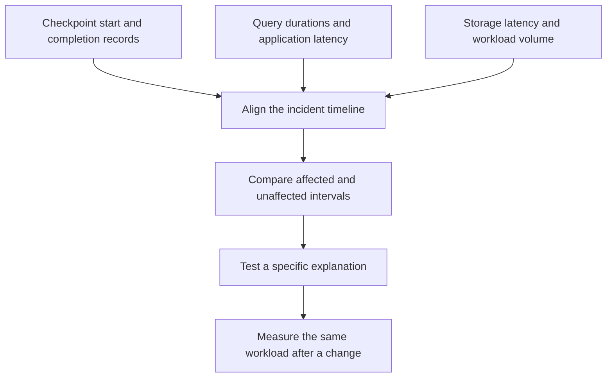

# Correlate PostgreSQL Checkpoints with Query Latency in pgBadger

Author: [nawazdhandala](https://www.github.com/nawazdhandala)

Tags: PostgreSQL, PgBadger, Performance, Troubleshooting

Description: Compare checkpoint intervals with query latency in pgBadger, interpret write and sync times, and gather evidence before changing checkpoint settings.

A checkpoint and a latency spike appearing near each other are a useful lead, not a complete diagnosis. Both can be consequences of a larger write burst. A slow query might instead be blocked on a lock while checkpoint activity is incidental.

The goal is to establish a repeatable relationship: which part of the checkpoint overlaps the slowdown, whether storage pressure rises at the same time, and whether similar checkpoints occur without a slowdown. pgBadger helps align the database evidence, but application and storage measurements complete the investigation.

This guide uses **pgBadger 13.3**, with locally tested synthetic logs. The SQL inspection example targets PostgreSQL 18 and was checked against its documentation; it was not executed against an 18 server.

## Understand the checkpoint interval

PostgreSQL writes changes to its write-ahead log, or WAL, so recovery can replay them after a crash. A checkpoint establishes a recovery position after required dirty data pages have been written. That work can create significant storage traffic, so PostgreSQL normally spreads checkpoint writes over time. [WAL and checkpoints](https://www.postgresql.org/docs/18/wal-configuration.html)

A completion message is the end of an interval. Do not compare only its timestamp with a query graph and assume all checkpoint work happened at that instant. Keep the corresponding start message and inspect the period between them.

| Completion field | Useful interpretation | Avoid this assumption |
|---|---|---|
| Buffers written | Amount of shared-buffer page writing reported | Every buffer caused a slow application request |
| `write` time | Elapsed write phase, which can include deliberate pacing | Pure device service time or proof of saturated storage |
| `sync` time | Time spent synchronizing files | Total latency of every transaction commit |
| `total` time | Overall checkpoint interval | All application requests were blocked for this long |

A long paced write phase may be expected. A change in synchronization time, request latency and storage behavior together is a stronger reason to investigate than the total duration alone.

## Collect matching evidence

Ensure checkpoint logging is enabled through your normal configuration process. Inspect the relevant values with an authorized connection:

```sql
SHOW log_checkpoints;
SHOW log_timezone;
SHOW checkpoint_timeout;
SHOW checkpoint_completion_target;
SHOW max_wal_size;
```

Checkpoint logging provides start/completion information. Query-duration records supply the other side of the comparison. Record any duration threshold or sampling policy; a report containing only slow statements cannot describe the complete latency distribution. [PostgreSQL logging](https://www.postgresql.org/docs/18/runtime-config-logging.html)

Collect a period before, during and after the incident, preserving multiline records and the database-instance identity. Confirm how server-log timestamps map to application and storage metrics. A timezone or clock mismatch can manufacture an apparent lead or lag.

Keep the workload scope stable. A changed query mix can increase average latency even when individual query shapes perform normally. Conversely, filtering only to one application's log entries can remove checkpoint records from background processes.

## Use a report interval that exposes the event

For a closed standard-error log, replace the path and prefix below:

```bash
pgbadger -f stderr \
  --average 1 --histo-average 5 \
  -p '%m [%p]: user=%u,db=%d,app=%a,client=%h ' \
  -o checkpoint-latency.html /archive/postgresql/incident.log
```

`--average 1` uses one-minute averaging for the relevant query and connection graphs. `--histo-average 5` sets a five-minute histogram interval. These controls change presentation granularity; they do not collect missing observations or make an average into a percentile. [pgBadger report controls](https://github.com/darold/pgbadger/blob/v13.3/README)

Inspect the checkpoint information and query activity together. Then return to individual statement examples for the critical seconds. A four-second stall can be diluted in a one-minute average, especially when many fast queries share the same bucket.



## Use an unaffected checkpoint as a control

The local fixture contained fifteen queries of one normalized shape across five minutes. It included two four-second checkpoint intervals with identical reported buffer counts, write time and sync time.

| Interval | Checkpoint in fixture | Query duration per execution |
|---|---|---:|
| 10:00 | None | 10 ms |
| 10:01 | Four seconds | 200 ms |
| 10:02 | None | 10 ms |
| 10:03 | Four seconds | 10 ms |
| 10:04 | None | 10 ms |

pgBadger retained the two checkpoint records and the different per-minute query durations. It reported fifteen queries and 720 milliseconds of total query time. The overall mean was therefore 48 milliseconds, which obscured the short affected interval.

These numbers are constructed parser tests, not performance measurements. Their purpose is to demonstrate the reasoning: checkpoint presence alone does not explain the difference between 10:01 and 10:03. In a real investigation, compare concurrent write volume, other jobs, storage latency, locks, query parameters and cache behavior across those windows.

## Add cumulative server evidence carefully

On PostgreSQL 18, this read-only query captures checkpointer counters and timings:

```sql
SELECT clock_timestamp() AS observed_at,
       num_timed, num_requested, num_done,
       write_time, sync_time, buffers_written, stats_reset
FROM pg_stat_checkpointer;
```

Take two snapshots bracketing a useful interval and compare differences. The timing fields are milliseconds and cumulative, not the duration of the latest checkpoint. Retain `stats_reset`; subtracting across a reset produces misleading results. Timed/requested counts can include skipped checkpoints, while `num_done` tracks completed ones in this documented version. [PostgreSQL 18 checkpointer statistics](https://www.postgresql.org/docs/18/monitoring-stats.html#MONITORING-PG-STAT-CHECKPOINTER-VIEW)

Use the view and column names for your installed PostgreSQL major version. Older releases expose checkpoint statistics differently; do not copy a modern query into an older incident runbook without checking it.

Correlate counter changes with the bounded log evidence. A daily increase in total write time cannot, by itself, attribute a particular request failure to a checkpoint. Similarly, WAL synchronization for commits and checkpoint synchronization of data files are related storage activities but different measurements.

## Change the cause you can support

Frequent WAL-driven checkpoints suggest investigating WAL generation and whether the configured WAL allowance fits the workload. `max_wal_size` is a soft limit, and increasing it has disk-space and recovery-time implications. Keep the start reason and workload evidence with the proposed change. [Checkpoint and WAL controls](https://www.postgresql.org/docs/18/runtime-config-wal.html)

If writes are concentrated into a short burst, review pacing and storage behavior. Lowering `checkpoint_completion_target` to finish sooner can concentrate I/O rather than reduce its impact. A prolonged sync phase calls for storage investigation; it does not automatically imply that the checkpoint interval is too short.

Test one justified adjustment under representative load. Compare request latency, errors, throughput, checkpoint frequency, write/sync behavior and disk headroom. Preserve durability settings; disabling synchronization is not a checkpoint-latency fix.

Do not force a production checkpoint merely to make a graph spike. A controlled rehearsal should reproduce the relevant workload and collection settings in an appropriate test environment. The conclusion should state both the observed relationship and the remaining uncertainty, such as whether a simultaneous batch job caused the shared storage pressure.
