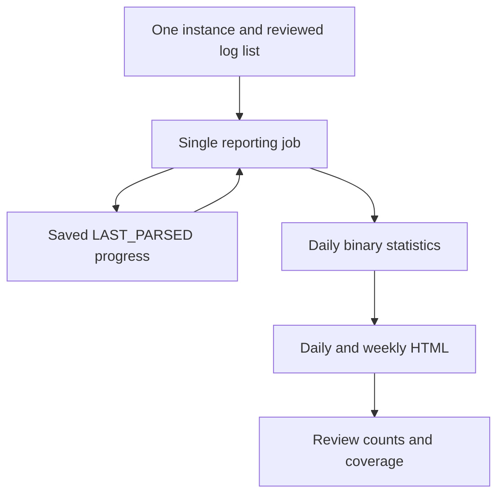

# Build Daily and Weekly pgBadger Reports Without Recounting Logs

Author: [nawazdhandala](https://www.github.com/nawazdhandala)

Tags: PostgreSQL, PgBadger, Logging, Database Monitoring

Description: Configure incremental pgBadger reports with durable progress state, controlled rotated-log inputs, and repeat-run checks that expose duplicate counting.

A daily reporting job often rereads yesterday's rotated log. That can be safe, but only if the reporting process remembers what it already consumed. Recreating the output directory every morning, changing the progress file, or supplying several copies of the same archive can turn a sensible retry into misleading query totals.

pgBadger's incremental mode maintains daily statistics and builds daily and weekly reports from them. This guide uses **pgBadger 13.3**, one PostgreSQL instance, and standard-error text logs. It focuses on keeping input selection and saved progress consistent, rather than treating every successful HTML generation as proof of correct accounting.

## Understand the three pieces of an incremental archive

The output directory is more than a collection of web pages:

| Component | Purpose | What happens if it is lost |
|---|---|---|
| Daily binary statistics | Retained parsed measurements | HTML cannot recreate the missing measurements |
| `LAST_PARSED` | Saved parsing progress | Old raw input can be counted again |
| Daily, weekly and main HTML pages | Readable presentation | Pages can be rebuilt from retained binary statistics |

With `-I`, pgBadger creates progress state automatically in the directory selected by `-O`. You normally do not need an additional `--last-parsed` option. Daily and weekly pages are generated from the accumulated data. [pgBadger 13.3 incremental mode](https://github.com/darold/pgbadger/blob/v13.3/README)

Keep all three pieces under a durable, instance-specific path. Use different directories for different database servers and for experiments with different filters. A progress record from one input stream is not a safe shared checkpoint for another.



## Choose inputs before choosing a schedule

Record the current log destination, rotation rules and retention period. PostgreSQL can rotate by age or size, and filenames can be reused or overwritten depending on configuration. A filename such as `postgresql-Mon.log` is not a permanent identity for a week's data. [PostgreSQL rotation settings](https://www.postgresql.org/docs/18/runtime-config-logging.html)

For a daily job, prefer completed archives whose coverage you understand. Include every size-based rotation in the intended interval, not just the final `.log.1`. Keep enough raw-log retention to recover after the longest outage you intend to tolerate.

Create a plain text file containing the reviewed paths, one per line. For example, `/srv/pgbadger/db01/inputs.txt` might contain:

```text
/var/log/postgresql/postgresql-2026-11-23.log.gz
/var/log/postgresql/postgresql-2026-11-24.log
```

These are placeholders for your actual files, listed in chronological order. Include one representation of each archive. Do not include both an uncompressed file and a compressed copy of that same content. A directory wildcard is convenient only after you have proved that it cannot also select backups, copied archives or unrelated instances.

An upstream rotation problem remains an upstream problem. For example, logrotate documents a possible loss window with `copytruncate`, where a file is copied and then truncated. No parser checkpoint can restore records lost during that operation. [logrotate 3.22.0 manual](https://github.com/logrotate/logrotate/blob/3.22.0/logrotate.8.in)

## Run the same command against the same archive

Prepare `/srv/pgbadger/db01/reports` as a private directory writable by the reporting account. Install pgBadger 13.3 and the decompressor required by your archives. Replace the paths and prefix before running:

```bash
pgbadger -I -f stderr \
  -p '%m [%p]: user=%u,db=%d,app=%a,client=%h ' \
  --iso-week-number \
  -O /srv/pgbadger/db01/reports \
  --logfile-list /srv/pgbadger/db01/inputs.txt
```

The prefix must match the database's actual `log_line_prefix`. The example contains timestamp, process, user, database, application and client fields. `--logfile-list` reads the selected filenames; `--iso-week-number` gives the calendar ISO week numbering and a Monday start. Keep that calendar choice consistent across runs. [Versioned option definitions](https://raw.githubusercontent.com/darold/pgbadger/v13.3/README)

After the first run, check the main `index.html`, the daily pages, the weekly page and `LAST_PARSED`. A week still in progress is a partial week, even though its page exists. State that clearly when sharing a report during an incident.

Do not run a separate weekly raw-log import into the same archive. The normal incremental run already builds the weekly view from daily data. A second workflow with different progress state is an unnecessary opportunity to replay input.

## Prevent overlapping writers

A slow daily job should not overlap tomorrow's run or a manual retry. On Linux with util-linux `flock`, this wrapper permits one process to update the archive at a time:

```bash
#!/usr/bin/env bash
set -euo pipefail
umask 077

flock --nonblock --conflict-exit-code 75 \
  /srv/pgbadger/db01/run.lock \
  pgbadger -I -f stderr \
    -p '%m [%p]: user=%u,db=%d,app=%a,client=%h ' \
    --iso-week-number \
    -O /srv/pgbadger/db01/reports \
    --logfile-list /srv/pgbadger/db01/inputs.txt
```

The lock file's parent directory must already exist and be writable. Every scheduled and manual writer must use the same lock. Exit 75 means the lock was occupied; record it as a skipped run and investigate repeated skips. This is a local-filesystem example, not a distributed lock across several report servers. The flags are documented in [util-linux 2.41.2](https://github.com/util-linux/util-linux/blob/v2.41.2/sys-utils/flock.1.adoc).

Schedule the wrapper after the relevant rotations finish, and keep the input list stable for the duration of each run. Capture command output and alert on failures or unexpected staleness. Hiding all output to make the schedule quiet also hides the evidence needed to explain a missing report.

## Prove retry behavior with a small fixture

Before trusting production totals, create a separate test archive and run a few recognizable records through the exact installed release. Check cumulative counts, not just file modification times.

The following sequence was tested locally with pgBadger 13.3:

| Operation | Cumulative queries |
|---|---:|
| Parse two records on November 23 | 2 |
| Rerun the unchanged file | 2 |
| Append one newer record on November 24 | 3 |
| Retain the old file and introduce one newer rotated-file record | 4 |
| Rerun both files | 4 |
| Replace the old input with its gzip representation and rerun | 4 |

The fixture produced two daily pages and the ISO week 48 page. Counts were inspected in the retained binary statistics rather than inferred from normalized query groups, because repeated SQL executions can belong to one group.

A separate fresh run supplied two copies of the same two-record input. It counted four executions. This is the boundary worth remembering: incremental progress handles continued reading; it is not a universal content-deduplication service.

The tests also supplied a late record dated before the saved progress timestamp. It was skipped. In this version, timestamp comparisons are part of the incremental position logic. Do not assume delayed archives will be backfilled simply because you add them to tomorrow's input list. [Incremental position implementation](https://github.com/darold/pgbadger/blob/v13.3/pgbadger)

## Recover without mixing old and new accounting

Back up the archive while writers are stopped so progress state and binary statistics describe the same point in processing. Retaining only HTML protects presentation, not the ability to continue parsing accurately.

If you discover missing historical input, build a replacement archive in a new directory from the complete approved log set. Compare coverage and counts before switching readers to it. Do not delete `LAST_PARSED` in a populated archive and replay everything into existing statistics.

For a presentation-only rebuild, use retained binary data rather than raw logs:

```bash
pgbadger -I --iso-week-number \
  -O /srv/pgbadger/db01/reports --rebuild
```

Run that under the same writer lock. The local fixture successfully rebuilt its daily, weekly and main pages without reimporting raw input. No live scheduler, Linux lock or production rotation was exercised; those integration checks remain necessary before deployment.
