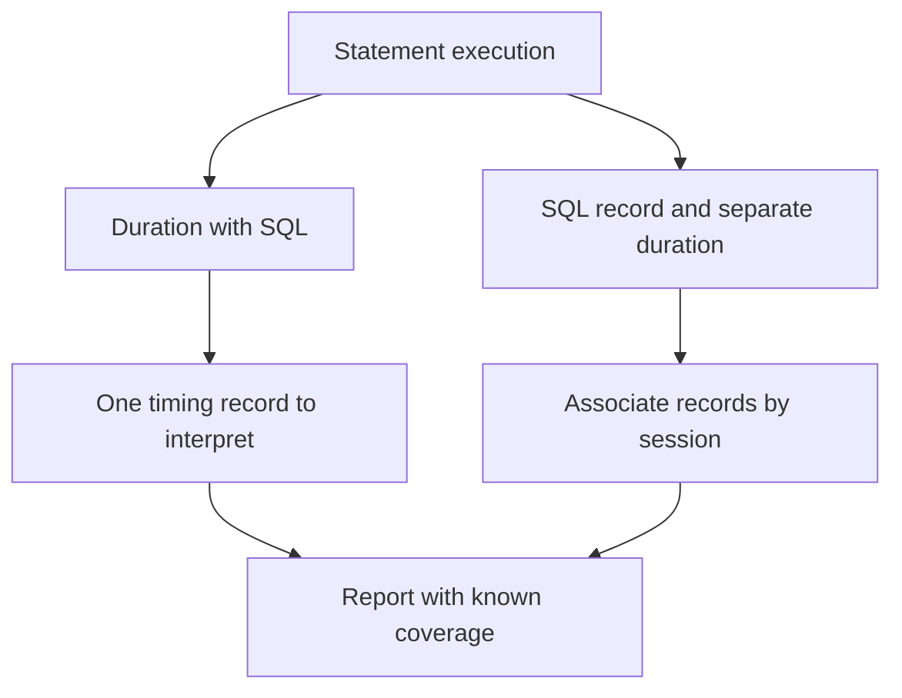

# Choose PostgreSQL Query Logging for Accurate pgBadger Reports

Author: [nawazdhandala](https://www.github.com/nawazdhandala)

Tags: PostgreSQL, PgBadger, Logging, Performance

Description: Compare statement, duration, and threshold logging with real pgBadger results, avoid double counting separate records, and interpret incomplete query coverage correctly.

The three PostgreSQL settings `log_min_duration_statement`, `log_duration`, and `log_statement` produce different evidence. Enabling more of them does not automatically produce a more accurate pgBadger report. It can separate SQL from its duration, change which statements are represented, or cause a parser invocation to count one execution twice.

Choose the question first. For detailed slow-query analysis, a duration threshold with SQL text is usually the easiest input to interpret. For all-duration statistics without SQL text, duration-only logging can be useful. Statement-only logs can show issued SQL, but they do not establish execution latency.

This guide tests **pgBadger 13.3** against simple-query records produced by a disposable **PostgreSQL 14.17** instance. PostgreSQL 18 documentation was reviewed for the configuration semantics. The older local server was a test fixture, not an installation recommendation.

## Understand the record shapes

A duration-and-statement record contains both timing and SQL:

```text
LOG:  duration: 30.100 ms  statement: SELECT pg_sleep(0.03);
```

A duration-only record omits the SQL:

```text
LOG:  duration: 30.100 ms
```

A statement record contains SQL without a measured duration:

```text
LOG:  statement: SELECT pg_sleep(0.03);
```

These abbreviated lines omit the timestamp and session prefix. Real input must preserve those fields. When PostgreSQL logs SQL through `log_statement`, it does not repeat that SQL in the later duration message. The process or session identifier lets a consumer associate the two records. [PostgreSQL duration logging](https://www.postgresql.org/docs/18/runtime-config-logging.html#GUC-LOG-MIN-DURATION-STATEMENT)



The diagram shows alternative logging shapes, not a requirement to enable both paths.

## Compare a known two-query workload

The local test ran one fast `SELECT` and one `SELECT pg_sleep(0.03)` in each fresh connection. Sampling was disabled. Each case's log was analyzed independently, using the same explicit stderr prefix.

| Settings for the test | Reported queries | Unique normalized queries | Meaning |
|---|---:|---:|---|
| Minimum duration `0`, duration off, statement none | 2 | 2 | Both SQL statements had durations |
| Minimum duration `-1`, duration on, statement none | 2 | 0 | Durations were present without SQL groups |
| Minimum duration `-1`, duration off, statement all | 2 | 2 | SQL was present; reported total duration was zero |
| Minimum duration `20ms`, duration off, statement none | 1 | 1 | Only the slower statement qualified |
| Minimum duration `20ms`, duration on, statement none | 2 | 1 | Both durations, but SQL only for the slower statement |
| Minimum duration `-1`, duration on, statement all | 4 | 2 | Default parsing counted separate records |
| Same separate-record input with `--log-duration` | 2 | 2 | Records were associated for the two executions |

These are observed results for this small, simple-query fixture. They are not a guarantee for every PostgreSQL protocol, log format, extension, or pgBadger release.

The statement-only row is particularly easy to misread. Zero reported duration means this input supplied no timing information. It does not mean the database completed the statements instantaneously. Likewise, two total queries and one normalized query in the mixed case do not describe complete SQL coverage.

## Prefer one clear policy for detailed timing

For a staging diagnostic window that needs every completed statement's text and timing, use an approved configuration equivalent to:

```conf
log_min_duration_statement = 0
log_duration = off
log_statement = 'none'
log_min_duration_sample = -1
log_transaction_sample_rate = 0
```

The zero threshold is intentionally comprehensive and can generate substantial logs. For routine slow-query analysis, replace it with a workload-appropriate positive threshold such as `'250ms'`. The example is a policy illustration, not a universal production threshold.

A positive threshold changes the population being measured. Average duration in the report becomes an average of captured statements, not all database requests. A frequent 5 ms query can consume considerable aggregate time while being absent from a 250 ms log.

Check role, database, connection and extension settings as well as the server configuration. Keep the effective threshold and sampling policy with each report. pgBadger's setup guidance recommends duration-and-statement logging for detailed query reports. [pgBadger 13.3 documentation](https://github.com/darold/pgbadger/blob/v13.3/README)

## Use duration-only input for an explicit purpose

If SQL text is not required for the timing question, this combination produces durations without forcing every query string into the log:

```conf
log_min_duration_statement = -1
log_duration = on
log_statement = 'none'
```

Keep unrelated sampling settings disabled if you intend this exact coverage. Error and event logging can still include SQL, so this is not a complete redaction policy.

Adding a positive `log_min_duration_statement` threshold to this arrangement includes SQL for slower statements while retaining durations for faster ones. That can answer a useful mixed question, but label the two populations separately. The top SQL tables only describe statements whose SQL was available. [PostgreSQL log_duration](https://www.postgresql.org/docs/18/runtime-config-logging.html#GUC-LOG-DURATION)

Do not compare a SQL group's frequency directly with a total that includes anonymous duration records and assume the missing text represents inactivity.

## Associate separate statement and duration records deliberately

Some installations already need `log_statement = 'all'` for another operational purpose. When it is combined with `log_duration = on`, pgBadger 13.3 provides `--log-duration` to associate the separate records. It is a parser option; it does not enable PostgreSQL logging. [pgBadger command options](https://pgbadger.darold.net/documentation.html)

The following synthetic fixture demonstrates why association matters without changing a database. Save it as `paired.log` in a new working directory:

```text
2026-11-25 01:02:03.000 UTC [81]: user=app,db=shop,app=probe,client=local LOG:  statement: SELECT 101 AS fast_probe;
2026-11-25 01:02:03.001 UTC [82]: user=app,db=shop,app=probe,client=local LOG:  statement: SELECT 202 AS slow_probe;
2026-11-25 01:02:03.012 UTC [81]: user=app,db=shop,app=probe,client=local LOG:  duration: 12.000 ms
2026-11-25 01:02:03.031 UTC [82]: user=app,db=shop,app=probe,client=local LOG:  duration: 30.000 ms
```

Two sessions, process IDs 81 and 82, have interleaved records. Parse them with the matching prefix:

```bash
pgbadger -f stderr \
  -p '%m [%p]: user=%u,db=%d,app=%a,client=%h ' \
  --log-duration -x text -o paired.txt paired.log
```

With pgBadger 13.3, the result is two queries, two normalized queries, and 42 ms total duration. Running the same fixture without `--log-duration` produced four queries while retaining the same 42 ms total. That discrepancy would distort an average derived from the inflated count.

The two durations overlap in wall-clock time. Their sum is accumulated database work, not the elapsed time of the entire concurrent workload.

Preserve both halves of each record pair, their identifiers, and ordering within each session. A time slice that starts after the statement or ends before its duration can be incomplete. The option cannot recover a missing record or infer its true duration. The pinned implementation buffers per-session query information for this association. [pgBadger 13.3 parser source](https://github.com/darold/pgbadger/blob/v13.3/pgbadger)

Enabling all three PostgreSQL controls also produced four rather than two queries under default parsing in the local test. Association corrected that specific fixture, but combining controls unnecessarily makes the input harder to reason about. Establish one intentional policy and test its actual records.

## Check the client protocol before trusting counts

An application using the extended query protocol can generate separate Parse, Bind and Execute timing records. Parse prepares SQL, Bind supplies parameters, and Execute runs the bound operation. Those phases should not be mistaken for three independent business requests. [PostgreSQL protocol flow](https://www.postgresql.org/docs/18/protocol-flow.html#PROTOCOL-FLOW-EXT-QUERY)

Repeat acceptance testing with the actual client driver and prepared-query behavior before using a report as a request-count source. The tests above used simple queries and do not establish prepared-statement or pipelining coverage. Also distinguish a logged statement from a successful business operation: failures and application retries need their own evidence.

## Establish a small acceptance test

Record the parser version, exact invocation, effective logging settings, client protocol and retained time window. Run a controlled workload with known statement count and at least one operation above and below the intended threshold.

Require the raw records to match the selected policy. Then check total count, normalized SQL coverage and timing together. A plausible total duration alone is insufficient: the separate-record fixture had a plausible total while its count was doubled.

Finally, preserve a protected sample as a regression fixture when upgrading pgBadger or changing log transport. Release 13.3 includes fixes affecting duplicate counting and statement-related parsing, so version changes deserve a small recount. [pgBadger 13.3 release notes](https://github.com/darold/pgbadger/releases/tag/v13.3)

A trustworthy report is one whose captured population and parser behavior are understood. Keep that explanation beside the charts so readers can tell whether they are looking at all durations, selected slow SQL, or statement records without timing.
