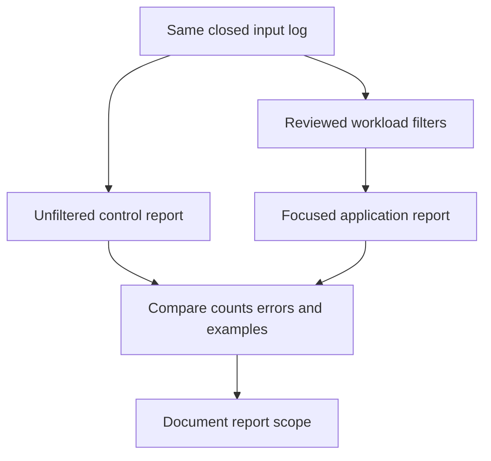

# Exclude Health Checks, Backups, and Migrations from pgBadger

Author: [nawazdhandala](https://www.github.com/nawazdhandala)

Tags: PostgreSQL, PgBadger, Logging, Performance

Description: Filter routine PostgreSQL activity from pgBadger with application names and precise query patterns, while retaining a complete view for incident analysis.

A query ranking dominated by health probes can make application work hard to see. Backup and migration activity can have the same effect. Filtering helps answer a narrower question, such as which application queries consume the most time during normal traffic.

It also changes the report's population. A filtered report does not show total database work, and excluding a workload can remove its errors as well as its successful queries. Keep an unfiltered view for investigating incidents and resource contention.

This tutorial uses **pgBadger 13.3**. Its examples were checked against the tagged source and exercised with synthetic PostgreSQL logs containing ordinary queries, maintenance activity, multiline SQL and a failed health check.

## Give routine connections a useful identity

The most reliable distinction is often the connection's `application_name`, not a broad SQL pattern. A backup can execute ordinary catalog queries, and a migration can run data changes as well as schema changes. Excluding every `COPY` or `ALTER` statement may remove unrelated application behavior.

PostgreSQL can include application names in text logs through `%a` in `log_line_prefix`. These examples use:

```text
'%m [%p]: user=%u,db=%d,app=%a,client=%h '
```

Use your actual prefix when invoking pgBadger. If application names were never logged, the parser cannot recover them from a filename. [PostgreSQL application names and logging](https://www.postgresql.org/docs/18/runtime-config-logging.html)

For clients using libpq, `PGAPPNAME` supplies a default application name. An explicit connection setting can override that default. Configure the name where your client or connection pool actually creates the database connection. [libpq environment variables](https://www.postgresql.org/docs/18/libpq-envars.html)

For example, after configuring an authorized read-only connection service named `app-readonly`, this command checks the name seen by the server:

```bash
PGAPPNAME=healthcheck psql 'service=app-readonly' -X \
  -c "SELECT current_setting('application_name');"
```

Replace the service name with your existing connection configuration. Expect `healthcheck` only if no higher-priority setting replaces it. `current_setting` reads a configuration value; this query does not change database data. [Configuration inspection functions](https://www.postgresql.org/docs/18/functions-admin.html)

Use similarly clear names for migration and backup connections, then verify their actual log entries. Do not assume every deployment tool keeps the same default name forever.

## Build an unfiltered control first

Use a closed log and a new output filename so the input is stable. Replace the path and prefix:

```bash
pgbadger -f stderr \
  -p '%m [%p]: user=%u,db=%d,app=%a,client=%h ' \
  -o all-activity.html /archive/postgresql/closed-day.log
```

Record the report's time range, execution count, total query duration and errors. This control is your reference for explaining what a filter removed. Comparing two different log windows would mix filtering effects with workload changes.



## Exclude named workloads

This example excludes three observed application names. `pg_dump` appears explicitly because it is a common backup-tool label; use the value in your logs rather than guessing:

```bash
pgbadger -f stderr \
  -p '%m [%p]: user=%u,db=%d,app=%a,client=%h ' \
  --exclude-appname healthcheck \
  --exclude-appname pg_dump \
  --exclude-appname migrate_release \
  -o application-activity.html /archive/postgresql/closed-day.log
```

The option can be repeated. It excludes log entries associated with matching names, rather than only suppressing one ranking row. [pgBadger filter options](https://github.com/darold/pgbadger/blob/v13.3/README)

There is a version-specific detail worth checking: the implementation matches application patterns against the whole name, case-insensitively, using regular expressions. A period therefore has pattern meaning. To match the literal name `web.prod`, use `--exclude-appname 'web\.prod'`. In a local test, the unescaped form also matched `webXprod`; the escaped form did not. [Application-name matching implementation](https://github.com/darold/pgbadger/blob/v13.3/pgbadger)

A missing or empty application field is another boundary. Excluding `healthcheck` does not remove an unnamed connection merely because its SQL looks like a probe. Fix connection labeling where possible, then add a query rule only when its scope is justified.

## Use an exact query rule for a known probe

Suppose your intended rule is to exclude only a bare `SELECT 1`, allowing whitespace and an optional semicolon. Use an anchored expression:

```bash
pgbadger -f stderr \
  -p '%m [%p]: user=%u,db=%d,app=%a,client=%h ' \
  --exclude-query '\A\s*SELECT\s+1\s*;?\s*\z' \
  -o without-bare-probes.html /archive/postgresql/closed-day.log
```

Here `\A` and `\z` anchor the complete query. `\s` matches whitespace, including a line break, and `;?` permits a semicolon. pgBadger's query matching is case-insensitive in this release.

The rule intentionally does not match `SELECT 10`, `SELECT 1 FROM orders` or `SELECT 1 AS alive`. It also does not automatically ignore a leading SQL comment. Those distinctions are useful safeguards against silently broadening the filter.

This is a global query rule: it can remove a bare `SELECT 1` from an application connection too. pgBadger is not inferring why the query ran. Use application-name filtering when you need to distinguish identical SQL issued for different purposes.

## Keep reusable pattern files precise

For several reviewed query patterns, use `--exclude-file`, with one expression per line. This creates a one-rule file:

```bash
cat > excluded-queries.regex <<'EOF'
\A\s*SELECT\s+1\s*;?\s*\z
EOF

pgbadger -f stderr \
  -p '%m [%p]: user=%u,db=%d,app=%a,client=%h ' \
  --exclude-appname healthcheck \
  --exclude-appname pg_dump \
  --exclude-appname migrate_release \
  --exclude-file excluded-queries.regex \
  -o focused-activity.html /archive/postgresql/closed-day.log
```

Keep explanations in a separate document. In the pinned implementation, the file is read as expressions; do not assume blank lines or comment lines are ignored. A blank expression does not mean “skip this line.” In the local test, adding a trailing blank rule changed the event count from one to zero while retaining eight timed executions. Avoid empty patterns and check the result rather than treating the file as a commented configuration format.

Avoid line-level text deletion as a shortcut for query filtering. PostgreSQL statements and diagnostic records can span multiple lines. Removing arbitrary matching lines before parsing can leave an incomplete statement or detach detail from its event.

## Verify what disappeared, including failures

The fixture contained 12 timed executions, including three named maintenance workloads, near-matching SQL, an unnamed connection and a multiline bare probe. It also contained one health-check error.

| Filter | Remaining executions | Remaining events |
|---|---:|---:|
| None | 12 | 1 |
| Three application names | 9 | 0 |
| Exact bare-query expression | 8 | 1 |
| Application names plus exact expression | 6 | 0 |

The application filter removed the health-check error because that event belonged to the excluded application. That is useful evidence of its scope, not a reason to hide failed probes from operational monitoring.

Check representative queries that must remain: a business `COPY`, a real application query starting with `SELECT 1`, and any migration-related failures relevant to the incident. Review total duration as well as execution count; a few removed backup statements may account for substantial database work.

Keep the filter definition beside the report and state the excluded workloads in its description. If you use incremental reporting, give a changed filter set its own consistent state and statistics rather than reusing a checkpoint from another report population.

The tests here validate parser behavior on synthetic text logs. They did not run a live backup, migration or connection pool. Verify actual application labels and input format in your environment before scheduling the focused report, and retain the unfiltered evidence when investigating the impact of the excluded work.
