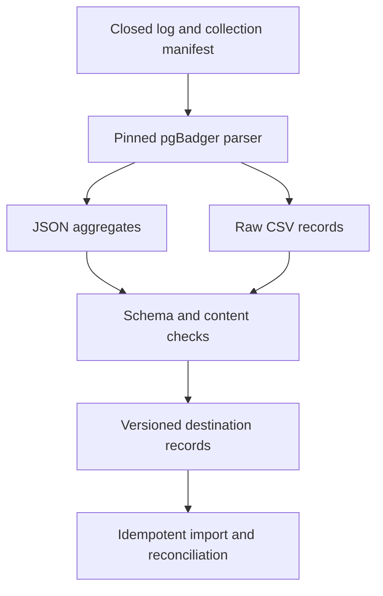

# Export pgBadger JSON, CSV, and Query Fingerprints Safely

Author: [nawazdhandala](https://www.github.com/nawazdhandala)

Tags: PostgreSQL, PgBadger, Observability, Data Pipeline

Description: Export pgBadger analysis into an observability pipeline with validated CSV, versioned query fingerprints and explicit rules for units, privacy and replay.

pgBadger offers several machine-readable outputs, but they represent different things. A JSON report contains aggregated analysis. Raw CSV contains parsed records. A normalized-query listing groups similar SQL and includes counts. Treating them as interchangeable can create duplicate metrics, broken parsers or unexpected exposure of query contents.

This tutorial pins **pgBadger 13.3** and uses **Python 3.11** for validation and conversion. The examples were exercised locally with synthetic statements containing repeated query shapes, a comma, a double quote, non-ASCII text and multiline SQL. No data was sent to an external service.

## Choose the appropriate export

| Output | Appropriate use | Important boundary |
|---|---|---|
| JSON report | Aggregate counts, durations and other report data | Nested, release-specific structure; includes query samples |
| Raw CSV | Inspect individual parsed records | Validate quoting, column count and missing fields |
| Normalized text | Review grouped query shapes and counts | Human-readable report framing, not a stable CSV schema |
| Your own fingerprint records | Import a small defined aggregate schema | Version the normalization contract and replay identity |

Use a closed input file and retain its collection window, instance identity, logging policy and filters. Exporting the same file twice does not represent two periods of database activity.



## Export JSON with an explicit parser configuration

Install pgBadger 13.3 and its JSON dependency, Perl `JSON::XS`, before running this example. Replace the input path and prefix:

```bash
log_file=/archive/postgresql/closed.log
prefix='%m [%p]: user=%u,db=%d,app=%a,client=%h '

pgbadger -f stderr -p "$prefix" \
  -x json -o analysis.json "$log_file"
```

The JSON contains aggregate objects as well as SQL samples and connection metadata. It is not an automatically sanitized metrics envelope. [pgBadger output options](https://github.com/darold/pgbadger/blob/v13.3/README)

In this release, grouped query data is under the deliberately spelled key `normalyzed_info`. In the tested default combined report, its outer bucket was named `postgres` even though the fixture's database was `shop`. Do not turn that bucket name into a database label without understanding the report mode. [JSON and grouping implementation](https://github.com/darold/pgbadger/blob/v13.3/pgbadger)

Pin a small input fixture and expected output fields in your integration tests. A successful JSON parse proves syntax, not that an upgraded parser preserved the meaning of your chosen fields.

## Capture raw CSV from standard output

Keep the shell variables from the previous example. This command explicitly selects commas and sends raw records to a file:

```bash
pgbadger -q -f stderr -p "$prefix" \
  --dump-raw-csv --csv-separator ',' \
  -o /dev/null "$log_file" > raw.csv 2> raw-export.log
```

Raw CSV is printed to standard output in the pinned implementation. `-q` suppresses progress output, and `/dev/null` discards the separate ordinary report output on this Unix-like example. Check the command's exit status and retain the diagnostic file. [Raw CSV writer](https://github.com/darold/pgbadger/blob/v13.3/pgbadger)

The tested header has fourteen columns, including `timestamp`, `duration`, `query/error`, `parameters`, `appname` and `queryid`. Duration values follow the parsed millisecond values. Missing fields can be empty; do not invent a session ID or query ID when the log did not supply one.

Use a CSV parser rather than splitting on commas. This small check rejects malformed quoting, unexpected columns and extra fields:

```python
import csv
from pathlib import Path

expected = (
    "timestamp,username,dbname,pid,client,sessionid,loglevel,"
    "sqlstate,duration,query/error,parameters,appname,backendtype,queryid"
).split(",")
with Path("raw.csv").open(encoding="utf-8", newline="") as source:
    reader = csv.reader(source, strict=True)
    if next(reader, None) != expected:
        raise ValueError("Unexpected pgBadger CSV header")
    for number, row in enumerate(reader, start=2):
        if len(row) != len(expected):
            raise ValueError(f"Unexpected field count on record {number}")
```

This checks framing, not every field's business meaning. Add type and range checks for the fields your destination uses. Python's CSV reader handles quoted delimiters and doubled quotes; those details are why a plain text split is unsuitable. [Python CSV parsing](https://docs.python.org/3.11/library/csv.html)

The multiline fixture exported query line breaks as literal `\n` sequences. Do not blindly replace every such sequence: SQL can contain backslashes too. A fixture with a quote inside the application name was rejected by the strict reader. Test bind parameters and other identifiers too. Treat an invalid export as a failed batch requiring investigation, rather than silently dropping malformed rows.

## Define your own fingerprint contract

For a human review of normalized shapes, run:

```bash
pgbadger -f stderr -p "$prefix" \
  --normalized-only -o normalized.txt "$log_file"
```

The result contains a title, metadata and a count/query listing. For automated ingestion, the JSON object is easier to validate than scraping that presentation text.

A fingerprint is an identifier derived from a normalized query shape. It is not PostgreSQL's native `queryid`, and changing pgBadger or its normalization settings can change the shape. The following adapter emits only counts, duration and identifiers. Save it as `export_groups.py`:

```python
import hashlib
import json
import math
import sys
from pathlib import Path

profile = "pgbadger/13.3/stderr-prefix-v1/no-filters"
source_id = sys.argv[3]
if not source_id:
    raise ValueError("A stable database-instance identity is required")
report = json.loads(Path(sys.argv[1]).read_text(encoding="utf-8"))
with Path(sys.argv[2]).open("rb") as source:
    source_hash = hashlib.file_digest(source, "sha256").hexdigest()
batch_key = "\0".join((profile, source_id, source_hash))
batch_id = hashlib.sha256(batch_key.encode()).hexdigest()
groups = report["normalyzed_info"]
if not isinstance(groups, dict):
    raise ValueError("Unexpected group structure")
records = []
for bucket, queries in groups.items():
    if not isinstance(queries, dict):
        raise ValueError("Unexpected bucket structure")
    for shape, values in queries.items():
        count, duration = values["count"], values["duration"]
        if type(count) is not int or count < 0:
            raise ValueError("Invalid query count")
        if type(duration) not in (int, float):
            raise ValueError("Invalid duration type")
        if not math.isfinite(duration) or duration < 0:
            raise ValueError("Invalid duration value")
        fingerprint = hashlib.sha256((profile + "\0" + shape).encode()).hexdigest()
        records.append({
            "schema": "pgbadger-groups-v1", "profile": profile, "source_id": source_id,
            "batch_id": batch_id, "report_bucket": bucket,
            "fingerprint": fingerprint, "count": count,
            "duration_ms": duration,
        })
for record in sorted(records, key=lambda r: (r["report_bucket"], r["fingerprint"])):
    print(json.dumps(record, allow_nan=False))
```

Run it with the JSON report, its exact single input log and a stable instance identity. Replace `db-instance-a` with your inventory identifier:

```bash
python3 export_groups.py analysis.json "$log_file" db-instance-a > groups.jsonl
```

The helper validates all groups before printing any records. It hashes the input as a stream and uses SHA-256 for identifiers. Change the profile whenever parser settings affecting this export change. [Python hashing](https://docs.python.org/3.11/library/hashlib.html)

The caller must keep the report and source file paired; the helper cannot prove that relationship from JSON alone. For multiple files, use a separately defined ordered input manifest and digest instead of pretending one file represents the entire batch.

## Make replay and privacy explicit

Use `(batch_id, report_bucket, fingerprint)` as the destination's replace/upsert identity for this example. Retrying the same validated batch should not add its count again. Overlapping source windows still duplicate activity even if their file hashes differ, so prevent overlap during collection and keep a durable ingestion ledger.

The four-statement fixture produced three grouped records whose counts summed to four and durations to ten milliseconds. Repeated conversion produced identical identifiers. Invalid count and duration inputs were rejected before output.

Raw CSV and full JSON retain SQL-related information. Normalization and hashing are not general anonymization: recognizable query shapes can be guessed, and report buckets can carry metadata. Restrict the source artifacts, review the destination schema and avoid using high-cardinality query identifiers as unrestricted metric labels.

The tests covered this pinned parser and a small fixture. The CSV fixture retained its non-ASCII literal, while the JSON sample showed altered encoding for that literal in this run. Validate encoding, unusual identifiers and prepared-protocol records before ingesting SQL text; this adapter omits raw samples. Keep import status, input coverage and rejected-batch evidence visible so a quiet pipeline cannot be mistaken for a quiet database.
