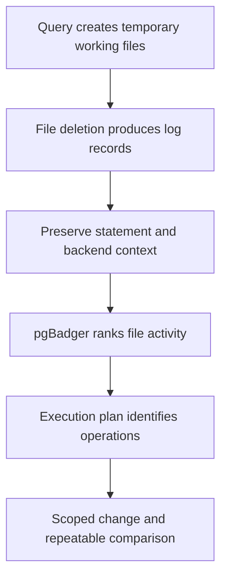

# Find Queries Spilling to Disk with pgBadger and log_temp_files

Author: [nawazdhandala](https://www.github.com/nawazdhandala)

Tags: PostgreSQL, PgBadger, Performance, Troubleshooting

Description: Trace PostgreSQL temporary-file activity to queries with pgBadger, confirm the responsible plan operations, and test memory changes without global tuning guesses.

A query can use temporary disk space when an operation needs more working memory than it is allowed. Large sorts, hash operations and intermediate results can all contribute. A temporary-file spike is therefore a useful lead, but it does not identify the correct fix by itself.

The practical workflow is to capture file events, associate them with statements, inspect the execution plan and test one change. Do not begin by raising memory for every connection.

This tutorial uses **pgBadger 13.3**. Its local execution test used a disposable PostgreSQL **14.17** instance, an older lab runtime rather than a deployment recommendation. Configuration explanations were also checked against PostgreSQL 18 documentation. The observed file sizes and plan choices are specific to the lab.

## Know what the file log measures

`log_temp_files` records temporary-file names and sizes when the files are deleted. Its values mean:

| Setting | Behavior |
|---|---|
| `-1` | Disable temporary-file logging |
| `0` | Log every temporary file |
| Positive size, such as `10MB` | Log each file at or above that size |

A bare positive number is interpreted in kilobytes, while the emitted log size is in bytes. Explicit units make configuration reviews easier. The threshold applies to each file, not the combined temporary space for a statement. [PostgreSQL temporary-file logging](https://www.postgresql.org/docs/18/runtime-config-logging.html)

Because records appear at deletion, their timestamps are not a live disk-usage meter. A long-running query can hold temporary files before their deletion is logged. Use filesystem or storage monitoring to investigate immediate free-space risk.

One query may also produce several files. Treat file count, summed file sizes and query execution count as different quantities. Summed logged file sizes are not necessarily total I/O bytes or peak simultaneous disk occupancy.

## Inspect settings and preserve query context

In an authorized connection, these read-only commands show the current session's settings:

```sql
SHOW work_mem;
SHOW log_temp_files;
SHOW statement_timeout;
SHOW max_parallel_workers_per_gather;
```

For text logs, retain a prefix with timestamp, process, user, database and application information. The example parser command later uses:

```text
'%m [%p]: user=%u,db=%d,app=%a,client=%h '
```

Use the prefix actually present in your input. Keep associated `STATEMENT` records and multiline continuations; copying only lines containing “temporary file” can remove the SQL needed for attribution.

For ongoing collection, choose a threshold and retention period suited to the workload. A brief authorized diagnostic can use zero, but consider the extra log volume and statement contents. Managed databases may require their parameter-management interface and appropriate privileges. Verify the effective setting instead of assuming a configuration edit reached every connection.



## Run a bounded demonstration in a test database

Use an isolated test instance with server-log access and permission to set `log_temp_files`. The following transaction generates 100,000 integers and sorts them. It creates no application tables, but it intentionally consumes CPU and temporary storage, so use it in the test environment.

```sql
BEGIN;
SET LOCAL application_name = 'spill_probe';
SET LOCAL log_temp_files = 0;
SET LOCAL work_mem = '64kB';
SET LOCAL statement_timeout = '10s';
SET LOCAL max_parallel_workers_per_gather = 0;
EXPLAIN (ANALYZE, BUFFERS, TIMING OFF)
SELECT g
FROM generate_series(1, 100000) AS g
ORDER BY g DESC;
ROLLBACK;
```

`generate_series` supplies the input rows. The small working-memory allowance encourages a spill, and disabling parallel workers makes this particular demonstration easier to attribute. Those settings are not production recommendations. [Series-generating functions](https://www.postgresql.org/docs/18/functions-srf.html)

`EXPLAIN ANALYZE` actually executes the query. `BUFFERS` includes temporary-block activity, while `TIMING OFF` avoids per-node clock measurements. Expect an execution plan rather than 100,000 result rows. If the timeout aborts the transaction, issue `ROLLBACK` before continuing in that session. [EXPLAIN options](https://www.postgresql.org/docs/18/sql-explain.html)

`SET LOCAL` lasts only for the transaction, so the settings revert when it ends. In the local test, the four inspected settings returned to their previous values after rollback. [Transaction-local settings](https://www.postgresql.org/docs/18/sql-set.html)

## Build the pgBadger report

After the test finishes, use a closed copy of its server log. Replace the path and prefix with your actual values:

```bash
pgbadger -f stderr \
  -p '%m [%p]: user=%u,db=%d,app=%a,client=%h ' \
  -o spill-report.html /archive/postgresql/spill-test.log
```

Inspect the temporary-file sections and their SQL examples. pgBadger can report file activity even when ordinary statement-duration logging is disabled. [pgBadger configuration and reports](https://github.com/darold/pgbadger/blob/v13.3/README)

The local low-memory run produced two file records: 1,425,408 bytes and 1,400,000 bytes. pgBadger associated both with the test statement and showed a combined 2,825,408 bytes. The plan included an external merge sort and temporary-block reads and writes.

The second file illustrates why the entire logged total should not be attributed to the sort alone: the query also creates an intermediate function result. Inspect the plan's operations rather than equating one file with one statement or one sort.

Ordinary duration logging remained disabled in this test. Consequently, the report showed zero ordinary timed queries even though the temporary-file query was identified. Its sample duration appeared as zero; that is missing timing evidence here, not proof that the work completed instantly.

## Test a targeted improvement

Repeat the same transaction in the test environment with `work_mem = '8MB'`. Keep the query and other settings unchanged. In this lab, the sort changed to an in-memory quicksort and no new temporary-file records appeared for the second execution.

That result validates a mechanism for this query size. It does not establish that eight megabytes is sufficient for real data or that raising the global default is safe.

`work_mem` applies to operations, not as one total budget per server or necessarily per query. Several operations, concurrent sessions and parallel workers can multiply consumption. Hash operations also use `hash_mem_multiplier`. Account for those factors before increasing memory across a workload. [PostgreSQL working-memory limits](https://www.postgresql.org/docs/18/runtime-config-resource.html)

Other fixes may reduce the work itself: filter rows earlier, avoid unnecessary wide columns, improve a plan's row estimates, or use a suitable index to support an ordering requirement. Test each change against representative data and verify the application result remains correct.

## Separate missing evidence from an improvement

If a report stops showing spills, check whether logging was disabled, the threshold increased, a filter excluded the workload, or the query has not finished deleting its files. Preserve the same collection settings for comparisons.

For parallel queries, inspect all participating processes and the plan. The serial demonstration does not validate attribution across every worker or log format. If SQL is missing, first inspect the original neighboring records and the parser prefix before blaming the query.

A useful final comparison records file count and sizes, plan behavior, execution time, query parameters and concurrency. Confirm both that the spill behavior improved and that memory use remains acceptable under realistic simultaneous work. Eliminating a small harmless spill is not an improvement if the resulting memory pressure makes the service less reliable.
