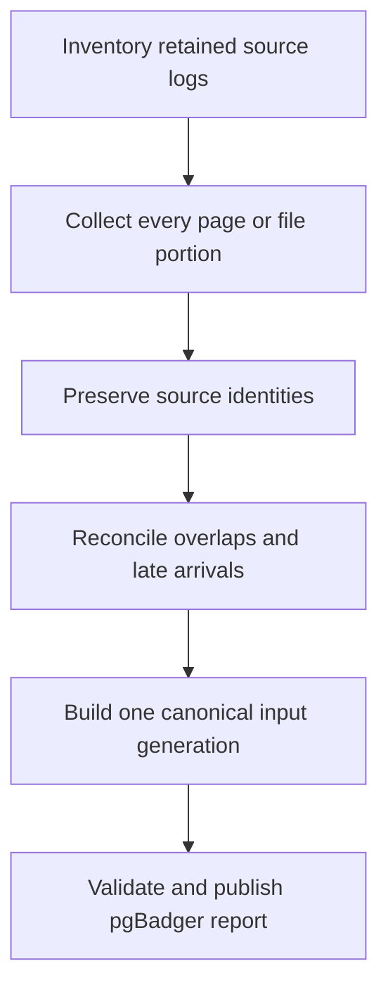

# Build Reliable pgBadger Reports from Rotating RDS and CloudWatch Logs

Author: [nawazdhandala](https://www.github.com/nawazdhandala)

Tags: PostgreSQL, PgBadger, Amazon RDS, CloudWatch

Description: Collect rotating RDS PostgreSQL logs completely, follow CloudWatch pagination, preserve event identity, and reconcile late arrivals before finalizing pgBadger reports.

A report can look plausible while missing the first part of a rotated file or the second page of a CloudWatch response. Repeating a download can create the opposite problem: duplicate executions that inflate query counts.

Treat collection as an evidence-preserving step before running pgBadger. Define the source, retain its identity, finish pagination, and reconcile the requested interval. “Gap-free” should describe verified coverage of retained, emitted logs, not a promise to recover queries the database never logged.

The parser examples use **pgBadger 13.3**. The CloudWatch helper was tested locally with **Python 3.11.13** and **Boto3 1.44.11**, using service-model-validated stub responses. No AWS account or database instance was accessed.

## Choose one authoritative input route

RDS file downloads and CloudWatch exports can contain the same database records. Do not concatenate both into one report as if they represented independent activity.

| Route | Identity to retain | Main completeness check |
|---|---|---|
| RDS files | Instance, filename, observed size/modification time, archived digest | Every selected file downloaded from its beginning |
| CloudWatch | Region, log group, stream, event ID and timestamps | Every response page collected and late arrivals reconciled |
| pgBadger input | Exact source manifest and parser invocation | No unexplained gaps or duplicated source generations |

For RDS PostgreSQL, enabling CloudWatch export later publishes new logs from that point onward; it does not upload the existing history. Record that start boundary before treating CloudWatch as your historical archive. [RDS PostgreSQL log export](https://docs.aws.amazon.com/AmazonRDS/latest/UserGuide/USER_LogAccess.Concepts.PostgreSQL.html)



## Download complete RDS files

With AWS CLI v2 configured for an authorized account, replace `REGION` and `DB_INSTANCE`. Save the paginated inventory in a new working directory:

```bash
set -e
umask 077
aws rds describe-db-log-files --region REGION \
  --db-instance-identifier DB_INSTANCE --output json > inventory.json
```

Leave automatic pagination enabled. Do not add `--no-paginate` or a result cap when claiming a complete inventory. The API's modification-time filter describes files written since a time, not an exact interval of records inside those files. [DescribeDBLogFiles](https://docs.aws.amazon.com/AmazonRDS/latest/APIReference/API_DescribeDBLogFiles.html), [CLI pagination](https://docs.aws.amazon.com/cli/latest/reference/rds/describe-db-log-files.html)

For each selected completed rotation file, substitute its exact inventory name:

```bash
aws rds download-db-log-file-portion --region REGION \
  --db-instance-identifier DB_INSTANCE \
  --log-file-name LOG_NAME_FROM_INVENTORY \
  --starting-token 0 --output text > closed-file.log
```

Use a distinct local filename for every source file. Starting at zero is essential: AWS documents that the default download can return only the latest portion. Keep pagination enabled. [Downloading a complete log file](https://docs.aws.amazon.com/AmazonRDS/latest/UserGuide/USER_LogAccess.Procedural.Downloading.html)

If implementing the API directly, begin with `Marker="0"`, pass each returned marker into the next request, and continue until `AdditionalDataPending` is false. A single API response is limited to 1 MB. That terminal flag describes the current file end; it does not prove an active file will never grow. [DownloadDBLogFilePortion](https://docs.aws.amazon.com/AmazonRDS/latest/APIReference/API_DownloadDBLogFilePortion.html)

Compare inventory metadata before and after collection. Archive closed files with checksums. Revisit files that grew or changed; replace their candidate archive generation rather than appending a full redownload to previously collected bytes. Inspect records around rotation boundaries because filenames alone do not establish exact query-time coverage.

## Follow CloudWatch pagination through empty pages

For a bounded CloudWatch capture, an empty page is not an end marker. `FilterLogEvents` can return an empty or partial page with `nextToken`; completion occurs when that token is absent. A page-size limit is not a guarantee about the total result. [FilterLogEvents API](https://docs.aws.amazon.com/AmazonCloudWatchLogs/latest/APIReference/API_FilterLogEvents.html)

Save this as `collect.py` in a Python environment containing `boto3==1.44.11`. Configure AWS region and credentials through your normal profile or workload identity. The caller needs permission to read the selected log group. Use a log group dedicated to one database instance.

```python
import json
import sys
from datetime import datetime
from pathlib import Path
import boto3


def milliseconds(value):
    parsed = datetime.fromisoformat(value)
    if parsed.tzinfo is None:
        raise ValueError('Use an explicit timezone, such as Z')
    return int(parsed.timestamp() * 1000)


def fetch(client, group, start, end):
    if start >= end:
        raise ValueError('Start must be before end')
    request = dict(logGroupName=group, startTime=start, endTime=end)
    tokens, seen, records = set(), {}, []
    while True:
        page = client.filter_log_events(**request)
        for event in page.get('events', []):
            if not start <= event['timestamp'] < end:
                continue
            key = (event['logStreamName'], event['eventId'])
            if key in seen:
                if seen[key] != event:
                    raise RuntimeError('Conflicting copies of one event')
                continue
            seen[key] = event
            records.append(event)
        token = page.get('nextToken')
        if not token:
            return records
        if token in tokens:
            raise RuntimeError('Pagination token repeated; capture incomplete')
        tokens.add(token)
        request['nextToken'] = token


if __name__ == '__main__':
    group, start_text, end_text, output = sys.argv[1:]
    client = boto3.client('logs')
    records = fetch(client, group,
                    milliseconds(start_text), milliseconds(end_text))
    if not records:
        raise SystemExit('No records; verify source and interval')
    folder = Path(output)
    folder.mkdir(mode=0o700, parents=False, exist_ok=False)
    with (folder / 'events.jsonl').open('x', encoding='utf-8') as metadata, \
         (folder / 'postgresql.log').open('x', encoding='utf-8', newline='') as raw:
        for event in records:
            metadata.write(json.dumps(event) + '\n')
            message = event['message']
            raw.write(message if message.endswith('\n') else message + '\n')
    (folder / 'capture.json').write_text(json.dumps({
        'region': client.meta.region_name, 'log_group': group,
        'start': start_text, 'end': end_text,
        'events': len(records), 'pagination_finished': True
    }, indent=2) + '\n')
    print(f'Saved {len(records)} events; source completeness still needs review')
```

The helper retains complete events, including multiline messages, and writes a raw parser input without stripping continuation lines. It keeps the API's returned order. It also enforces a start-inclusive, end-exclusive interval locally and refuses to reuse an output directory.

Run it with your actual log group and an explicit UTC interval. `capture-001` must not already exist:

```bash
set -e
python collect.py /aws/rds/instance/DB_INSTANCE/postgresql \
  2026-11-24T00:00:00Z 2026-11-24T01:00:00Z capture-001
pgbadger -f rds -o capture-001/report.html capture-001/postgresql.log
```

These example dates and instance name are placeholders. `-f rds` targets RDS-formatted PostgreSQL text; choose the matching parser if your instance exports another format. pgBadger documents this RDS/CloudWatch input path. [pgBadger 13.3 README](https://github.com/darold/pgbadger/blob/v13.3/README)

The helper deliberately applies no message-text filter. Filtering only for `duration:` during export can discard SQL, error details, or continuation records needed for interpretation. It holds the bounded capture in memory; split busy intervals or use a durable collector for larger workloads.

## Deduplicate identities, not SQL strings

Within this one-group capture, `(logStreamName, eventId)` identifies repeated delivery of the same event. Two distinct IDs containing identical SQL remain two events. If collecting multiple groups or regions, include those source identities in the key as well. CloudWatch returns event identity, occurrence time and ingestion time as separate fields. [FilteredLogEvent fields](https://docs.aws.amazon.com/AmazonCloudWatchLogs/latest/APIReference/API_FilteredLogEvent.html)

A message hash alone is unsafe: two legitimate executions can have identical text. Conversely, if your shipper ingests the same source record twice as different CloudWatch events, the API IDs will differ. Prevent that duplication upstream or retain a stronger source-record identity; this helper cannot infer that the records were originally one event.

Local tests followed an empty first page, removed a repeated event ID, retained two identical multiline messages with different IDs, and excluded an event exactly at the end boundary. Repeated pagination tokens and conflicting copies failed. pgBadger counted the two retained executions and their combined 24 ms duration.

## Reconcile late records before finalizing

Event time and ingestion time need not match. A successful bounded API read does not prove that another event with an older event time cannot arrive afterward.

Choose a delay based on observed export latency, then recapture overlapping recent intervals and compare event identities with the previous generation. Rebuild the canonical interval from the reconciled evidence. Do not feed both complete overlapping captures to pgBadger. If a late record changes a finalized interval, create a corrected report and retain the superseded generation for explanation.

Advance your durable collection checkpoint only after capture, reconciliation and report validation succeed. The helper's `capture.json` confirms that its pagination loop finished; it is not a durable scheduler checkpoint or a proof of source completeness.

Ensure source retention exceeds the collection and reconciliation window. RDS file retention and CloudWatch group retention are separate policies; rotation creates another file, while retention eventually removes historical evidence. [RDS logging parameters](https://docs.aws.amazon.com/AmazonRDS/latest/UserGuide/USER_LogAccess.Concepts.PostgreSQL.overview.parameter-groups.html), [CloudWatch retention](https://docs.aws.amazon.com/AmazonCloudWatch/latest/logs/Working-with-log-groups-and-streams.html)

## Make coverage part of the report

Record the first and last retained event times, source file or event counts, excluded intervals, parser version and query-logging policy. Check known harmless markers around rotation boundaries and compare overlapping generations for unexplained differences.

An idle interval can legitimately contain no queries, so missing timestamps alone do not prove data loss. Likewise, an HTML file and a successful exit code do not prove completeness. Mark a report provisional when records have expired, export was disabled, collection failed, or late-arrival reconciliation is unfinished. That makes the limits visible without presenting an incomplete workload as a complete one.
