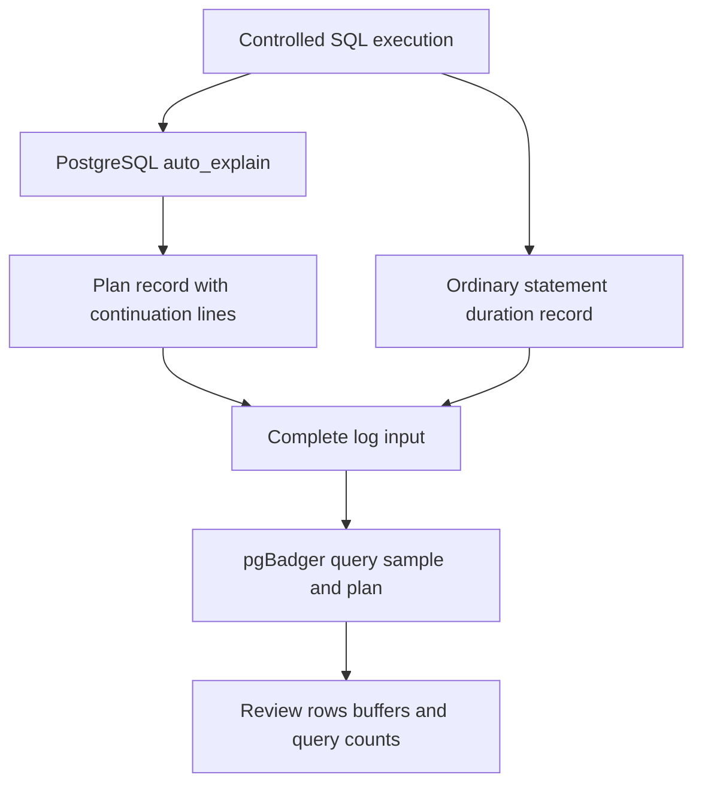

# Include auto_explain Plans in pgBadger Reports

Author: [nawazdhandala](https://www.github.com/nawazdhandala)

Tags: PostgreSQL, PgBadger, Observability

Description: Capture a query plan with session-scoped auto_explain settings, include it in pgBadger, and verify plan contents and query counts before broader collection.

A duration tells you that a statement was slow. An execution plan helps explain how PostgreSQL performed the work: which scans it used, how many rows passed through an operation, and where it accessed buffers. When the original execution has already finished, rerunning the query later may produce a different plan or different conditions.

The `auto_explain` module records plans during query execution, and pgBadger can include that evidence in its report. This walkthrough uses **pgBadger 13.3** and a small temporary-table exercise. The live test ran on an available disposable PostgreSQL 14.17 instance; PostgreSQL 18 documentation was also reviewed. The older server is identified as a test fixture, not a deployment recommendation.

## Separate plan capture from report generation

PostgreSQL creates the plan log record. pgBadger reads it afterward. Running pgBadger does not connect to the database, execute the SQL, or generate a new execution plan for an old statement.



The [auto_explain documentation](https://www.postgresql.org/docs/18/auto-explain.html) explains that loading the module alone does not enable plan logging. Its duration threshold defaults to disabled. It can be loaded in one session or preloaded more broadly; begin with a session whose workload and lifetime you control.

## Use a bounded lab session

Prerequisites are the server's `auto_explain` module, a superuser account on an isolated lab database, access to that database's log, and a known text log prefix. This example assumes ordinary statement logging is otherwise disabled and the test session is not handling application traffic.

Save the following as `plan_probe.sql`. The table is temporary, so it disappears when the connection closes. Creating and analyzing it before loading the module keeps setup work out of the plan-capture exercise:

```sql
CREATE TEMP TABLE plan_probe AS
SELECT g AS id, repeat('x', 40) AS payload
FROM generate_series(1, 10000) AS g;
ANALYZE plan_probe;
LOAD 'auto_explain';
```

Append the capture block to the same file:

```sql
BEGIN;
SET LOCAL application_name = 'autoexplain_probe';
SET LOCAL statement_timeout = '5s';
SET LOCAL auto_explain.log_min_duration = '0';
SET LOCAL auto_explain.log_analyze = on;
SET LOCAL auto_explain.log_timing = off;
SET LOCAL auto_explain.log_buffers = on;
SET LOCAL auto_explain.log_format = 'text';
SET LOCAL log_min_duration_statement = 0;
SELECT count(*) FROM plan_probe WHERE id >= 9000;
ROLLBACK;
SHOW auto_explain.log_min_duration;
SHOW log_min_duration_statement;
```

`SET LOCAL` limits each setting to the transaction. The query returns **1001**. After `ROLLBACK`, both displayed thresholds should return to their prior values; in the clean lab they were `-1`. The loaded module remains available in that connection until it ends, even though its transaction-local settings revert.

Run the file through an existing lab connection service. Replace the service name with one you have configured:

```bash
psql 'service=pgbadger-lab' -X -v ON_ERROR_STOP=1 -f plan_probe.sql
```

`-X` ignores personal psql startup files, and `ON_ERROR_STOP` prevents the script from continuing after a SQL error. This is a small controlled execution, not a command to capture every production plan.

## Understand the capture settings

The zero plan threshold captures this test even when it finishes quickly. `log_analyze=on` adds actual execution statistics. `log_buffers=on` includes buffer-use information, while `log_timing=off` avoids per-node timing measurements. Text format provides a readable plan for the initial parser check.

These options are also documented for the [PostgreSQL 14 lab version](https://www.postgresql.org/docs/14/auto-explain.html). Turning off node timing reduces instrumentation cost; it does not make analyzed plan capture free. A high duration threshold also does not automatically eliminate the collection overhead required to obtain execution statistics.

Notice the two different thresholds. `auto_explain.log_min_duration` controls plan records. `log_min_duration_statement` controls ordinary duration records. Keeping both enabled in this exercise lets us check that one execution is not accidentally interpreted as two queries by the reporting workflow.

## Confirm that the original log contains a complete plan

In the live fixture, the plan included an aggregate above a sequential scan. The relevant scan portion was:

```text
Seq Scan on plan_probe  (cost=0.00..219.00 rows=1001 width=0) (actual rows=1001 loops=1)
  Filter: (id >= 9000)
  Rows Removed by Filter: 8999
  Buffers: local hit=94
```

The numbers describe this small test, not a performance target. The actual row count matches the SQL result. `local` buffers are appropriate here because the table is temporary. A sequential scan is unsurprising when the example has no index and scans a small table.

Check that the log also retains the `Query Text:` line, plan indentation and continuation lines. A log shipping rule that keeps only timestamped first lines can leave pgBadger with a duration and no usable plan. Preserve process identification and timestamps too, since related records need to remain attributable to the same execution context.

## Generate and inspect the pgBadger report

Replace the path and prefix with the collected lab log's actual values:

```bash
log_file=/archive/postgresql/autoexplain-probe.log
prefix='%m [%p]: user=%u,db=%d,app=%a,client=%h '

pgbadger -f stderr -p "$prefix" \
  --include-query 'plan_probe' -o with-plans.html "$log_file"
```

The filter selects the probe statement. Plan processing is enabled by default; the [pgBadger option reference](https://github.com/darold/pgbadger/blob/v13.3/README) documents `--noexplain` as the option that disables it.

The generated report should retain the query text and captured plan. In our 13.3 test, both the plan message and the ordinary statement-duration message were present, yet the report counted **one query**. The [tagged parser](https://github.com/darold/pgbadger/blob/v13.3/pgbadger) contains logic for merging matching plan and duration records. Verify this behavior on representative input rather than assuming every log transport and timestamp format produces the same result.

As a comparison, generate a report that deliberately omits plans:

```bash
pgbadger -f stderr -p "$prefix" --noexplain \
  --include-query 'plan_probe' -o without-plans.html "$log_file"
```

The local comparison still contained one query, but the scan-plan text was absent. This helps distinguish a plan-processing setting from a general failure to parse the statement.

## Review the captured evidence before expanding collection

Read estimated versus actual rows, the chosen scan, filter removals and buffer usage. A plan is evidence from a particular execution. It does not establish that every execution of the normalized query used the same plan or parameter values. Stored examples also depend on report sample retention.

The report embeds plan text. Its graphical explain link is a separate action: the 13.3 default submits to an external visualization endpoint. Review that destination before using it with private SQL or plans; generating the report itself did not submit our test plan anywhere.

| Missing or surprising result | Check first |
|---|---|
| No plan in the database log | Module availability, session settings and plan threshold |
| Plan in the log but absent from HTML | Full continuation lines, parser format and `--noexplain` |
| Two queries for one test execution | Duplicate input, parser version and timestamp fidelity |
| No actual rows or buffers | Analyze and buffer options used during capture |
| Plan differs from a later manual EXPLAIN | Parameters, statistics, schema and execution conditions |

Before broader use, choose a threshold, sampling policy and capture interval appropriate to the workload, and measure overhead in staging. Keep plans under the same access controls as SQL logs. A successful small capture proves the reporting path works; it does not by itself justify collecting analyzed plans across a busy production cluster.
