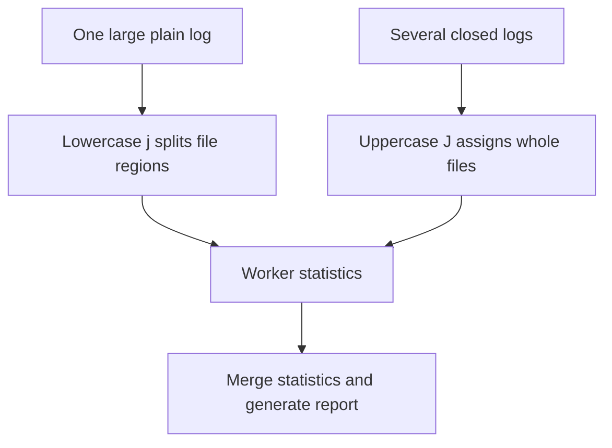

# pgBadger -j vs -J: Choose Parallelism for Large or Many Log Files

Author: [nawazdhandala](https://www.github.com/nawazdhandala)

Tags: PostgreSQL, PgBadger, Performance, Parallelism

Description: Choose pgBadger workers for one large log or many archives, verify actual splitting, and compare report accuracy before increasing concurrency.

You gave pgBadger four workers, but the report did not finish faster. Perhaps the file was too small to split. Perhaps the input was compressed. Or perhaps the parser finished quickly and report generation became the expensive part.

The case of the option matters: **`-j` divides a suitable individual log into chunks; `-J` processes multiple log files concurrently**. Neither option guarantees that a particular workload will run faster. This guide explains the choice using **pgBadger 13.3**, source inspection and local parser fixtures rather than production benchmark claims.

## Match the unit of work to the input

The lowercase option is also named `--jobs`; the uppercase option is `--Jobs`. Their documented meanings differ in what each worker receives. [Version 13.3 options](https://raw.githubusercontent.com/darold/pgbadger/v13.3/README)

| Input shape | Starting choice | Reason |
|---|---|---|
| One large, local, uncompressed text log | Try `-j 2`, then `-j 4` | Workers can parse different file regions |
| Many independent closed text logs | Try `-J 2`, then `-J 4` | Each worker handles a complete file |
| Several gzip archives | Test `-J` with the installed release | Whole archives can be separate jobs |
| One gzip file or a standard-input stream | Establish a serial baseline | There is no ordinary seekable chunk input |
| One small file | Usually stay serial | Process overhead can dominate |

“Seekable” means the reader can jump directly to a position within the file. A normal local text file permits this. A decompressed stream arriving through a pipe does not provide the same access pattern.



The merge and report-generation stage still matters after workers finish. Adding parser workers cannot make every stage scale at the same rate.

## Verify whether the file is actually split

In pgBadger 13.3, `split_logfile` leaves files of **16,777,216 bytes or less** as one chunk. A tiny demonstration file therefore cannot prove that `-j 4` used four parsing chunks. The main processing path also avoids chunk splitting for compressed files, standard input and command streams. These are release-specific implementation details. [Tagged splitting logic](https://github.com/darold/pgbadger/blob/v13.3/pgbadger)

For a large plain file, use verbose output to inspect the chosen boundaries:

```bash
pgbadger -v -j 4 -f stderr \
  -p '%m [%p]: user=%u,db=%d,app=%a,client=%h ' \
  --tempdir /analysis/pgbadger-scratch \
  -o large-log.html /archive/postgresql/large.log
```

Before running, create the scratch directory as a private writable directory and replace both paths. The prefix must match the actual PostgreSQL log; the example includes timestamp, backend process and connection fields. `-f stderr` describes the log contents, not its filename.

Look for a debug line describing boundaries. In the local 19,265,254-byte fixture, `-j 4` produced five offsets defining four regions. In an 80,010-byte fixture, the same option produced only a start and end offset. That result explained the worker behavior without relying on a momentary process-list screenshot.

`-J 4` on one file also does not create four independent files to process. This release caps that file-level concurrency at the number of available inputs. Do not combine both options while establishing a baseline; test one strategy at a time so the result is interpretable.

## Use whole-file workers for an archive collection

Prepare a reviewed file list with one path per line, for example `/analysis/closed-logs.txt`. Include each closed archive once and keep the input set unchanged during the comparison.

```bash
pgbadger -v -J 4 -f stderr \
  -p '%m [%p]: user=%u,db=%d,app=%a,client=%h ' \
  --tempdir /analysis/pgbadger-scratch \
  --logfile-list /analysis/closed-logs.txt \
  -o archive-set.html
```

This arrangement is useful when the files are independently readable and none dominates the entire workload. If one file contains almost all the data, it can remain the last unfinished job while other workers are idle. “Many files” alone is not enough; inspect their sizes too.

For the local fixture, four plain files processed with `-J 4` produced the same execution count as one serial combined file. Four gzip versions also passed with `-J 4`. That is a tested result for this release and gzip setup, not a promise for every compression program or remote transport.

Do not infer that `-j` can split a compressed stream just because `-J` can schedule separate compressed files. Likewise, explicitly configured CSV input follows a separate path that does not use ordinary chunk splitting. Keep the first experiment on the exact format and transport you actually intend to run.

## Compare correctness before elapsed time

Chunk boundaries can intersect records that span several lines. The tagged documentation warns that chunk-based processing can affect statements near those boundaries. Whole-file scheduling avoids this particular artificial boundary, but it cannot restore records already missing from the input. [Parallel-processing documentation](https://github.com/darold/pgbadger/blob/v13.3/README)

The local comparison used 24,000 timed statements, including multiline SQL and four backend process IDs:

| Mode | Input | Counted executions | Total query duration |
|---|---|---:|---:|
| Serial | One plain file | 24,000 | 24 seconds |
| `-j 4` | Same plain file | 24,000 | 24 seconds |
| `-J 4` | Four plain files | 24,000 | 24 seconds |
| `-J 4` | Four gzip files | 24,000 | 24 seconds |

All four modes also produced one normalized query group. Normalization groups similar SQL after replacing values; one group is not the same as one execution. Compare execution counts and duration totals, then check recognizable multiline examples and the first and last timestamps.

These checks passed for this fixture. They do not establish exact equivalence for arbitrary prepared statements, split error messages or every boundary placement. Keep a serial control for an incident where a particular missing statement would change your conclusion. The 13.3 release also contains multiline-query fixes, making the installed version part of the evidence. [Release notes](https://github.com/darold/pgbadger/releases/tag/v13.3)

## Measure the workload you will actually deploy

Run comparisons on a fixed copy of the same input and use separate output filenames. Avoid sharing incremental state between benchmark runs, because a later run could skip already-consumed records and appear artificially fast.

This Bash loop compares lowercase `-j` counts using text output, which makes basic counts easy to inspect:

```bash
#!/usr/bin/env bash
set -euo pipefail
umask 077

for workers in 1 2 4; do
  /usr/bin/time -p pgbadger -j "$workers" -f stderr \
    -p '%m [%p]: user=%u,db=%d,app=%a,client=%h ' \
    --tempdir /analysis/pgbadger-scratch \
    -x text -o "check-j${workers}.txt" \
    /archive/postgresql/large.log \
    > "check-j${workers}.run.log" 2>&1
done
```

Use a system where `/usr/bin/time` supports `-p`. It reports elapsed, user CPU and system CPU time. [Time command documentation](https://www.man7.org/linux/man-pages/man1/time.1.html)

After choosing a candidate, repeat the comparison with your real HTML output and options. Text-output timing does not measure the full HTML-generation cost. Repeat runs under comparable load and note cache effects rather than presenting one favorable measurement as a capacity plan.

Watch aggregate memory and scratch-disk use as worker counts rise. Each worker gathers statistics, and the final merge also needs resources. Increasing concurrency while storage is saturated or memory is tight can make the job slower. Use the reporting host's monitoring to identify that constraint before adding workers.

The small local fixture actually ran slower with four workers than serially. It was a functional check, not a representative performance benchmark. The useful outcome was confirming which modes ran, what they counted and which input restrictions applied. Choose the smallest worker count that meets your measured reporting deadline with matching results and resource headroom.
