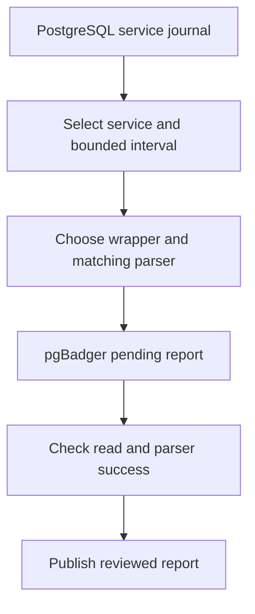

# Run pgBadger Directly from journalctl Without Copying Raw Logs

Author: [nawazdhandala](https://www.github.com/nawazdhandala)

Tags: PostgreSQL, PgBadger, Systemd, Logging

Description: Stream PostgreSQL journal entries into pgBadger, match their format correctly, and prevent failed reads from replacing a trustworthy report.

A PostgreSQL service already writes into the system journal. You want a report for yesterday's incident, but copying several gigabytes of logs into another file adds time and creates another sensitive artifact to manage. You can stream the journal directly into pgBadger.

The important decisions are which service to read, which part of each journal entry reaches the parser, and how to detect an incomplete read. A report that opens successfully is not proof that the entire interval was collected.

This walkthrough uses **pgBadger 13.3**. It provides two paths: its built-in journal command for investigation, and an explicit Bash pipeline for a scheduled job. The parser and failure-handling examples were exercised locally with a controlled journal-output producer. They were not run against a live Linux journal.

## Confirm that the journal contains database messages

The journal is systemd's structured log store. `journalctl` reads it. PostgreSQL running as a systemd service does not, by itself, guarantee that all query logs reach that store.

For example, PostgreSQL's logging collector can capture standard-error messages and put them in database log files. The service journal might then contain startup messages but no useful query history. Inspect the actual destination before changing anything. Do not disable the collector merely to make this tutorial work. [PostgreSQL 18 logging configuration](https://www.postgresql.org/docs/18/runtime-config-logging.html)

The following read-only command selects a small sample. Replace the service name and timestamps with your actual instance and incident window; `postgresql@18-main.service` is an example, not a universal unit name. Run it using an account authorized to read that service's journal.

```bash
journalctl --unit=postgresql@18-main.service \
  --since='2026-11-24 00:00:00 UTC' \
  --until='2026-11-24 01:00:00 UTC' \
  --no-pager --output=cat --lines=20
```

Here `cat` prints the message without journal-added timestamps and host labels. `--lines=20` is only for this inspection; omit it from the full report. The unit and time filters restrict the selection, while `--no-pager` avoids an interactive viewer. [journalctl options](https://www.freedesktop.org/software/systemd/man/latest/journalctl.html)

Look for a complete PostgreSQL record resembling this illustrative input:

```text
2026-11-24 00:00:01.000 UTC [81]: user=app,db=shop,app=probe,client=local LOG:  duration: 12.000 ms  statement: SELECT 42 AS journal_probe;
```

That message contains its own timestamp, backend process ID, database context, severity and timed SQL statement. If the sample contains only startup notices, fix source selection first. If SQL is absent because query logging was disabled, journal streaming cannot reconstruct it.

## Choose the wrapper and parser together

A journal entry has a message plus metadata about its source. `MESSAGE` is the application-supplied text; it is distinct from fields such as `_PID`. Removing the wrapper is useful only if the remaining message has enough information for the parser. [Journal field definitions](https://www.freedesktop.org/software/systemd/man/latest/systemd.journal-fields.html)

For the illustrated message, PostgreSQL's prefix is:

```text
'%m [%p]: user=%u,db=%d,app=%a,client=%h '
```

Use the real `log_line_prefix` from your database. Do not change the database prefix just to match this example. `%m` supplies a timestamp with milliseconds, and `%p` supplies the database process ID. Other fields identify the user, database, application and client.

The two paths below consume different input shapes:

| Input path | Data arriving at pgBadger | Format option |
|---|---|---|
| Built-in `--journalctl` | Journal `short-iso` wrapper plus PostgreSQL message | `-f syslog2` |
| Explicit `journalctl --output=cat` pipeline | PostgreSQL message alone | `-f stderr` |

In pgBadger 13.3, command input does not receive ordinary file-format detection. Its journal integration appends `--output='short-iso'`. Choose the format explicitly and retain the matching PostgreSQL prefix. [Version 13.3 implementation](https://github.com/darold/pgbadger/blob/v13.3/pgbadger)



## Use the built-in command for an investigation

With pgBadger 13.3 installed and available on your path, this command generates an HTML report without first writing the raw journal output to disk:

```bash
pgbadger -f syslog2 \
  -p '%m [%p]: user=%u,db=%d,app=%a,client=%h ' \
  --journalctl "journalctl --unit=postgresql@18-main.service --since='2026-11-24 00:00:00 UTC' --until='2026-11-24 01:00:00 UTC' --no-pager" \
  -o journal-investigation.html
```

The outer double quotes keep the command together. The inner single quotes preserve the spaces in the two timestamps when it runs. Keep this command administrator-controlled; do not build it from untrusted web-form values.

Do not add `--output=cat` inside this option and expect message-only input: this release appends its own output mode. The built-in facility and standard-input support are documented in the [tagged pgBadger README](https://github.com/darold/pgbadger/blob/v13.3/README).

Check the report's time range, database and recognizable query examples. For this exact prefix, a local fixture with journal-wrapper PID 500 and PostgreSQL PID 81 was assigned to PID 81. That matters when filtering by backend: the journal wrapper and the database message are separate layers, and guessing the prefix can attach activity to the wrong identity.

## Make a scheduled pipeline detect failed reads

For automation, use a checked pipeline and publish only after both commands succeed. Run this as a Bash script in a private report directory, with one instance of the job at a time:

```bash
#!/usr/bin/env bash
set -euo pipefail
umask 077

journalctl --unit=postgresql@18-main.service \
  --since='2026-11-24 00:00:00 UTC' \
  --until='2026-11-24 01:00:00 UTC' \
  --no-pager --output=cat |
  pgbadger -f stderr \
    -p '%m [%p]: user=%u,db=%d,app=%a,client=%h ' \
    -o report.pending.html -

mv report.pending.html report.html
```

The final `-` tells pgBadger to read standard input. The pending file is a report, not a copy of the raw logs. Keeping it beside the published report also keeps the final rename on the same filesystem. This is not a promise that pgBadger performs no temporary disk I/O internally.

Bash's `pipefail` makes a pipeline fail when an earlier command fails, even if the final command succeeds. With `set -e`, the script stops before `mv` in that case. Without `pipefail`, a failed journal read could be hidden by a successful parser exit. [Bash pipeline status](https://www.gnu.org/software/bash/manual/html_node/Pipelines.html)

In the controlled test, a producer emitted one valid query and then exited with status 42. The built-in pgBadger journal command returned zero. The explicit pipeline returned 42 and left the previous published report unchanged. A successful producer then published a one-query report. These observations are specific to the tested 13.3 path, not a claim about every release.

Successful exit statuses still need content checks. For a busy expected interval, a zero-query report should trigger investigation rather than automatic acceptance. Define that expectation for your workload; an idle maintenance window can legitimately have no queries.

## Preserve the meaning of the interval

Use a finished, bounded interval for a report. Avoid continuous-follow mode and reverse ordering. Record the service name, timestamps, parser version and prefix alongside the report so someone can reproduce the selection later.

A rerun should replace the same interval's report, not append the same entries into an accumulated dataset. Adjacent time filters also need an explicit boundary policy before you use them for incremental accounting; the two one-off examples here are not a durable scheduling checkpoint.

Finally, check journal retention and delivery. Volatile storage can disappear after reboot, retention limits can remove old entries, and rate limiting can drop messages before this analysis begins. Reading successfully cannot recover those records. [journald storage and rate-limit settings](https://www.freedesktop.org/software/systemd/man/latest/journald.conf.html)

When the report looks incomplete, investigate in order: source service, available interval, PostgreSQL message content, wrapper/parser match, then command failures. That sequence separates missing data from parsing problems without creating another raw-log archive.
