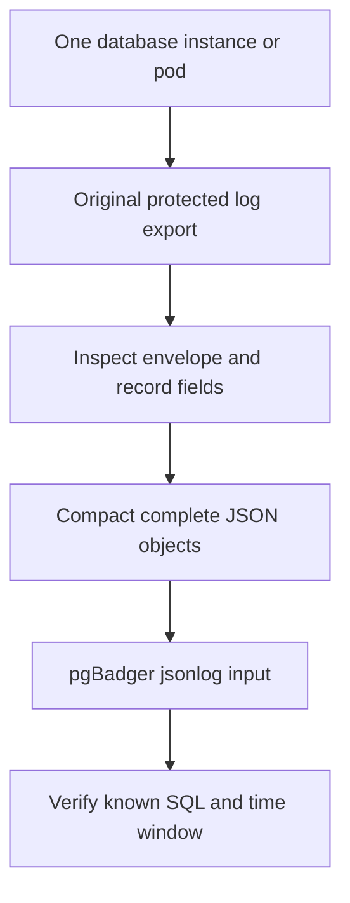

# Parse CloudNativePG and Cloud SQL JSON Logs with pgBadger

Author: [nawazdhandala](https://www.github.com/nawazdhandala)

Tags: PostgreSQL, PgBadger, CloudNativePG, Cloud SQL

Description: Prepare CloudNativePG records and Cloud SQL JSON exports for pgBadger while preserving timestamps, session identity, multiline SQL, and evidence of capture completeness.

“JSON logs” can describe three different inputs: PostgreSQL's native `jsonlog`, a CloudNativePG envelope containing a parsed database record, or a Cloud Logging entry containing PostgreSQL text. Their fields are not interchangeable.

pgBadger supports these representations, but it still needs a recognizable record shape and the information required to reconstruct query activity. Keep the original export, normalize its JSON representation carefully, and verify a known statement before trusting the report.

The local examples were tested with **pgBadger 13.3**, **jq 1.7.1**, and **Perl 5.34.1**. CloudNativePG behavior was checked against its **1.29** documentation. The Kubernetes and Google Cloud download commands are documentation-verified examples; they were not executed against a live cluster or cloud account.

## Identify the envelope before extracting anything

| Source | Recognizable fields | What to preserve |
|---|---|---|
| Native PostgreSQL `jsonlog` | `timestamp`, `pid`, `message`, optional `user` and `dbname` | The complete database JSON object |
| CloudNativePG | `logger`, `logging_pod`, nested `record` | The envelope and its nested record |
| Cloud SQL through Cloud Logging | `timestamp`, `textPayload`, resource metadata | The Cloud Logging entry containing the database text |

Native PostgreSQL JSON output emits one object per log line. It is a server logging destination, not merely a generic JSON file extension. [PostgreSQL JSON logging](https://www.postgresql.org/docs/18/runtime-config-logging.html#RUNTIME-CONFIG-LOGGING-JSONLOG)

CloudNativePG 1.29 requires PostgreSQL CSV output internally and converts it to JSON through its instance manager. Do not change its fixed logging settings to force native `jsonlog`; analyze the operator's existing output. [CloudNativePG PostgreSQL configuration](https://cloudnative-pg.io/docs/1.29/postgresql_conf/)

For Cloud SQL, an export formatted as JSON wraps the collected entry. It does not prove that the PostgreSQL message inside is native JSON. Cloud SQL documents JSON export through `gcloud logging read`. [Cloud SQL instance logs](https://docs.cloud.google.com/sql/docs/postgres/logging)



## Keep one server's records together

Start with one pod or Cloud SQL instance and a bounded interval. Database process IDs can repeat across servers. Combining unrelated instances into one stream can make session reconstruction ambiguous, especially when SQL and duration are separate records.

Record the source identity, collection interval, parser version, and logging policy beside the output. Keep raw exports unchanged so you can investigate missing fields or conversion mistakes. Store these files with access controls appropriate for SQL text and possible application data.

For complete query timing, the source must already contain the corresponding duration and SQL information. A JSON wrapper cannot manufacture statements excluded by the database's logging threshold. Audit events, operator messages, and query-duration records answer different questions.

## Collect CloudNativePG records

With `kubectl` configured for the intended cluster and permission to read pod logs, replace `NAMESPACE` and `POD_NAME` below. Run in a new working directory:

```bash
set -e
umask 077
kubectl logs -n NAMESPACE POD_NAME -c postgres --since=1h \
  > cnpg.raw.jsonl
jq -cS 'select(.logger == "postgres" and
              (.record.message | type == "string"))' \
  cnpg.raw.jsonl > cnpg.jsonl
test -s cnpg.jsonl
pgbadger -f jsonlog -o cnpg.html cnpg.jsonl
```

The filter keeps structured PostgreSQL records and excludes unrelated instance-manager output. It preserves the entire object, including `logging_pod` and `record`, rather than extracting only the message string. CloudNativePG documents these envelope fields and multiple logger types. [CloudNativePG logging](https://cloudnative-pg.io/docs/1.29/logging/)

Avoid adding human-readable prefixes or `--timestamps` to this capture. Those options add text around the JSON records. `--since=1h` limits the requested history; it does not recover logs already removed by rotation. For a restarted container, collect its previous instance separately when needed and record that boundary. [kubectl logs reference](https://kubernetes.io/docs/reference/kubectl/generated/kubectl_logs/)

Long-term retention belongs to your logging infrastructure. A successful pod-log command is not evidence that it returned every record from a historical incident.

## Export a bounded Cloud SQL interval

Use an authenticated Google Cloud CLI account with permission to read the relevant logs. Replace every `PROJECT_ID` placeholder, `INSTANCE_ID`, and the example UTC interval. The filter selects the PostgreSQL log for one instance, not administrative audit logs.

```bash
set -e
umask 077
gcloud logging read \
  'resource.type="cloudsql_database"
   AND resource.labels.database_id="PROJECT_ID:INSTANCE_ID"
   AND logName="projects/PROJECT_ID/logs/cloudsql.googleapis.com%2Fpostgres.log"
   AND timestamp>="2026-11-24T00:00:00Z"
   AND timestamp<"2026-11-24T01:00:00Z"' \
  --project=PROJECT_ID --order=asc --limit=10000 --format=json \
  > cloudsql.export.json
```

Ascending order is deliberate because `gcloud logging read` otherwise defaults to newest-first output. The limit bounds this diagnostic download; a result at the cap may be incomplete. [gcloud logging read](https://docs.cloud.google.com/sdk/gcloud/reference/logging/read)

Convert the JSON array to one compact object per line, while rejecting unexpected input:

```bash
set -e
jq -cS '
  if type != "array" or length == 0 or length >= 10000 then
    error("Empty or possibly truncated export")
  elif all(.[]; (.textPayload | type) == "string") then
    .[]
  else
    error("Inspect unexpected payload types")
  end
' cloudsql.export.json > cloudsql.jsonl
pgbadger -f jsonlog -o cloudsql.html cloudsql.jsonl
```

This example intentionally targets entries with `textPayload`. If your export uses `jsonPayload` or another nested structure, inspect it rather than silently dropping those records. If the cap is reached, split the interval into smaller nonoverlapping windows and verify their coverage. A lower count alone does not prove complete retention or exclude late arrivals.

Keep `timestamp` even when the text begins with a process ID. Extracting only `textPayload` can discard the time that the parser needs. The original envelope also retains resource identity for later review.

## Compact JSON without flattening its meaning

`jq -c` emits compact JSON; `-S` sorts object keys consistently. For a JSON array, `.[]` emits individual entries. For an existing stream of objects, `.` retains each object. JSON escaping keeps embedded SQL newlines inside a single physical input line. [jq 1.7 manual](https://jqlang.org/manual/v1.7/)

For an existing native PostgreSQL JSON log, a minimal path is:

```bash
set -e
jq -cS '.' native.raw.jsonl > native.jsonl
pgbadger -f jsonlog -o native.html native.jsonl
```

Do not replace escaped newlines with literal line breaks using a text substitution. Do not discard nested metadata merely to make each line shorter. The pgBadger 13.3 parser contains distinct handling for CloudNativePG fields and Cloud SQL text payloads, so preserving the expected shape matters. [pgBadger 13.3 parser source](https://github.com/darold/pgbadger/blob/v13.3/pgbadger)

The `-f jsonlog` flag selects the input parser. It does not request JSON report output. Output format is a separate choice; the commands here generate HTML. Both Cloud SQL and CloudNativePG input examples are documented by the pinned release. [pgBadger 13.3 README](https://github.com/darold/pgbadger/blob/v13.3/README)

## Verify the conversion before scheduling it

Use a known harmless query from an approved diagnostic session, then locate its original record, converted record, and report entry. Check the database identity and timestamps as well as the SQL text. A nonempty report can still cover the wrong instance or interval.

The local tests created equivalent native, CloudNativePG and Cloud SQL fixtures containing two queries, quoted identifiers, and multiline SQL. Each converted stream produced two queries, two normalized query groups, and 32 ms total duration. The Cloud SQL guard rejected empty arrays, capped exports, unexpected payload types, and non-array input. The release's own Cloud SQL and CloudNativePG fixtures also parsed successfully.

These tests validate the transformation and parser against those shapes. They do not demonstrate live Kubernetes retention, Cloud Logging completeness, IAM permissions, or every possible JSON escape and payload variation.

If a report is empty, inspect the selected objects before changing database logging. Confirm that the message contains query timing, the expected timestamp and process fields survived, and the stream contains complete compact objects. If counts are inflated, check overlapping downloads or separate SQL/duration records. Preserve the raw evidence and adjust one stage at a time so the repaired report remains explainable.
