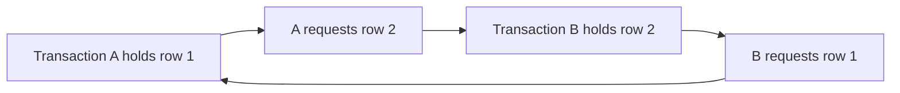

# Diagnose Lock Waits, Deadlocks, and Cancellations with pgBadger

Author: [nawazdhandala](https://www.github.com/nawazdhandala)

Tags: PostgreSQL, PgBadger, Troubleshooting, Database Monitoring

Description: Separate PostgreSQL lock waits, deadlocks and timeout cancellations using pgBadger events, preserved log details and a read-only live blocker query.

A slow database request can be executing useful work, waiting for another transaction, or approaching a timeout. These cases need different responses. A lock wait does not automatically mean a deadlock, and a cancelled query does not automatically mean it was blocked.

Use pgBadger to find recurring events and representative statements, then return to the complete log records to reconstruct the cause. For an incident still in progress, add a live blocker snapshot before the transactions disappear.

This guide uses **pgBadger 13.3**. The examples were checked with real events from an isolated PostgreSQL **14.17** lab; PostgreSQL 18 documentation supports the configuration explanations. The older lab version is disclosed for reproducibility, not recommended for a new deployment.

## Separate the four conditions

| Evidence | What it means | First investigation |
|---|---|---|
| Still waiting for a lock | A requested lock has not yet been granted | Identify the holder and transaction lifetime |
| Acquired a lock after a delay | The wait ended successfully | Explain why the holder kept the lock |
| Deadlock detected | Transactions form a cycle of incompatible waits | Reconstruct their lock acquisition order |
| Statement cancelled | A deadline or cancellation mechanism interrupted work | Read the exact reason before assuming a lock problem |

PostgreSQL resolves a detected deadlock by aborting one participating transaction. The victim is not necessarily the transaction that should be changed, and applications must not depend on which transaction is chosen. [PostgreSQL deadlocks](https://www.postgresql.org/docs/18/explicit-locking.html#LOCKING-DEADLOCKS)

## Capture useful evidence before an incident

Inspect the relevant settings in an authorized connection:

```sql
SHOW log_lock_waits;
SHOW deadlock_timeout;
SHOW log_min_error_statement;
SHOW lock_timeout;
SHOW statement_timeout;
```

`log_lock_waits` enables logging of waits exceeding `deadlock_timeout`. Despite its name, `deadlock_timeout` is the delay before checking for a deadlock and also controls the wait-log threshold. It is not a deadline that automatically cancels every waiting statement. [Lock-management settings](https://www.postgresql.org/docs/18/runtime-config-locks.html)

For an approved diagnostic, enable wait logging and choose a threshold that balances visibility with overhead. The lab used 100 milliseconds to make short controlled waits visible; do not copy that value into a busy production cluster without considering the additional checks and log volume.

`lock_timeout` limits waiting for each lock acquisition. `statement_timeout` limits the statement more broadly, including time spent waiting. A shorter statement timeout can therefore fire before the lock timeout. Preserve the server's error reason instead of inferring the cause from the application's generic timeout message. [Timeout behavior](https://www.postgresql.org/docs/18/runtime-config-client.html)

Keep error statements enabled at an appropriate level and retain `DETAIL`, `CONTEXT` and `STATEMENT` records. They can contain the blocking process, lock object and SQL. A log export containing only the first error line loses much of the investigation value.

## Build an incident report without removing the blocker

Use logs from the affected instance and a closed incident window. Replace the path and prefix below with the actual values:

```bash
pgbadger -f stderr \
  -p '%m [%p]: user=%u,db=%d,app=%a,client=%h ' \
  -o locking-incident.html /archive/postgresql/incident.log
```

Start with a broad report. Filtering to the affected application too early can exclude a migration or background job that held the lock. Compare the locking sections with the event report, including failures that never acquired the requested lock. [pgBadger report options](https://github.com/darold/pgbadger/blob/v13.3/README)

The local test recorded one table-lock wait that later succeeded, another that ended in a lock timeout, a statement timeout during `pg_sleep`, and a two-transaction deadlock. The report preserved all four situations in its detailed evidence.

Ordinary statement-duration logging was disabled, so the timed-query count was zero. That did not prevent lock and error analysis. Equally, zero timed queries does not mean no SQL ran.

## Read a wait as a relationship

A “still waiting” record identifies the waiting process. Its associated detail can identify a holder and other waiting processes. A later “acquired” record gives a completed wait duration. Neither record alone establishes how long the holder's entire transaction lasted.

The SQL displayed with a wait is often the blocked statement. It can be innocent: an ordinary read may wait behind a schema change holding an incompatible table lock. Investigate the holder's transaction and earlier statements instead of tuning the waiting read solely because it appears in a slow list.

During an active incident, this read-only query lists blocked backends in the connected database:

```sql
WITH activity AS (
    SELECT pid, application_name, state, wait_event_type, wait_event,
           pg_blocking_pids(pid) AS blockers
    FROM pg_stat_activity
    WHERE datname = current_database()
)
SELECT pid, application_name, state, wait_event_type, wait_event, blockers
FROM activity
WHERE cardinality(blockers) > 0
ORDER BY pid;
```

`pid` is a server process identifier; `blockers` is an array of blocking process IDs. The lab returned the waiting application with `wait_event_type = Lock` and the expected holder. The query does not cancel anything. [pg_blocking_pids](https://www.postgresql.org/docs/18/functions-info.html), [Activity view](https://www.postgresql.org/docs/18/monitoring-stats.html#MONITORING-PG-STAT-ACTIVITY-VIEW)

Use a role with appropriate monitoring visibility. This is a point-in-time view, so an empty result does not disprove an earlier wait. A blocking PID of zero can represent a prepared transaction; parallel-query reporting also has special cases. Avoid treating every array entry as an ordinary client session that can simply be terminated.

## Reconstruct a deadlock cycle

A typical cycle looks like this:



Read the full deadlock detail to identify both directions of the dependency. Associate each process with its application, transaction and statements before the failure. Query text on the final failing line may show only the second lock request, not the earlier work that established the cycle.

Where possible, make participating transactions acquire resources in a consistent order and keep transactions short. When retrying is appropriate, retry the transaction with bounded backoff and account for external side effects; repeating just the failed statement inside an aborted transaction is not a recovery strategy. [Deadlock prevention and recovery](https://www.postgresql.org/docs/18/explicit-locking.html#LOCKING-DEADLOCKS)

## Treat cancellation totals as a starting point

Read the exact event: “due to lock timeout” differs from “due to statement timeout” or a user-requested cancellation. SQLSTATE codes help applications classify errors, but the broader query-cancelled category still needs contextual evidence. [PostgreSQL error codes](https://www.postgresql.org/docs/18/errcodes-appendix.html)

The pinned parser has special handling for statement-timeout cancellation. It should not be assumed to count every form of cancellation in one headline. In this local run, the HTML cancellation figure remained zero even though the event report contained the statement-timeout error and its SQL. That observed limitation makes the detailed event records essential. [13.3 cancellation implementation](https://github.com/darold/pgbadger/blob/v13.3/pgbadger)

Before changing a timeout, establish whether the limit protected the service or interrupted legitimate work. Increasing it can leave more requests waiting behind the same blocker. Releasing a lock also needs context: identify the owner and intended transaction outcome before coordinating a commit, rollback or approved administrative action.

After a fix, compare waits, errors, transaction durations and application outcomes over equivalent traffic. Keep the original log evidence with the report. A quieter cancellation chart alone is not enough to show that contention has been resolved.
