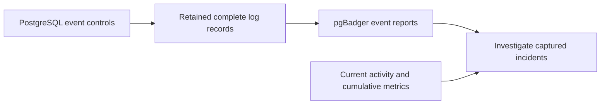

# Capture PostgreSQL Events in pgBadger Without Logging Every Statement

Author: [nawazdhandala](https://www.github.com/nawazdhandala)

Tags: PostgreSQL, PgBadger, Database Monitoring, Logging

Description: Collect lock waits, disk spills, autovacuum activity, and checkpoints for pgBadger with explicit thresholds, useful validation, and manageable logging volume.

You can investigate several important PostgreSQL performance problems without recording the duration of every statement. Lock waits, temporary files, autovacuum actions, and checkpoints have dedicated logging controls. pgBadger can summarize those event records even when ordinary query timing is disabled.

The tradeoff is coverage. An event report can show a long lock wait or a large spill, but it cannot reconstruct the latency distribution of statements that were never logged. Design it around operational questions rather than expecting every pgBadger panel to be populated.

This guide uses **pgBadger 13.3** and configuration semantics documented for **PostgreSQL 18**. The executed event tests used an isolated, locally available PostgreSQL 14.17 instance and Perl 5.34.1. That older database version was a disposable fixture, not a production recommendation.

## Choose what you want to observe

| Signal | Main control | What missing records cannot prove |
|---|---|---|
| Long lock waits | `log_lock_waits` and `deadlock_timeout` | That shorter waits never happened |
| Temporary files | `log_temp_files` | That no smaller spills occurred |
| Automatic vacuum and analyze | `log_autovacuum_min_duration` | That fast maintenance did not run |
| Checkpoints and restartpoints | `log_checkpoints` | That an incomplete log window covers a full operation |

Use the same settings and retained time window when comparing two reports. A lower threshold can increase the event count without any workload regression. Keep the effective configuration with the report so another reader can interpret the numbers.



Current activity and cumulative statistics complement the historical log. They answer questions about what is happening now and how counters have changed, including activity excluded by your log thresholds. [PostgreSQL monitoring statistics](https://www.postgresql.org/docs/18/monitoring-stats.html)

## Start with an explicit configuration

The following is an example for a server already exporting stderr logs through a working collector or service manager. Review its thresholds against your workload. Apply it through the configuration mechanism that owns your server; managed services may require parameter-group changes.

```conf
log_destination = 'stderr'
log_line_prefix = '%m [%p]: user=%u,db=%d,app=%a,client=%h '
lc_messages = 'C'

log_statement = 'none'
log_duration = off
log_min_duration_statement = -1
log_min_duration_sample = -1
log_transaction_sample_rate = 0

log_lock_waits = on
deadlock_timeout = '1s'
log_temp_files = '10MB'
log_autovacuum_min_duration = '1s'
log_checkpoints = on
```

The first group preserves a predictable English-language record format. The second disables ordinary statement, duration, and sampled-duration logging for this example. The final group retains selected operational events. These settings do not disable logging from errors, extensions, or independently configured sessions.

pgBadger's documented setup includes the four event controls and an identifiable timestamp/process prefix. Here the temporary-file and autovacuum thresholds are deliberately higher than its all-events examples. [pgBadger 13.3 configuration guidance](https://github.com/darold/pgbadger/blob/v13.3/README)

This configuration is not a privacy filter. Event records can include a related `STATEMENT` line. In the local tests, PostgreSQL attached SQL to lock and temporary-file messages even though ordinary statement-duration logging was disabled. Protect the raw files and generated reports accordingly.

## Understand each threshold

`deadlock_timeout` determines when PostgreSQL checks a waiting lock for a deadlock and also controls when `log_lock_waits` emits its wait message. It does not cancel a query after that interval. Lowering it globally can increase checking overhead; choose a shorter value only for a justified diagnostic window. [PostgreSQL lock management](https://www.postgresql.org/docs/18/runtime-config-locks.html)

For an incident in progress, an authorized monitoring account can inspect current blockers without waiting for a completed report:

```sql
SELECT pid, wait_event_type, wait_event,
       pg_blocking_pids(pid) AS blockers
FROM pg_stat_activity
WHERE cardinality(pg_blocking_pids(pid)) > 0;
```

Each returned row identifies a blocked session and its blocking process IDs. An empty result only describes that observation. Avoid tight polling: PostgreSQL documents that repeated `pg_blocking_pids` calls take a lock-manager lock briefly. [Blocking process information](https://www.postgresql.org/docs/18/functions-info.html#FUNCTIONS-INFO-SESSION)

`log_temp_files = '10MB'` logs qualifying temporary files when they are removed. It is a per-file threshold, not a total-per-query budget. Several smaller files may therefore be absent even when their combined size exceeds 10 MB. A long-running operation's file may not appear until cleanup. [Temporary-file logging](https://www.postgresql.org/docs/18/runtime-config-logging.html#GUC-LOG-TEMP-FILES)

The autovacuum duration threshold includes automatic vacuum and analyze actions. It controls reporting, not the frequency or work performed by autovacuum. Table storage settings can override the server setting. Keep those overrides in your investigation rather than disabling maintenance to reduce log volume. [Autovacuum configuration](https://www.postgresql.org/docs/18/runtime-config-vacuum.html), [autovacuum logging](https://www.postgresql.org/docs/18/runtime-config-logging.html#GUC-LOG-AUTOVACUUM-MIN-DURATION)

Checkpoint logging includes start/completion information and statistics about writing buffers. Retain both sides of an operation when collecting an incident window. A checkpoint overlapping a latency spike is a lead to investigate, not proof that it caused every slow request. [Checkpoint logging](https://www.postgresql.org/docs/18/runtime-config-logging.html#GUC-LOG-CHECKPOINTS)

## Verify the applied settings

On a self-managed server, an authorized administrator can request a configuration reload after reviewing the edited configuration. The returned Boolean confirms that the signal was sent, not that every setting is active. [Server signaling functions](https://www.postgresql.org/docs/18/functions-admin.html#FUNCTIONS-ADMIN-SIGNAL)

```sql
SELECT pg_reload_conf();

SELECT name, setting, unit, source, pending_restart
FROM pg_settings
WHERE name IN (
  'log_lock_waits', 'deadlock_timeout', 'log_temp_files',
  'log_autovacuum_min_duration', 'log_checkpoints',
  'log_statement', 'log_duration', 'log_min_duration_statement',
  'log_min_duration_sample', 'log_transaction_sample_rate'
)
ORDER BY name;
```

Check values from a fresh connection after reload. `pg_settings` reports units separately: the example temporary-file threshold appears as `10240` with unit `kB`, while the one-second duration thresholds appear as `1000` with unit `ms`. Inspect `source` and `pending_restart` rather than assuming the file edit won over every override. [pg_settings reference](https://www.postgresql.org/docs/18/view-pg-settings.html)

Leave an existing log transport intact. Enabling PostgreSQL's logging collector is a separate startup change, and this event policy does not require changing an already working transport.

## Build the report from a complete log copy

With pgBadger 13.3 installed and a protected copy of the relevant stderr log, run:

```bash
pgbadger -f stderr \
  -p '%m [%p]: user=%u,db=%d,app=%a,client=%h ' \
  -o events.html /path/to/postgresql.log
```

Replace the path and match the prefix to the log that was actually written. Start without database or user filters: background-process records can have empty session fields, and filtering too early can discard useful context. Preserve multiline details and associated statement lines during transport.

Use the HTML report for the complete set of event panels. In the tested release, its text output showed lock and temporary-file details but did not reproduce the autovacuum and checkpoint sections available in HTML. This was checked against both generated output and the release's text-report implementation. [pgBadger 13.3 source](https://github.com/darold/pgbadger/blob/v13.3/pgbadger)

## Validate coverage in staging

Test each event class independently in a disposable database or approved staging workload. Do not manufacture contention or force checkpoints on a busy production server merely to populate a dashboard.

The local test created a blocked table reader, a bounded sort with low working memory, a small table eligible for autovacuum, and an explicit checkpoint. Diagnostic thresholds were lowered inside that disposable instance. pgBadger reported the lock wait, two temporary files, one automatic vacuum, one automatic analyze, and two checkpoints including shutdown, while ordinary timed-query count remained zero.

That result demonstrates event capture without complete query timing. It does not measure production overhead or establish appropriate thresholds for another workload. For acceptance, require a matching raw record and populated report section for each event class, plus confirmation that the normal threshold configuration is applied afterward.

If a section stays empty, check whether an event crossed its threshold, whether the relevant background or continuation lines reached the file, and whether a report option disabled the section. Once capture works, measure log growth and retention costs. Combine these event reports with request latency metrics and current database activity; use targeted query logging only when the next diagnostic question requires it.
