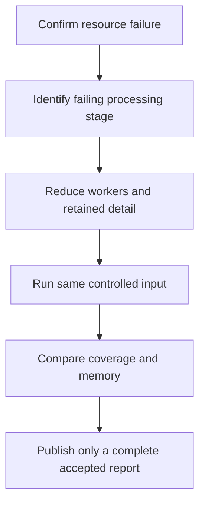

# Stop pgBadger from Exhausting Memory on Busy PostgreSQL Logs

Author: [nawazdhandala](https://www.github.com/nawazdhandala)

Tags: PostgreSQL, PgBadger, Performance, Troubleshooting

Description: Diagnose pgBadger memory pressure, reduce retained samples and report scope, and avoid settings that hide queries while appearing to fix resource use.

A compressed log can be small on disk yet expensive to analyze. pgBadger does more than read lines: it groups SQL, retains examples and event details, builds time-based statistics, and merges worker results. The number of distinct things it must remember can matter more than the archive's compressed size.

When the process disappears or becomes extremely slow, first establish whether it hit a memory limit. Then reduce the retained workload deliberately. This guide uses **pgBadger 13.3** and local tests of its retention options; it does not claim a universal RAM requirement for a given log size.

## Confirm the failure and its stage

Keep the command's exit status and diagnostic output. A killed process is not, by itself, proof of an out-of-memory event. Check the reporting service or container's resource evidence and identify whether the failure occurred during parsing, merging, or report generation.

On Linux using cgroup v2, a control group accounts for a workload and its descendant processes. If you already know the reporting job's cgroup directory, this read-only inspection is useful. Replace the path; do not assume every service uses this layout:

```bash
job_cgroup=/sys/fs/cgroup/system.slice/pgbadger.service

cat "$job_cgroup/memory.current"
cat "$job_cgroup/memory.peak"
cat "$job_cgroup/memory.max"
cat "$job_cgroup/memory.events"
```

The first two files report current and peak memory; availability of `memory.peak` depends on the kernel. The limit may be a byte count or `max`. Compare `oom_kill` and related event counters before and after the attempt, because they can include earlier activity. These values cover the group, which is more useful than watching only the parent parser process. [Kernel cgroup memory interface](https://docs.kernel.org/admin-guide/cgroup-v2.html)

Preserve the input list and parser options when comparing attempts. A second run that consumed less data because of incremental progress is not evidence that a memory setting worked.



## Reduce concurrency before changing query meaning

Each parser worker can hold its own statistics. Later, the parent combines results. Increasing `-j` or `-J` can therefore raise the aggregate memory requirement even when individual workers handle less input.

Establish a one-worker baseline on an analysis machine with sufficient headroom. This example processes one closed log for one database and retains one sample per normalized query group:

```bash
pgbadger -v -j 1 -J 1 -f stderr \
  -p '%m [%p]: user=%u,db=%d,app=%a,client=%h ' \
  -d shop -s 1 \
  --tempdir /analysis/pgbadger-scratch \
  -o shop-day.pending.html \
  /archive/postgresql/postgresql-2026-11-24.log
```

Replace the database, prefix and paths. The scratch directory must be private and writable. A closed file makes the input repeatable; selecting `shop` means the report deliberately excludes other databases. State that scope in its filename and when sharing it.

Keep this diagnostic run separate from a production incremental archive. Review coverage before replacing a published report. A valid HTML file generated from a partial or filtered input should not silently replace a previously complete report.

## Distinguish examples from distinct query groups

Normalization turns SQL that differs mainly in values into a shared query shape. For example, requests for different customer IDs can belong to one group. Different table names or retained per-request comments can create many more groups.

pgBadger's `-s` option controls retained query samples. Reducing it from the default three to one reduces examples per group; it does not reduce the number of executions counted. The source maintains sample collections separately from each group's statistics. [Sample retention implementation](https://github.com/darold/pgbadger/blob/v13.3/pgbadger)

A local fixture contained 500 executions across 100 table-specific query shapes, with five different durations per shape. Inspection of the generated binary statistics produced:

| Setting | Executions | Query groups | Retained group samples |
|---|---:|---:|---:|
| Default | 500 | 100 | 300 |
| `-s 1` | 500 | 100 | 100 |
| `-s 0` | 500 | 100 | 0 |
| `-t 1` | 500 | 100 | 300 |

`-s 0` removed these per-group samples, but the separate slowest-query collection still retained examples. It is not a SQL-erasure or anonymization switch.

Lowering `-t` reduced the retained slowest list from 20 entries to one in this fixture. It did **not** turn the complete normalized-query collection into a one-entry table. A top-ten display should not be mistaken for a ten-query memory bound. The option definitions distinguish sample count, top lists and query length. [pgBadger 13.3 options](https://raw.githubusercontent.com/darold/pgbadger/v13.3/README)

These tests measure retained data structures, not peak process memory. The smaller binary outputs support the retention explanation but are not a formula for RAM savings.

## Avoid increasing cardinality accidentally

Cardinality means the number of distinct values or groups being tracked. If SQL comments contain request IDs, enabling `--keep-comments` can make otherwise equivalent statements distinct during normalization.

In the same fixture, preserving unique request comments increased the group count from 100 to 500. Unless those comments are essential to the investigation, avoid keeping them in normalized identities. This is different from deciding whether original examples remain visible in a report. [Comment-normalization option](https://github.com/darold/pgbadger/blob/v13.3/README)

Inspect whether a recent application change introduced unique table names, generated SQL shapes, application names or client identities. Adding more memory may postpone failure while that growth continues. Narrowing the report to a meaningful database or incident interval can be more useful than retaining an unbounded mixture of unrelated workloads.

## Treat query truncation as a data tradeoff

`-m`, or `--maxlength`, limits query text length. It is not a memory-size setting. In the pinned implementation, truncation occurs before some later query processing, so shortening text can change the information available for grouping and diagnosis.

The local fixture placed a long literal before the table name. With `-m 100`, all 100 distinct table-specific shapes collapsed into one retained group, although the total remained 500 executions. The option reduced detail by removing the distinguishing part of the statement.

That can be acceptable for a narrowly defined summary, but it is a poor silent fix for a report used to identify which tables are slow. Preserve the raw logs and check representative long statements before adopting a lower limit. Do not assume `-m 0` means zero memory: this source treats zero as disabling the length truncation.

Similarly, disabling query prettification changes presentation work; it is not a guarantee that all parsing statistics become bounded. Start with fewer workers and samples before changing the SQL evidence itself.

## Split the reporting scope, including expensive rollups

If a week-wide report still exceeds the available budget, use complete daily or database-specific reports and measure them independently. Do not merge every partition immediately into one huge report and assume the original peak-memory problem has disappeared.

Incremental mode can generate daily data while skipping the weekly report with `--no-week`:

```bash
pgbadger -I --no-week -j 1 -J 1 -s 1 -f stderr \
  -p '%m [%p]: user=%u,db=%d,app=%a,client=%h ' \
  -O /analysis/db01-daily-reports \
  --logfile-list /analysis/db01-closed-logs.txt
```

Use a dedicated durable output directory and a reviewed input list. `--no-week` avoids that rollup; it does not guarantee that one high-cardinality day fits. The daily and weekly behavior is documented in the [incremental reporting guide](https://pgbadger.darold.net/documentation.html).

Keep scratch storage large enough for the run and do not delete active temporary files. Moving scratch files to disk does not make all in-memory statistics spill automatically.

For a managed service, memory limits remain useful containment. systemd distinguishes `MemoryHigh`, which applies pressure, from `MemoryMax`, which can trigger an out-of-memory kill. A limit protects the host; it does not make an oversized report complete successfully. [systemd resource controls](https://www.freedesktop.org/software/systemd/man/latest/systemd.resource-control.html)

Accept the change only when the same intended input completes, its counts and examples remain useful, and measured peak usage leaves operational headroom. The retention tests here ran locally; Linux cgroup behavior and production memory capacity still require measurement in the deployment environment.
