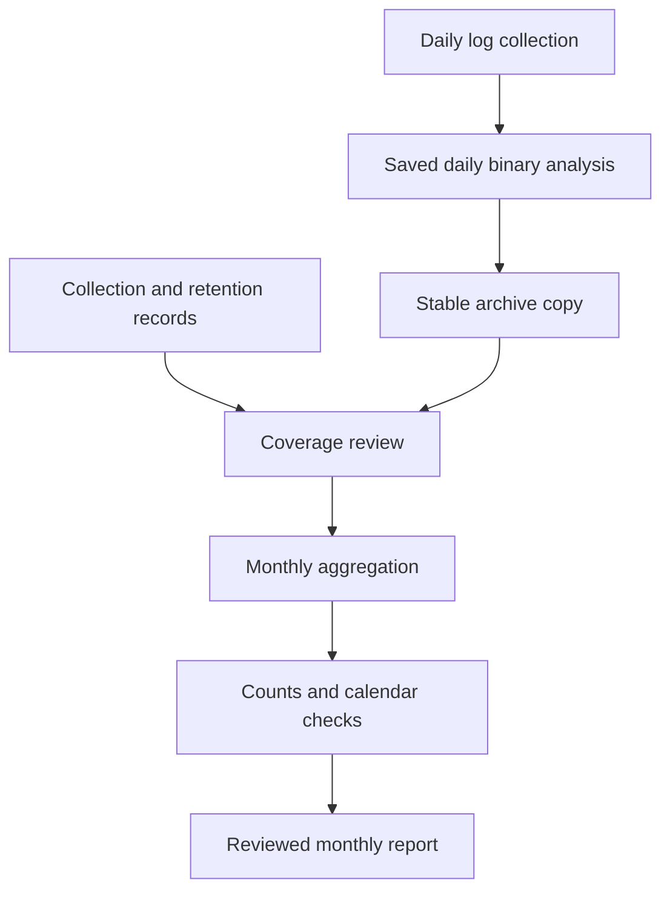

# Build a Monthly pgBadger Report from Saved Binary Data

Author: [nawazdhandala](https://www.github.com/nawazdhandala)

Tags: PostgreSQL, PgBadger, Observability

Description: Build monthly pgBadger reports from retained daily binaries, check coverage before trusting totals, and rebuild safely without rereading PostgreSQL logs.

A monthly database report should answer a simple question: what happened during this month? Having a directory named October does not establish that its contents cover October. Some days might be missing, collection might have stopped halfway through a day, or older data might already have expired.

pgBadger can combine its saved daily analysis into a monthly report without parsing PostgreSQL logs again. This walkthrough uses **pgBadger 13.3**, a protected copy of an incremental archive, and a coverage review before publication. Local synthetic tests confirmed both the successful rebuild and a less obvious failure mode: a missing day's binary can produce a successful but incomplete report.

## Know which files contain the evidence

Incremental mode stores daily binary analysis under year, month and day directories. A binary file is a serialized analysis object: saved counts, query groups and other information the parser collected. It is not a PostgreSQL database backup, and it is not a substitute for every original log record.

The [13.3 monthly-report documentation](https://github.com/darold/pgbadger/blob/v13.3/README) requires the incremental directory structure and its necessary binary files. An archive might look like this:

```text
reports/
  LAST_PARSED
  index.html
  2026/
    10/
      01/
        2026-10-01-12345.bin
        index.html
      15/
        2026-10-15-12345.bin
        index.html
      31/
        2026-10-31-12345.bin
        index.html
```

The filenames are illustrative. Keep the actual names and layout created by your installation. Multiple binary files in a day are not automatically duplicates; they may represent separate processing contributions. Conversely, copying the same binary under another name does not create new activity.



Only load trusted binaries produced by your reporting process. pgBadger uses Perl serialization, and [Storable warns against loading untrusted data](https://metacpan.org/pod/Storable#SECURITY-WARNING). A report attachment from an unknown sender should not be treated like inert text.

## Work from a stable copy

Prerequisites are pgBadger 13.3, read access to your retained archive, enough space for a copy and generated report, and an account permitted to see the SQL samples inside it. Coordinate with the scheduled collector so the source stays unchanged during the copy, or use an established filesystem snapshot process.

Replace both paths below. Choose a new review directory outside the original archive:

```bash
set -euo pipefail
archive=/srv/pgbadger/reports
review=/srv/pgbadger/review-2026-10

if [ -e "$review" ]; then
  echo 'Choose a new, empty review destination.' >&2
  exit 1
fi
cp -R "$archive" "$review"
pgbadger --version
```

The existence check prevents accidentally nesting a copy inside an older review directory. The expected version for this example is 13.3. Do not silently change versions while investigating missing monthly totals; preserve the producing version and parser settings in your collection records.

This copy also keeps calendar and HTML changes away from the live reporting tree. It is still sensitive reporting data, so apply the archive's access controls to the review location.

## Inventory the month before aggregation

Save this as `month_inventory.py`. It uses Python 3.11's [path operations](https://docs.python.org/3.11/library/pathlib.html) to list every calendar day, including days without a binary:

```python
import calendar
import sys
from pathlib import Path

root = Path(sys.argv[1])
year, month = map(int, sys.argv[2].split("-"))
month_dir = root / f"{year:04d}" / f"{month:02d}"
if not month_dir.is_dir():
    raise SystemExit(f"Missing month directory: {month_dir}")

for day in range(1, calendar.monthrange(year, month)[1] + 1):
    folder = month_dir / f"{day:02d}"
    files = sorted(p for p in folder.glob("*.bin") if p.is_file())
    status = f"{len(files)} binary file(s)" if files else "CHECK: no binary"
    print(f"{year:04d}-{month:02d}-{day:02d}: {status}")
```

Run it against the copy:

```bash
python3 month_inventory.py "$review" 2026-10
```

This is an inventory, not a completeness certificate. Match each apparent gap against collection-job results, retained input manifests, outages and retention policy. A genuinely idle day and a failed collector can both leave no useful analysis. A file's presence also does not prove that every hour was collected.

Record the database instances included, logging threshold or sampling policy, time zone used for daily boundaries, and any query exclusions. If one day contains only statements above one second while another contains all statements, a monthly frequency comparison needs that qualification.

## Build the monthly report

For a normal combined incremental archive, run:

```bash
pgbadger -X --month-report 2026-10 "$review"
```

Here, `--month-report` selects the month and `-X` uses separate JavaScript and CSS resources. The argument is the archive root, not its `2026/10` subdirectory. In the tested layout, the command created `2026/10/index.html` and added a month link to the root calendar. Keep the generated assets available when reviewing the page.

The [tagged implementation](https://github.com/darold/pgbadger/blob/v13.3/pgbadger) finds daily directories containing binary files and loads their saved analysis. It does not infer missing days from the calendar or reconstruct them from existing HTML.

If the original archive was generated with per-database reports, repeat that mode:

```bash
pgbadger -E -X --month-report 2026-10 "$review"
```

Use this alternative only for an archive built with `-E`/`--explode`. Review each database's calendar and monthly destination rather than assuming the combined-report path applies. The per-database variant is documented upstream; the local monthly test here exercised the combined layout.

## Check totals, coverage and repeated builds

Our small fixture contained two queries on October 1, one on October 15, three on October 31 and one on November 1. Each query lasted 10 milliseconds. Its October report should therefore contain six queries and 60 milliseconds of recorded query duration, excluding November's query.

The local rebuild produced those totals. Repeating the monthly command did not alter the retained daily binaries or `LAST_PARSED`, the incremental collection state. A second build replaces the monthly presentation; it should not be interpreted as a second month's activity.

Removing the October 15 binary from a disposable copy still allowed the command to succeed. The resulting aggregate contained five queries and 50 milliseconds. This is why the inventory and collection records matter more than the exit status alone.

For your own report, compare selected daily totals with the monthly total, inspect the first and last recorded timestamps, and open the calendar's monthly link. Check query groups, errors and other sections relevant to the review. A chart spanning the first and last day can still hide a gap between them.

## Handle incomplete or changing months explicitly

| Observation | Next action |
|---|---|
| Monthly directory cannot be opened | Check the selected month and archive-root argument |
| HTML exists but no daily binaries remain | Recover retained analysis or reprocess retained logs through a separate, controlled workflow |
| Command succeeds but counts are low | Reconcile missing days, partial collection, filtering and retention |
| Current month's totals increase on each run | Record the cutoff; compare reports with equivalent coverage |
| Counts unexpectedly double | Investigate copied binaries or overlapping source ingestion |

The current month can be rebuilt as new daily analysis arrives, but label it with its collection cutoff. Do not compare it unqualified with a complete previous month. Keep a short report manifest alongside the output: month, snapshot time, parser version, collection policy and unresolved gaps. That context makes the monthly report usable long after the person who generated it has forgotten the details.
