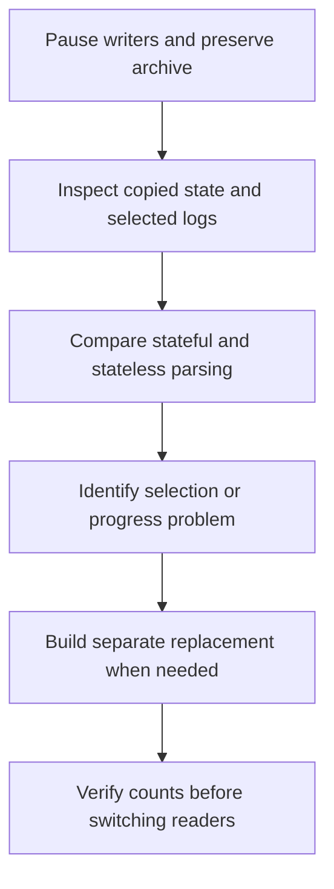

# Fix pgBadger No New Entries After Log Rotation Without Losing History

Author: [nawazdhandala](https://www.github.com/nawazdhandala)

Tags: PostgreSQL, PgBadger, Troubleshooting, Logging

Description: Diagnose stale pgBadger progress with copied state and a stateless control, then recover reporting without replaying logs into existing totals.

The log rotated, new SQL is visible in the file, and pgBadger still says there are no new entries since the last run. Deleting the progress file looks tempting. It can also make a populated reporting archive count its old data again.

The safer approach is to separate three questions: does the selected file contain parseable records, does saved progress exclude those records, and do the retained report statistics already contain them? This guide uses **pgBadger 13.3** and local PostgreSQL standard-error text logs. Its tests use synthetic files, including a copied archive that can be damaged without affecting real reports.

## What the progress file actually remembers

With `--last-parsed`, pgBadger records a timestamp, a file position and the last original log line. Incremental mode, `-I`, uses a `LAST_PARSED` file in its output directory unless you supply another location. [Version 13.3 options](https://github.com/darold/pgbadger/blob/v13.3/README)

That state is more than a filename or an inode, the filesystem's identifier for a file. The implementation compares timestamps and may seek to a saved position or reread a file from the beginning. Compressed input cannot be handled like an ordinary seekable text file. [Progress and rotation logic](https://github.com/darold/pgbadger/blob/v13.3/pgbadger)

Consequently, a different file size does not prove the checkpoint is broken. In the local test, replacing a two-record file with a shorter file containing a newer record worked: the new execution was counted. Conversely, resetting only the offset to zero did not help when the saved timestamp was later than all the candidate records.

## Preserve evidence before running another import

Pause scheduled and manual writers to the affected reporting archive. Record the exact command, pgBadger version, output directory, explicit `--last-parsed` path if present, selected filenames and database instance. Back up state and retained binary statistics together while those writers are stopped.

Check the actual database log destination. PostgreSQL's `current_logfiles`, when present for its logging collector, identifies current destinations. Rotation can reuse filenames, and `log_truncate_on_rotation` can overwrite a matching filename on time-based rotation. A familiar pathname therefore does not prove that today's job selected today's records. [PostgreSQL 18 logging documentation](https://www.postgresql.org/docs/18/runtime-config-logging.html)

Also check the most recent successful report period. If the candidate records are already represented there, “no new entries” can be correct. A missing HTML refresh and missing parsed data are different problems.



## Inspect the timestamp without printing SQL

The progress file can contain a full SQL statement. Avoid pasting it into an incident chat. The following small Python 3 helper prints only the PostgreSQL timestamp and position from a copied pgBadger 13.3 state file. Save it as `inspect_state.py`:

```python
import sys
from pathlib import Path

for line in Path(sys.argv[1]).read_text().splitlines():
    fields = line.split("\t", 2)
    if len(fields) == 3 and fields[0] != "pgbouncer":
        if not fields[1].isdigit():
            raise SystemExit("Unexpected position; inspect the format privately")
        print("saved_timestamp:", fields[0])
        print("saved_position:", int(fields[1]))
        break
else:
    raise SystemExit("No PostgreSQL progress record found")
```

Run it against your copied file:

```bash
python3 inspect_state.py saved.state
```

For a normal record, expect a timestamp and an integer position. The helper does not edit the file or print its SQL-bearing third field. It intentionally does not interpret PgBouncer progress. Its file reading uses Python's standard [pathlib API](https://docs.python.org/3.11/library/pathlib.html).

Compare the saved timestamp with the candidate records and the source instance's clock and log timezone. A timestamp ahead of the incident window could come from a different stream, a prior test, an incorrect clock or legitimately later data. Establish which explanation applies before changing state.

## Run a stateful test and a stateless control

Use a new private working directory and a closed log file. Replace both source paths below. The prefix must match your actual PostgreSQL log format; this example includes timestamp, backend process and connection fields.

```bash
#!/usr/bin/env bash
set -euo pipefail
umask 077

mkdir pgbadger-investigation-20261125
cp /srv/pgbadger/db01/reports/LAST_PARSED \
  pgbadger-investigation-20261125/saved.state
cp /archive/postgresql/candidate.log \
  pgbadger-investigation-20261125/candidate.log

prefix='%m [%p]: user=%u,db=%d,app=%a,client=%h '

pgbadger -v -f stderr -p "$prefix" \
  --last-parsed pgbadger-investigation-20261125/saved.state \
  -o pgbadger-investigation-20261125/with-state.html \
  pgbadger-investigation-20261125/candidate.log

pgbadger -v -f stderr -p "$prefix" \
  -o pgbadger-investigation-20261125/without-state.html \
  pgbadger-investigation-20261125/candidate.log
```

`mkdir` deliberately fails if this investigation directory already exists. The first parser run may update only the copied state. The control uses neither `-I` nor `--last-parsed`, so it parses independently of saved progress. Neither command merges into production statistics. Keep verbose output private too. When all input is skipped, this release can omit the stateful output file entirely; use its verbose message as evidence rather than expecting an empty report.

Interpret the result before attempting a repair:

| Observation | Likely next investigation |
|---|---|
| Both reports have no usable queries | Format, prefix, query logging, selected file or filters |
| Control has queries; stateful report has none | Compare record timestamps with saved progress and existing coverage |
| Both have the expected newer queries | Scheduler command, permissions, different state path or publication destination |
| Records were parsed but HTML is stale | Report-generation or publishing failure rather than raw-log selection |

The control proves only that pgBadger can parse this candidate. It does not prove those executions are missing from the production archive.

## Why editing one field is not a reliable repair

A local fixture created progress dated November 26, then offered two valid November 24 records. Stateless parsing counted two queries; parsing with the copied future state skipped the input and created no report. A second copy with position zero still counted zero. Timestamp filtering remained active.

Do not subtract an arbitrary hour from the timestamp, insert a guessed position or reset every field to zero. The apparent fix can replay old records, skip boundary records or disconnect progress from the binary statistics already accumulated. The original line stored alongside the timestamp is another reason to treat the file as tool-maintained state.

Check for shared state paths between instances and for a restored checkpoint that does not match the restored statistics. Correct the source of the mismatch as part of recovery; otherwise the next scheduled run can recreate it.

## Recover into a separate archive

If the input selection was wrong but the existing state and statistics are consistent, correct the selected files and rehearse the next run on a copy. If historical records were skipped or state consistency cannot be established, rebuild a replacement from the complete retained input set.

Create a new empty directory, prepare a reviewed chronological file list with one copy of each archive, and run:

```bash
pgbadger -I -f stderr \
  -p '%m [%p]: user=%u,db=%d,app=%a,client=%h ' \
  --iso-week-number \
  -O /srv/pgbadger/db01/replacement-20261125 \
  --logfile-list /srv/pgbadger/db01/recovery-inputs.txt
```

The replacement path must not contain existing report statistics. Include the full coverage you intend to retain, not just the file that exposed the problem. When older raw logs are gone, document the unavailable period rather than presenting a partial replacement as complete history.

The local recovery test rebuilt four executions into a fresh archive, and a repeat stayed at four. In a disposable copy of the old populated archive, removing state and replaying those same records increased the total from four to eight. The original archive was preserved.

Compare per-day counts, time coverage, known events and the weekly total before switching readers and the scheduled writer to the replacement. Keep the old archive available for rollback. These checks were local fixture tests, not a live PostgreSQL rotation or a production recovery rehearsal.
