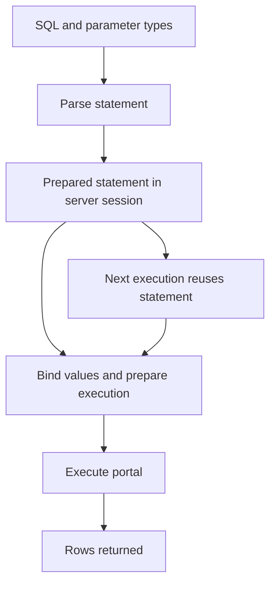

# Separate Parse, Bind, and Execute Time in pgBadger Reports

Author: [nawazdhandala](https://www.github.com/nawazdhandala)

Tags: PostgreSQL, PgBadger, Observability

Description: Read prepared-query phase timings in pgBadger, verify statement reuse with a small driver test, and avoid confusing partial logs or summary ratios with application latency.

A prepared query has work before execution. PostgreSQL must understand the statement, associate parameter values with it, and execute the resulting operation. pgBadger can report those phases separately when the logs contain them. Looking only at execution time can hide preparation or planning costs; adding every reported number to an application timer can also be misleading.

This walkthrough uses **pgBadger 13.3** and **Psycopg 3.2.10**. A disposable PostgreSQL 14.17 instance supplied a live protocol check, while PostgreSQL 18 documentation was reviewed for protocol and logging behavior. The older server was a lab fixture, not a deployment recommendation. Repeat the check on your supported server and actual driver before applying its results operationally.

## Understand the three phases

PostgreSQL's [extended-query protocol](https://www.postgresql.org/docs/18/protocol-flow.html#PROTOCOL-FLOW-EXT-QUERY) separates the work into messages:

| Phase | What it establishes | Interpretation caution |
|---|---|---|
| Parse | A prepared statement from SQL and parameter types | Reuse can avoid repeating this for each execution |
| Bind | Parameter values and a portal, the execution context | Query planning typically happens here; it is not merely copying values |
| Execute | Runs the portal and returns results | A bounded fetch can require further Execute messages |

A named prepared statement can be reused in the same server session. That does not guarantee a new plan is never needed: PostgreSQL can choose between plans tailored to parameter values and [reusable generic plans](https://www.postgresql.org/docs/18/sql-prepare.html). Do not relabel all Parse time as planning or all Bind time as network overhead.



SQL commands named `PREPARE` and `EXECUTE` are related facilities, but typing them into a SQL console is not the same test as observing a driver's protocol messages. Psycopg's [tagged preparation documentation](https://github.com/psycopg/psycopg/blob/3.2.10/docs/advanced/prepare.rst) explicitly describes protocol-level preparation and the `prepare=True` option used below.

## Make the necessary evidence visible in a lab

PostgreSQL logs Parse, Bind and Execute durations independently for clients using the extended protocol. Its [logging reference](https://www.postgresql.org/docs/18/runtime-config-logging.html#GUC-LOG-MIN-DURATION-STATEMENT) explains that a zero `log_min_duration_statement` records all statement durations, while a positive threshold limits what appears.

Use an isolated test database and an account permitted to set the session logging parameters. For this example, the lab has `log_statement=none`, `log_duration=off`, English log messages, and a known log destination. Do not enable unrestricted production logging merely to reproduce a two-query example.

Install the pinned driver in a scratch environment:

```bash
python3 -m venv .venv
.venv/bin/python -m pip install 'psycopg[binary]==3.2.10'
```

Save this as `phase_probe.py`. It runs two read-only expressions with bound parameters and explicitly requests prepared-statement reuse:

```python
import os
import psycopg

with psycopg.connect(
    os.environ["PGBADGER_LAB_DSN"],
    autocommit=True,
    application_name="phase_probe",
    options=(
        "-c log_min_duration_statement=0 "
        "-c log_parameter_max_length=0 "
        "-c statement_timeout=5000"
    ),
) as connection:
    for value in (41, 42):
        row = connection.execute(
            "SELECT %s::integer + 1 AS phase_probe",
            (value,),
            prepare=True,
        ).fetchone()
        print(row[0])
```

The options apply to this connection. They request complete duration evidence, suppress parameter values in normal statement logging, and impose a five-second statement timeout. They do not modify the cluster's persistent configuration. Autocommit avoids adding explicit transaction commands to this small demonstration.

Set the connection string using an existing lab service definition or your approved local connection configuration. The service below is a placeholder you must configure; do not put passwords into shared shell history:

```bash
export PGBADGER_LAB_DSN='service=pgbadger-lab'
.venv/bin/python phase_probe.py
```

Expect `42` and `43` on separate lines. In the local run, the database log contained one Parse, two Binds and two Executes for the same named statement. That establishes reuse for this connection. It says nothing yet about connection pools, statement eviction or later plan invalidation in another workload.

## Generate a report containing only the probe

Replace the log path and prefix. The prefix here matches the lab's plain-text logs:

```bash
log_file=/archive/postgresql/phase-probe.log
prefix='%m [%p]: user=%u,db=%d,app=%a,client=%h '

pgbadger -f stderr -p "$prefix" \
  --include-query 'phase_probe' -o phases.html "$log_file"
```

The query filter selects the probe's SQL text across its phase records. Check the log itself too, using its process or session identifier to avoid mixing unrelated connections that happen to use the same statement name.

In the report's duration figures, look for **Prepare/parse total duration**, **Bind total duration** and **Execute total duration**. The [13.3 parser](https://github.com/darold/pgbadger/blob/v13.3/pgbadger) maps logged `parse` records into its `prepare` duration category. Its prepare/bind detail sections can then help identify which SQL shapes incur that work.

## Reconcile known totals before diagnosing a workload

A second, synthetic fixture used deliberately visible durations:

| Recorded operation | Duration |
|---|---:|
| Initial Parse | 2 ms |
| First Bind | 3 ms |
| First Execute | 10 ms |
| Second Bind | 4 ms |
| Second Execute | 20 ms |

pgBadger reported two queries, 2 ms of preparation, 7 ms of binding and 30 ms of execution, with a total query duration of 39 ms. The query count did not become five merely because five phase records were present.

The live probe was much faster. Its logged phase sums were fractions of a millisecond, and pgBadger's JSON duration values matched them, while the HTML's whole-millisecond presentation showed zeros. Inspect precision before treating a displayed zero as absence of work.

We also observed a version-specific reporting limitation: the HTML summary's bind-versus-prepare ratio displayed `0.00` despite the known one-Parse/two-Bind sequence. The phase chart contained the expected counts. Reconcile the underlying phase records and duration totals rather than using that summary ratio alone to claim reuse is working or broken.

## Recognize incomplete evidence

To model a five-millisecond threshold, we retained only the synthetic 10 ms and 20 ms Execute records. The resulting report still contained two queries, but its recorded preparation and binding totals were zero. Their costs had fallen below the logging cutoff; the operations had not disappeared.

This affects comparisons across services and days. Record the logging threshold, sampling policy, driver version, preparation settings and connection-pool behavior with each analysis. A change in these settings can alter phase counts without changing the SQL itself.

| Observation | Useful next investigation |
|---|---|
| Many Parses relative to executions | Connection churn, preparation settings or statement reuse lifetime |
| Bind duration dominates | Planning behavior, parameter-sensitive plans and statement complexity |
| Execute duration dominates | Query plan, waits, data access and result volume |
| Application time exceeds recorded phases | Pool waits, network transfer, client processing and missing log records |

These are investigation directions, not diagnoses. Summed server phase durations are not a complete application request timer: they exclude some client-side work and may reflect partial logging or multiple fetch operations. Use application traces and database evidence together. The practical goal is to identify which phase deserves investigation while keeping the measurement's scope and missing evidence explicit.
