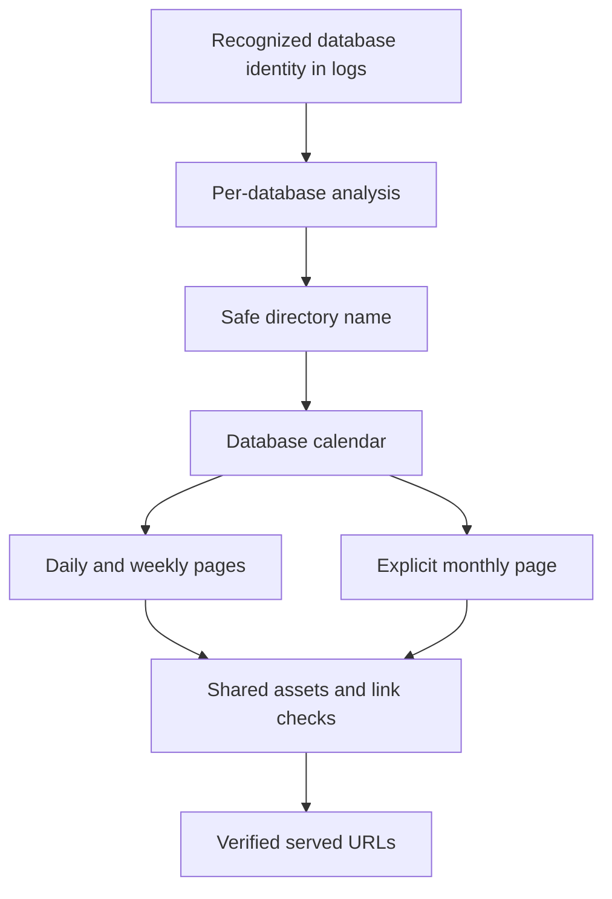

# Generate pgBadger Reports per Database and Check Calendar Links

Author: [nawazdhandala](https://www.github.com/nawazdhandala)

Tags: PostgreSQL, PgBadger, Observability

Description: Generate per-database pgBadger reports, find each database's calendar, and verify encoded directory names, monthly links and shared assets before publication.

A report directory can exist while its calendar links are wrong. With per-database pgBadger output, there is another prerequisite: the parser must actually recognize every database name in the input. Otherwise a perfectly working calendar can describe only part of the workload.

This tutorial uses **pgBadger 13.3** with PostgreSQL JSON-format logs. It checks the full path from database identity to report directory to browser URL. Local synthetic tests covered ordinary names, a numeric name and names containing slashes. They also checked daily and monthly totals before accepting the generated links.

## Understand what per-database mode produces

The `-E`/`--explode` option creates separate reports for each database. In incremental mode, each database gets its own directory and calendar. Do not assume there will be one root `index.html` listing all databases; the tested layout had calendars inside the database directories instead.

The [official per-database documentation](https://github.com/darold/pgbadger/blob/v13.3/README) also explains that global information not associated with a database is assigned to the `postgres` report. A cluster-level event does not become activity in every application database merely because several databases share the instance.



This is report organization, not an authorization system. Restrict access through the serving application if teams should see different databases.

## Validate the input format first

The command below expects PostgreSQL JSON logs containing timed SQL records. PostgreSQL's [JSON logging documentation](https://www.postgresql.org/docs/18/runtime-config-logging.html#RUNTIME-CONFIG-LOGGING-JSONLOG) describes fields including `dbname`, `message` and timestamps. It also requires the logging collector for JSON-format output. Use a closed log already collected under your approved logging policy; this walkthrough does not enable exhaustive production logging.

A custom plain-text prefix can impose its own parsing limits. In the tested 13.3 `%d` prefix matcher, names containing `/` were not recognized. The same synthetic database names were processed using JSON input. That is a reason to verify representative names and counts, rather than conclude that a missing database simply had no activity.

Prepare new absolute output directories. Their parent directories must exist and be writable by the reporting account:

```bash
set -euo pipefail
state=/srv/pgbadger/private/perdb
html=/srv/pgbadger/staging/perdb
log_file=/archive/postgresql/closed.json

if [ -e "$state" ] || [ -e "$html" ]; then
  echo 'Choose unused output directories.' >&2
  exit 1
fi
mkdir "$state" "$html"
pgbadger -E -I -X -f jsonlog \
  -O "$state" -H "$html" "$log_file"
```

Replace all three paths. `-I` enables incremental reporting, `-O` retains binary analysis and collection progress, and `-H` separates HTML output. `-X` places shared JavaScript and CSS in separate files. Keep the state directory private and publish only reviewed presentation files.

For a normal database named `shop`, expect `$html/shop/index.html` to be its calendar and `$html/shop/2026/11/23/index.html` to be a daily report. Date paths depend on the actual log data.

## Distinguish names, directory names and URLs

pgBadger 13.3 encodes database names that would create unsafe paths or collide with its own directory layout. The [tagged path-building functions](https://github.com/darold/pgbadger/blob/v13.3/pgbadger) distinguish a filesystem directory name from a URL path segment.

The tested examples were:

| Database name | Directory name | Calendar URL path relative to serving root |
|---|---|---|
| `shop` | `shop` | `/shop/index.html` |
| `2025` | `%32025` | `/%2532025/index.html` |
| `tenant/eu` | `tenant%2Feu` | `/tenant%252Feu/index.html` |
| `../escape` | `%2E.%2Fescape` | `/%252E.%252Fescape/index.html` |

The unusual names are test cases, not naming recommendations. A percent sign in an actual directory name must itself be represented as `%25` in a URL. Removing that layer can make the server look for a different file. Do not rename generated directories to make the URLs prettier or repeatedly decode a path until it resembles the original database name.

Within each database calendar, ordinary date links are relative to that calendar. Shared assets are above the database directories. Preserve the directory tree when publishing; copying only a daily page can break both navigation and styling.

## Rebuild with the same per-database setting

Keep `-E` on later rebuilds and monthly generation:

```bash
pgbadger -E -I -X -O "$state" -H "$html" --rebuild
pgbadger -E -I -X -H "$html" \
  --month-report 2026-11 "$state"
```

The first command rebuilds eligible daily and weekly pages from retained analysis. The second adds the selected monthly report and its calendar link. Replace the month and check that the necessary binaries remain available. Neither command can restore a day whose analysis was already deleted.

## Check local destinations before publishing

Save this as `check_report_links.py` and use Python 3.11. It prints encoded calendar entry URLs, then checks local page and asset references. It uses the standard [HTML parser](https://docs.python.org/3.11/library/html.parser.html) and [URL parsing functions](https://docs.python.org/3.11/library/urllib.parse.html).

```python
import sys
from html.parser import HTMLParser
from pathlib import Path
from urllib.parse import quote, unquote, urlsplit

class Links(HTMLParser):
    def __init__(self):
        super().__init__()
        self.urls = []

    def handle_starttag(self, tag, attrs):
        key = {"a": "href", "link": "href", "script": "src"}.get(tag)
        value = dict(attrs).get(key) if key else None
        if value:
            self.urls.append(value)

root = Path(sys.argv[1]).resolve()
pages = sorted(root.rglob("*.html"))
if not pages:
    raise SystemExit("No HTML reports found")
for calendar in sorted(root.glob("*/index.html")):
    print("/" + quote(calendar.relative_to(root).as_posix(), safe="/"))

checked = 0
for page in pages:
    parser = Links()
    parser.feed(page.read_text(encoding="utf-8"))
    for href in parser.urls:
        url = urlsplit(href)
        if url.scheme or url.netloc or not url.path:
            continue
        path = unquote(url.path)
        target = (root / path.lstrip("/") if path.startswith("/")
                  else page.parent / path).resolve()
        if target.is_dir():
            target = target / "index.html"
        if root not in target.parents or not target.is_file():
            raise SystemExit(f"Broken local link in {page}: {href}")
        checked += 1
print(f"Checked {checked} local references in {len(pages)} pages")
```

Run it on the complete HTML tree:

```bash
python3 check_report_links.py "$html"
```

It decodes a URL path once when mapping it to disk. It skips external URLs and in-page anchors, and fails on missing destinations or paths outside the root. It does not execute JavaScript, validate anchor names or simulate reverse-proxy rewriting.

## Confirm the reports describe the right databases

Our JSON fixture contained seven queries: three for `shop`, two for `2025`, and one for each slash-containing name. The monthly HTML showed those separate counts. The generated calendars, report links and assets resolved locally. URL-encoded calendar entry points also worked through a temporary loopback HTTP server; this was not a production authentication or browser test.

Check known query counts and representative SQL for your own databases before relying on links alone. Keep auxiliary exports private until inspected: in this version's test, a JSON report emitted beneath one database directory still contained aggregate structures for other databases. A directory name does not prove that every format inside it is restricted to that database.

Finally, follow each published calendar through the actual authenticated web route, including one encoded-name case and one weekly or monthly link. Verify charts and asset requests. If local checks pass but served links fail, investigate URL decoding, path prefixes, routing and publication completeness before editing the generated HTML.
