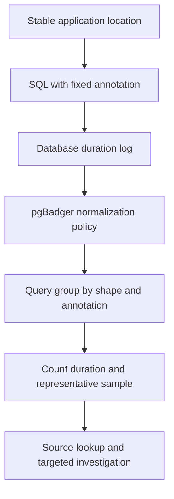

# Preserve SQL Comments in pgBadger to Find Application Code

Author: [nawazdhandala](https://www.github.com/nawazdhandala)

Tags: PostgreSQL, PgBadger, Observability

Description: Preserve useful SQL annotations in pgBadger, distinguish query groups from raw samples, and trace slow statements to stable application locations without excessive groups.

A slow query can be easy to recognize and hard to locate in the application. Several handlers may issue the same SQL, perhaps through a shared repository method. A small annotation can tell the person reading the report which service and code path produced a statement.

pgBadger can preserve SQL comments in normalized query groups with `--keep-comments`. However, preserving a comment does not mean preserving every character unchanged, and adding a unique request identifier can make the report much harder to use. This tutorial tests **pgBadger 13.3** and develops a stable tagging approach with a reproducible log fixture.

## Distinguish the query sample from its group

A raw sample shows a particular statement recorded in the logs. A normalized query groups similar statements after transformations such as replacing ordinary literal values with placeholders. These serve different purposes: a sample helps inspect one execution, while a group summarizes a recurring SQL shape.

The [pgBadger option reference](https://github.com/darold/pgbadger/blob/v13.3/README) says `--keep-comments` retains comments in normalized queries. The separate `-C`/`--nocomment` option removes block comments from queries. Do not combine the options when your intention is to preserve annotations.

For example, two application paths might produce these statements. They assume an existing `orders` table with `total` and `id` columns:

```sql
/* service=checkout route=order-read source=orders_repository.find */
SELECT total FROM orders WHERE id = 42;

/* service=worker route=order-sync source=orders_repository.find */
SELECT total FROM orders WHERE id = 73;
```

The annotations identify stable application locations. The SQL values still differ normally. PostgreSQL treats comments as whitespace during parsing, as described in its [SQL lexical documentation](https://www.postgresql.org/docs/18/sql-syntax-lexical.html#SQL-SYNTAX-COMMENTS).

Keep annotations as fixed strings controlled by application code. Continue binding query values through your driver's parameter interface. Never concatenate arbitrary request data into a comment: it can expose private data or contain characters that terminate the comment.



## Choose a small annotation vocabulary

Start with service, route or job name, and a logical source identifier. Use a route template or handler name rather than the complete requested URL. A source identifier can point to a repository method without embedding a developer's home directory or an absolute build path.

Keep spelling and key order consistent. Decide how source identifiers map to the deployed version of the code, especially when several releases are running together. The annotation is a lookup hint, not proof of identity or a complete distributed trace.

| Candidate field | Useful for grouped reports? | Reason |
|---|---|---|
| Stable service name | Usually | Connects workload to an owner |
| Handler or scheduled-job name | Usually | Separates recurring application paths |
| Logical repository method | Usually | Gives a maintainable source-code lookup |
| Customer email or access token | No | Exposes private or secret information |
| Unique request or trace ID | Often unsuitable as a grouping tag | Can create one group per execution |

Framework instrumentation may already add SQL comments. For example, [sqlcommenter](https://google.github.io/sqlcommenter/) associates SQL with framework and request context. Inspect its actual output before enabling comment-based grouping; its annotation format and your report's normalization rules may interact.

## Reproduce the grouping behavior without a database

The following Python 3.11 script creates five synthetic duration records. It does not execute SQL. Save it as `make_comment_fixture.py` and run it in a scratch directory:

```python
from pathlib import Path

tags = [
    "service=checkout route=order-read source=orders_repository.find",
    "service=checkout route=order-read source=orders_repository.find",
    "service=worker route=order-sync source=orders_repository.find",
    "service=worker route=order-sync source=orders_repository.find",
    "",
]
with Path("comments.log").open("x", encoding="utf-8") as output:
    for number, tag in enumerate(tags, start=1):
        annotation = f"/* {tag} */ " if tag else ""
        output.write(
            f"2026-11-25 10:00:{number:02d}.000 UTC [81]: "
            "user=app,db=shop,app=probe,client=local LOG:  "
            f"duration: {number}.000 ms  statement: "
            f"{annotation}SELECT total FROM orders WHERE id = {number};\n"
        )
```

The exclusive `"x"` mode refuses to overwrite an existing fixture. Each record has a distinct timestamp and a known duration, totaling five statements and 15 milliseconds.

Generate two reports from the same file:

```bash
python3 make_comment_fixture.py
prefix='%m [%p]: user=%u,db=%d,app=%a,client=%h '

pgbadger -f stderr -p "$prefix" \
  -o default.html comments.log
pgbadger -f stderr -p "$prefix" --keep-comments \
  -o with-comments.html comments.log
```

In the local 13.3 test, the default analysis produced one normalized group. Keeping comments produced three: checkout with two executions, worker with two, and the unannotated statement with one. The total count and duration stayed five and 15 milliseconds. Grouping changed; the workload did not.

Inspect normalized query headings and representative samples, not just the top few slowest statements. A default report can retain a comment in a raw sample even when its grouped query no longer distinguishes application paths.

## Check quoted tags and dynamic values

`--keep-comments` leaves other normalization steps active. The [13.3 normalization code](https://github.com/darold/pgbadger/blob/v13.3/pgbadger) lowercases unquoted text and replaces quoted string content. In a second fixture, annotations using `service='checkout'` and `service='worker'` both normalized to `service=?`; quoted route values likewise became placeholders. Those four annotated executions collapsed into one annotated group, plus the separate unannotated group.

Do not assume a standardized quoted annotation becomes an unchanged grouping key. If you need its exact original value, inspect retained samples and the original logs. The fixed, unquoted vocabulary above is a deliberately simple application convention, not a claim to implement the sqlcommenter specification.

Another test used 20 distinct request identifiers inside otherwise identical comments. Keeping comments produced 20 groups for the same SQL shape. This increases the number of groups, often called cardinality. It can fragment rankings, enlarge analysis state and obscure the recurring operation you wanted to investigate. Preserve request-level correlation in an appropriate trace or log system when aggregate SQL reporting needs stable categories.

## Keep the policy consistent across collection

Apply the chosen comment policy when parsing new logs. In an additional test, a binary analysis created with default normalization still contained one group when rendered later with `--keep-comments`. Rendering does not recover the per-tag counts that were previously merged.

For an incremental archive, document the date on which annotation and grouping policies change. Comparing group counts before and after that date without qualification would confuse an instrumentation change with a workload change. Reprocessing retained logs into a separate analysis is an option when a consistent historical view is necessary.

Before rolling out broadly, verify that the annotation reaches the actual PostgreSQL log through your driver, object-relational mapper and any proxy. Those components can transform the SQL before the database sees it. Our checks exercised synthetic logs and pgBadger locally; they did not validate a production driver or application deployment.

Use the resulting report to choose a concrete investigation: locate the named method, compare its duration and frequency with another caller, and inspect representative SQL. Keep the source mapping small and maintained. An annotation that reliably points to a few stable code paths is more useful than a report filled with unique identifiers nobody can group meaningfully.
