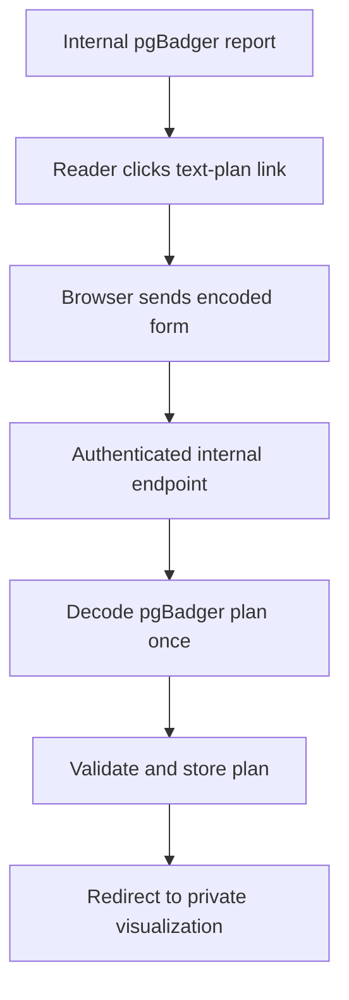

# Connect pgBadger Explain Links to a Private Plan Visualizer

Author: [nawazdhandala](https://www.github.com/nawazdhandala)

Tags: PostgreSQL, PgBadger, Observability, Security

Description: Redirect pgBadger plan links to an internal visualizer, adapt its encoded form payload, and verify routing and privacy boundaries before sharing database plans.

An execution plan can reveal table names, predicates and operational details. When a report offers an explain-plan link, the destination matters just as much as the report's own location. Hosting pgBadger internally does not automatically make every link inside its HTML internal.

In **pgBadger 13.3**, `--explain-url` changes the destination of a form submitted by the reader's browser. It does not convert the payload into whatever format another visualizer expects. This tutorial checks that contract and provides a small adapter for the **explain.dalibo.com v2.22.0 Flask service**, running on your own infrastructure. It assumes the service is already installed and protected; it is not a deployment recipe for the public site.

## Identify what the browser sends

The [tagged pgBadger source](https://github.com/darold/pgbadger/blob/v13.3/pgbadger) generates a POST form containing these fields:

| Field | Generated value | Meaning for integration |
|---|---|---|
| `plan` | Filled when the explain link is clicked | Contains a percent-encoded text plan |
| `is_public` | `0` | A form field, not an access-control guarantee |
| `is_anon` | `0` | Does not request anonymization |

The default destination is `https://explain.depesz.com/`. Changing it affects newly generated HTML. It does not rewrite reports that were generated earlier.

There are two encoding layers: pgBadger encodes the plan into a JavaScript string, then the browser encodes that string as form data. A web framework removes the form-encoding layer, leaving the plan's percent escapes. A compatible receiver must account for that remaining layer exactly once.



In this release, the outgoing link is generated for text-format plans. Other captured plan formats can remain visible in the report without receiving the same submission link. Test with a known text plan first.

## Match the receiving application, not just its homepage

The [Dalibo v2.22.0 service](https://github.com/dalibo/explain.dalibo.com/blob/v2.22.0/app/__init__.py) accepts ordinary uploads at `/new`, validates a `plan` field, stores the submission, and redirects to `/plan/<id>`. Its homepage is not the upload endpoint. The standalone PEV2 visualization component is also different from this Flask application with storage and routes.

Directly changing pgBadger's destination to `/new` is insufficient for this pinned combination. In our local form-path test, `/new` passed the still-encoded plan into storage. The service expects plan text, so the adapter below performs the additional decoding only on a dedicated pgBadger route.

Use the service tag above as the reference for the edit. Check changes again when upgrading either component; this adapter is an integration patch, not an upstream pgBadger option.

## Add a dedicated adapter route

In the service's `app/__init__.py`, change the existing `save` function signature to:

```python
def save(json=False, form=None):
```

Inside that function, replace its existing `form = PlanForm()` line with this conditional, keeping the rest of the function unchanged:

```python
if form is None:
    form = PlanForm()
```

Indent that conditional inside the function. Existing `/new` and `/new.json` callers continue creating their normal forms. The adapter can now pass an explicitly prepared form through the same validation and storage logic.

Add the following imports and route in the same module, where `app`, `abort`, `PlanForm` and `save` already exist:

```python
from urllib.parse import unquote
from flask import request

@app.route("/from-pgbadger", methods=["POST"])
def from_pgbadger():
    if request.mimetype != "application/x-www-form-urlencoded":
        abort(415)
    values = request.form.copy()
    if not values.get("plan", "").strip():
        abort(400)
    try:
        values["plan"] = unquote(values["plan"], errors="strict")
    except UnicodeDecodeError:
        abort(400)
    return save(form=PlanForm(formdata=values))
```

[Flask-WTF accepts explicit form data](https://flask-wtf.readthedocs.io/en/1.2.x/api/), and Python's [unquote function](https://docs.python.org/3.11/library/urllib.parse.html#urllib.parse.unquote) performs the percent decoding. Use `unquote`, not repeated decoding until the text looks readable. A literal `%20` inside the original plan must remain literal data rather than becoming a space. This adapter also preserves literal plus signs.

The endpoint rejects empty submissions, invalid UTF-8 escapes and the wrong content type. It does not establish that the submitted text is a valid PostgreSQL plan. It relies on the existing form and downstream viewer for their respective processing.

## Keep the service private at its actual boundary

Place the new route behind the same authenticated internal ingress as the viewer and stored-plan pages. Apply request-size limits suitable for your plans and retain your existing protections against unwanted browser submissions. The stock service configuration and this patch are not a complete authentication or cross-site request protection design.

In particular, a pgBadger-generated form does not include your application's custom anti-forgery token. If your deployment requires one, provide an approved authenticated handoff that obtains it; do not disable existing protection merely to make the link work.

The service's save path marks plans as nonpublic, but that is not equivalent to authenticating readers of `/plan/<id>`. Review stored-plan retention and access, use a deployment-specific secret, and keep optional analytics disabled for a private installation. These are properties of your service deployment, not settings supplied by `--explain-url`.

## Generate a report with the internal destination

Replace the internal hostname, log path and prefix. The input must contain a captured text-format plan:

```bash
explain_url='https://plans.monitoring.example/from-pgbadger'
log_file=/archive/postgresql/with-text-plan.log
prefix='%m [%p]: user=%u,db=%d,app=%a,client=%h '

pgbadger -f stderr -p "$prefix" \
  --explain-url "$explain_url" -o internal-plans.html "$log_file"
```

The `.example` hostname is a placeholder. Point it at your deployed adapter, with a certificate the reader's browser trusts. Report generation is local; the browser sends the plan only when the submission link is used.

Check the generated form before distributing the report. Save this as `check_destination.py` and run it with Python 3.11:

```python
import sys
from html.parser import HTMLParser
from pathlib import Path

class Forms(HTMLParser):
    def __init__(self):
        super().__init__()
        self.actions = []

    def handle_starttag(self, tag, attrs):
        if tag == "form":
            fields = dict(attrs)
            self.actions.append((fields.get("method", "get").lower(),
                                 fields.get("action", "")))

parser = Forms()
parser.feed(Path(sys.argv[1]).read_text(encoding="utf-8"))
if parser.actions != [("post", sys.argv[2])]:
    raise SystemExit(f"Unexpected submission destinations: {parser.actions}")
print("Plan submission destination matches")
```

```bash
python3 check_destination.py internal-plans.html "$explain_url"
```

This checks the form destination, not every outbound resource or the presence of a usable captured plan. Regenerate historical daily, weekly and monthly reports with the same destination setting if they also need updated links.

## Test the complete handoff with nonsensitive evidence

Our local tests used the pinned Flask application's actual routing and form processing with a stubbed storage operation. They verified the saved plan text, private flag and redirect, including literal percent text, a plus sign and non-ASCII characters. Normal uploads remained unchanged. Empty, invalid-encoding, wrong-method and wrong-content-type cases were rejected. No production database or browser visualization was exercised.

For deployment acceptance, use a harmless captured plan and follow the link through your real authenticated route. Confirm the POST reaches the adapter, the redirect stays internal, and the viewer displays the expected plan rather than percent escapes. Inspect browser requests for external destinations and test with an expired login session too: a login redirect must not silently lose the submitted plan.

If the report contains no link, check its plan format and captured data. If the service returns 404 or 405, check the exact route and method. If a page opens but the plan is unreadable, compare the received text before changing parser settings. Keep the original report and payload contract available so each failure can be traced to the correct stage.
