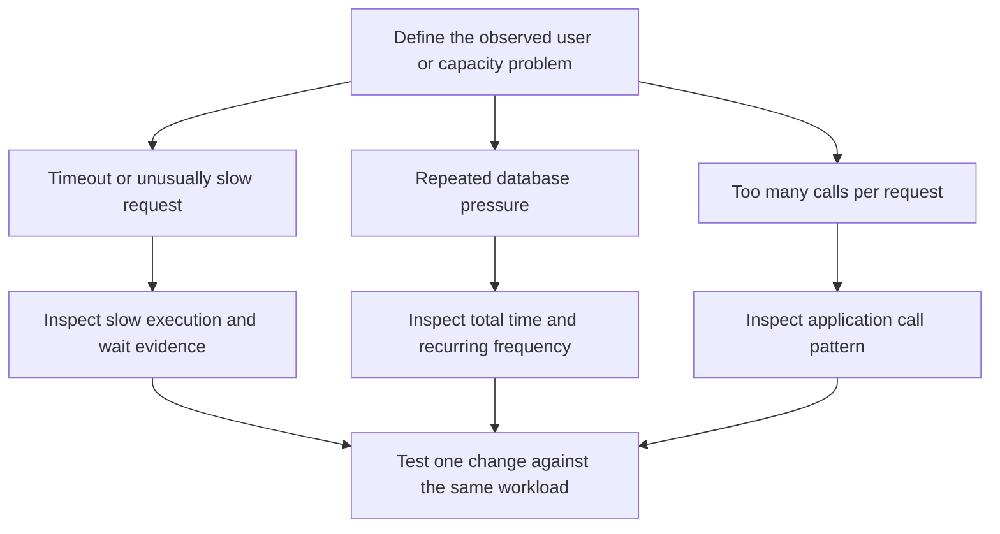

# Which pgBadger Query Ranking Should You Fix First?

Author: [nawazdhandala](https://www.github.com/nawazdhandala)

Tags: PostgreSQL, PgBadger, Performance, Troubleshooting

Description: Choose between pgBadger's slowest, most frequent and total-time query rankings using a reproducible example and an evidence-based tuning workflow.

The first query in a slow-query report is not automatically the best optimization target. One statement might take three seconds once, while another takes only 100 milliseconds but runs hundreds of times. A third may be fast individually yet waste work through repeated calls.

Choose the ranking that matches the problem you are trying to solve. For an interactive timeout, inspect the slow execution. For recurring database pressure, inspect total time and frequency. For an application issuing too many database calls, investigate why those calls exist before tuning each one.

This guide uses **pgBadger 13.3**. The examples were executed against synthetic logs, not a database benchmark. They demonstrate how rankings answer different questions.

## Understand what each list measures

pgBadger provides individual slow-query examples and rankings of grouped queries. Grouping, also called normalization, combines similar statements whose literal values differ. For example, requests for different `id` values can appear under one query shape.

| Ranking | What it helps find | What it cannot establish alone |
|---|---|---|
| Slowest executions | Exceptional delays and incident examples | Whether the query dominates everyday work |
| Most frequent queries | Repeated calls and possible unnecessary round trips | Whether those calls are expensive |
| Queries taking the most total time | Large accumulated contributions in the observed workload | Whether that time was CPU work, waiting, or user-visible delay |

The available report sections and grouping behavior are defined by the pinned parser. Inspect the actual SQL samples behind a grouped row before proposing a change. [pgBadger reports](https://github.com/darold/pgbadger/blob/v13.3/README), [13.3 implementation](https://github.com/darold/pgbadger/blob/v13.3/pgbadger)

A sum of statement durations is not elapsed wall time for the incident. Concurrent statements overlap. It is also not a measurement of CPU consumption: a long statement can spend time waiting. Use resource and wait evidence to explain the ranking.

## Reproduce three different winners

Use Python 3.11 and pgBadger 13.3 in a disposable directory. Save the following as `make_demo.py`. It creates artificial duration records and does not connect to PostgreSQL or execute the displayed SQL. The exclusive file mode refuses to overwrite an existing demo log.

```python
from datetime import datetime, timedelta, timezone
from pathlib import Path

workloads = [
    ("lookup", 1000, 2),
    ("batch", 50, 100),
    ("export", 1, 3000),
]
clock = datetime(2026, 11, 25, 10, tzinfo=timezone.utc)

with Path("ranking-demo.log").open("x", encoding="utf-8") as log:
    for table, calls, duration_ms in workloads:
        for key in range(calls):
            clock += timedelta(milliseconds=duration_ms + 1)
            stamp = clock.strftime("%Y-%m-%d %H:%M:%S.%f")[:-3]
            log.write(
                f"{stamp} UTC [81]: user=app,db=shop,"
                "app=demo,client=local LOG:  "
                f"duration: {duration_ms:.3f} ms  statement: "
                f"SELECT * FROM {table} WHERE id = {key};\n"
            )
```

Each tuple specifies a query shape, its call count and its duration in milliseconds. Changing only the key lets pgBadger group repeated executions while keeping the three table names distinct.

Run the generator and create the report:

```bash
python3 make_demo.py
pgbadger -f stderr \
  -p '%m [%p]: user=%u,db=%d,app=%a,client=%h ' \
  -o ranking-demo.html ranking-demo.log
```

The result should contain 1,051 executions, three normalized query groups and ten seconds of accumulated query duration:

| Query shape | Calls | Duration per call | Total duration | Leads which ranking? |
|---|---:|---:|---:|---|
| `lookup` | 1,000 | 2 ms | 2 seconds | Frequency |
| `batch` | 50 | 100 ms | 5 seconds | Total time |
| `export` | 1 | 3,000 ms | 3 seconds | Slowest |

This is why opening only the slowest list can miss the largest recurring contributor. It is also why optimizing the most frequent query without considering its cost can disappoint.

## Decide which problem matters now



If `export` is a background task with an acceptable three-second completion time, it may not need immediate work. If the same query runs in checkout and exceeds the request deadline, its low frequency does not make the failure unimportant. Link the example to the affected request or job.

For `batch`, reducing the representative execution from 100 to 50 milliseconds would save an estimated 2.5 seconds across 50 calls. Reducing `lookup` from two to one millisecond would save one second across 1,000 calls. Those are arithmetic estimates for this fixed workload, not promised CPU savings or production improvements.

For `lookup`, inspect whether one application request fetches rows one at a time. Reducing unnecessary calls through batching may help more than optimizing an already short query. Validate correctness, response size and cache freshness before changing that behavior. A frequent query can also be entirely appropriate for a busy endpoint.

## Check whether logging changed the winner

A report describes the records it received. If PostgreSQL logs only statements lasting at least 100 milliseconds, the two-millisecond lookup calls disappear. The apparent most frequent query is then `batch`, even though the complete workload contains far more lookup calls.

A local control test retained only records meeting that threshold. pgBadger reported 51 executions, two groups and eight seconds, rather than 1,051 executions, three groups and ten seconds. This reproduces selection bias without changing a live server.

PostgreSQL also supports sampled statement logging. A thresholded or sampled report should not be presented as a complete query census. Record the logging configuration, input window and filters alongside the ranking. [PostgreSQL duration thresholds and sampling](https://www.postgresql.org/docs/18/runtime-config-logging.html)

Where `pg_stat_statements` is already installed and accessible, its `calls` and `total_exec_time` can provide another view. Compare deltas over a matching interval and account for resets, entry eviction and database/user grouping. Do not expect its query IDs or aggregation to match pgBadger fingerprints automatically. [pg_stat_statements statistics](https://www.postgresql.org/docs/18/pgstatstatements.html)

## Turn the ranking into a testable change

Take a representative SQL example and record its parameters, database, application and incident time. A normalized group can contain inputs with very different row counts. Testing only a small, convenient parameter value can conceal the real problem.

Inspect a plan in an appropriate test environment. Plain `EXPLAIN` shows the planned work; `EXPLAIN ANALYZE` executes the statement and reports observed behavior. Use the latter only where execution and its side effects are authorized. Look for excessive rows, inaccurate estimates, repeated loops, disk spills and waiting evidence rather than assuming every slow query needs a new index. [Using EXPLAIN](https://www.postgresql.org/docs/18/using-explain.html)

After the change, compare the same workload mix, logging policy and time coverage. Check calls, total time and slow examples together. A lower mean with more calls can still increase total work; a lower total with fewer users may not reflect an improvement.

Finally, verify the outcome that motivated the work: fewer timeouts, lower request latency, less resource pressure or a faster scheduled job. The ranking is a way to choose and explain the next experiment. Its position alone is not the success criterion.
