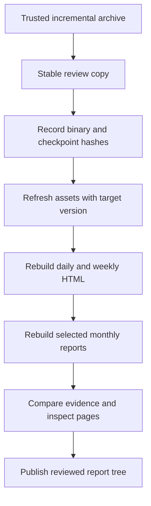

# Rebuild pgBadger HTML After an Upgrade Without Reprocessing Logs

Author: [nawazdhandala](https://www.github.com/nawazdhandala)

Tags: PostgreSQL, PgBadger, Observability

Description: Rebuild pgBadger reports from saved analysis after an upgrade, refresh the correct assets, preserve collection state, and identify reports that cannot be rebuilt.

Upgrading the pgBadger executable does not upgrade every report already on disk. Existing HTML pages still contain the old presentation, and shared JavaScript or CSS files can survive an otherwise successful rebuild. At the same time, an attractive new page does not mean old logs have been parsed with new logic.

Treat the operation as a presentation rebuild with a defined input archive. This tutorial tests **pgBadger 13.2 to 13.3**, using daily binaries produced by 13.2 and rebuilding them under 13.3. It covers an incremental archive with combined reports and separate page assets. The version pair matters: the successful fixture is evidence for this case, not a guarantee that every historical binary format will work with every future release.

## Separate saved analysis from generated pages

Incremental reporting maintains three kinds of state:

| Files | Purpose | Upgrade treatment |
|---|---|---|
| Daily `.bin` files | Previously parsed analysis | Retain and verify unchanged |
| `LAST_PARSED` | Collection progress | Preserve so collection does not accidentally restart |
| HTML, JavaScript and CSS | Presentation of saved analysis | Regenerate and review together |

The [official rebuild instructions](https://github.com/darold/pgbadger/blob/v13.3/README) use `--rebuild` with incremental mode. The command finds days with retained binary data and generates their reports again. It does not revisit the original PostgreSQL log records.

Consequently, a rendering correction can improve old reports without reprocessing logs. A parser correction cannot recover events the earlier parser never saved. Neither can a rebuild restore SQL samples excluded by the original collection settings. Decide which kind of change you need before promising historical corrections to report consumers.



## Prepare a versioned review copy

Install the target executable separately and confirm its version. The [13.3 release](https://github.com/darold/pgbadger/releases/tag/v13.3) identifies the target used here. Keep the previous executable and published report tree available until review is complete.

Replace the paths below. The source must be a stable snapshot or an archive whose reporting writer is paused for the copy. This example assumes pgBadger owns the entire report directory; it is not a procedure for moving a shared web application's assets.

```bash
set -euo pipefail
archive=/srv/pgbadger/reports
review=/srv/pgbadger/rebuild-13.3
old_assets=/srv/pgbadger/rebuild-13.3-old-assets
pgbadger=/opt/pgbadger-13.3/pgbadger

if [ -e "$review" ] || [ -e "$old_assets" ]; then
  echo 'Choose unused review and asset-backup paths.' >&2
  exit 1
fi
cp -R "$archive" "$review"
"$pgbadger" --version
```

Expect version 13.3. Preserve the original job's settings, especially per-database mode and calendar conventions. If the job uses a custom `--last-parsed` path, include that checkpoint in your snapshot plan; the example below checks the default file inside the archive.

## Record what must remain unchanged

Save this helper as `analysis_manifest.py`. With Python 3.11, it records hashes of daily binaries and the default checkpoint. A hash is a compact content fingerprint: matching hashes let you detect unexpected file changes without printing SQL samples.

```python
import hashlib
import json
import sys
from pathlib import Path

root = Path(sys.argv[1])
files = sorted(root.rglob("*.bin"))
state = root / "LAST_PARSED"
if not files or not state.is_file():
    raise SystemExit("Expected retained binaries and default LAST_PARSED")
files.append(state)
manifest = {}
for path in files:
    with path.open("rb") as stream:
        manifest[str(path.relative_to(root))] = hashlib.file_digest(
            stream, "sha256"
        ).hexdigest()
print(json.dumps(manifest, sort_keys=True, indent=2))
```

This uses the documented [streaming hash interface](https://docs.python.org/3.11/library/hashlib.html#hashlib.file_digest). Run it before the rebuild and save the result outside the report tree:

```bash
python3 analysis_manifest.py "$review" > before.json
```

For a large archive, hashing adds disk reads. Budget for that work rather than treating a rebuild as free. Keep the copy private because binaries and rendered pages can contain sensitive SQL and database identifiers.

## Refresh the assets actually referenced by this release

For this version pair with `-X`, shared assets live in the archive's **`13/` directory**, not directly beside the root calendar. The [13.3 `write_resources` implementation](https://github.com/darold/pgbadger/blob/v13.3/pgbadger) uses the major version as the resource directory and preserves files that already exist.

Move that directory aside in the review copy, then rebuild:

```bash
mv "$review/13" "$old_assets"
"$pgbadger" -X -I -O "$review" --rebuild
```

The first command preserves the old resources outside the report tree. The second recreates resources from the target executable and regenerates eligible HTML. `-I` selects incremental mode, `-O` identifies its archive, and `-X` keeps resources separate.

This exact path is appropriate for the tested 13.x layout. Inspect generated page references and the target release's source before applying the procedure to another major version. If the original reports used embedded assets, there may be no `13/` directory to move; do not force the example onto a different layout.

Use the full `--rebuild` spelling. In 13.3, **`-R` means retention**, not rebuild. Confusing the options changes the purpose of the command.

If your archive was generated using `-E`/`--explode`, include that option when rebuilding, as upstream documents. Likewise, retain any relevant calendar options. A custom HTML destination needs its corresponding `-H` path and separate review of that destination's assets. Those layouts require their own rehearsal; the executed example here uses one combined directory tree.

## Rebuild monthly pages separately

A general rebuild refreshed our daily and weekly pages but left the existing monthly HTML unchanged. Rebuild each retained month you intend to publish:

```bash
"$pgbadger" -X --month-report 2026-11 "$review"
```

Replace the month, and retain per-database mode when applicable. Check coverage before calling a month complete. A month's first and last timestamps do not reveal every missing day between them.

Now compare the protected files:

```bash
python3 analysis_manifest.py "$review" > after.json
cmp before.json after.json
```

A successful comparison produces no output. A mismatch is a reason to investigate the review copy, not to replace production collection state with an older checkpoint.

## Verify freshness and content before publishing

The local fixture contained three timed queries across two days, totaling 30 milliseconds. After the 13.2-to-13.3 rebuild, those totals remained intact, binary and checkpoint hashes matched, and the daily and weekly HTML identified 13.3 as their generator. An explicit monthly rebuild refreshed the monthly page too.

Two negative checks were equally useful. An existing asset containing a test marker survived `--rebuild` until it was moved aside. Also, removing a day's binary from a disposable copy left that day's old HTML untouched. A successful exit therefore does not establish that every visible page was refreshed.

Compare your expected day list with regenerated pages. Inspect the generator version, representative counts and queries, calendar destinations, and JavaScript/CSS requests. Open the report through the same authenticated serving path readers will use, checking browser errors and charts. The tests for this article inspected generated files and links; they did not exercise a browser or a production web server.

Publish the reviewed presentation through your established deployment process, preserving the prior tree for rollback. Keep collection checkpoints and retained binaries under their existing ownership. If review fails, continue serving the previous report while investigating the copy. Rebuilding pages should improve the report consumers see without making collection history ambiguous.
