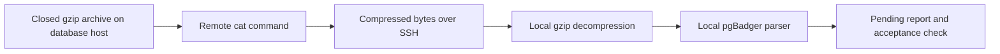

# Analyze Remote and Compressed PostgreSQL Logs with pgBadger over SSH

Author: [nawazdhandala](https://www.github.com/nawazdhandala)

Tags: PostgreSQL, PgBadger, SSH, Logging

Description: Read archived PostgreSQL logs over SSH with pgBadger, choose where decompression runs, and catch transfer or archive failures before publishing reports.

Your database host has yesterday's compressed logs, while your analysis machine has pgBadger and enough memory to build reports. You do not need to install the reporting tool on the database server. You do need to decide where decompression runs and how to distinguish a complete transfer from a plausible partial report.

There are two useful arrangements: let pgBadger request and decompress the remote archive, or transfer compressed bytes through SSH and decompress them locally. This guide uses **pgBadger 13.3** and PostgreSQL standard-error text logs compressed with gzip. Other log formats and compression programs need their own compatibility checks.

## Start with one closed archive

Choose a rotated file that the logging system has finished writing. An actively growing log is a moving target: reading to its current end says nothing about entries written immediately afterward. A closed archive also gives you a stable object to retry or retain for an investigation.

Replace the example host, account and filename throughout this guide. The account should already have authorized read access to the selected logs. It does not need permission to change PostgreSQL settings or delete archives. Keep the report directory private because query examples can contain sensitive values.

You also need the actual PostgreSQL `log_line_prefix`. These examples assume:

```text
'%m [%p]: user=%u,db=%d,app=%a,client=%h '
```

That prefix identifies the timestamp, backend process, user, database, application and client. A `.gz` suffix describes compression; it does not tell pgBadger whether the contents are standard-error text, CSV or JSON. Set `-f stderr` only when that matches the data. [PostgreSQL logging formats and prefix fields](https://www.postgresql.org/docs/18/runtime-config-logging.html)

## Establish an unattended, verified SSH connection

SSH provides the encrypted connection. Public-key authentication identifies the analysis account; host-key verification checks the server's identity. Arrange both through your normal access-management process before scheduling the report.

This preflight checks read permission and gzip integrity without extracting a file on the server:

```bash
ssh -T -o BatchMode=yes -o StrictHostKeyChecking=yes \
  -o ConnectTimeout=10 logreader@db01.internal \
  'test -r /var/log/postgresql/postgresql-2026-11-24.log.gz && gzip -t /var/log/postgresql/postgresql-2026-11-24.log.gz'
```

A successful run normally prints nothing and exits zero. `BatchMode=yes` prevents password or confirmation prompts from hanging a scheduled job. Strict host checking requires the server key to be trusted already. Do not fix a host-key error by disabling verification. [OpenSSH client configuration](https://man.openbsd.org/ssh_config)

`-T` disables terminal allocation so the command is suitable for a data stream. OpenSSH returns the remote command's status, or 255 for a connection-level error. [OpenSSH command behavior](https://man.openbsd.org/ssh)

The integrity check reads the whole compressed archive, so it adds I/O before the subsequent report. For very large files, decide whether that separate preflight is worthwhile; the checked streaming pipeline below also observes decompressor failure. Neither check proves the archive contains every expected PostgreSQL event.

## Option 1: Let pgBadger read the remote file

For an occasional report, pgBadger's remote-host option is convenient:

```bash
pgbadger -f stderr \
  -p '%m [%p]: user=%u,db=%d,app=%a,client=%h ' \
  --remote-host db01.internal \
  --ssh-user logreader \
  --ssh-option '-o BatchMode=yes -o StrictHostKeyChecking=yes -o ConnectTimeout=10 -o PreferredAuthentications=publickey' \
  -o remote-day.html \
  /var/log/postgresql/postgresql-2026-11-24.log.gz
```

The path belongs to the remote host. The HTML report is created locally. Existing SSH configuration can supply the approved identity and connection details; no password belongs in this command.

For this release, the gzip reader is invoked **on the remote host**. Decompressed text crosses the encrypted connection, and pgBadger performs parsing locally. The server therefore needs the appropriate decompression utility. The implementation constructs a remote command using the selected reader, rather than downloading the archive and then expanding it locally. [pgBadger 13.3 source](https://github.com/darold/pgbadger/blob/v13.3/pgbadger)

The full `--ssh-option` string is intentional: this version stores the supplied string as the SSH options value. Do not assume a short custom string preserves every documented default.

Use simple, controlled filenames with this interface. In a local command-construction test, a remote filename containing a space failed during file enumeration despite being passed as one local argument. The simple filename above follows the successful tested shape. This test used a local SSH substitute; it did not connect to a database server.

For gzip, the default reader is sufficient. pgBadger also documents other compressed extensions and a `--zcat` override. A custom override changes automatic reader selection, so avoid one global gzip override when processing mixed compression types. [Tagged compression and SSH documentation](https://github.com/darold/pgbadger/blob/v13.3/README)

## Option 2: Transfer compressed bytes and decompress locally

This arrangement reduces database-host decompression work and keeps the transferred content compressed. It also exposes each command's exit status to the reporting script:



Run the following as a Bash script in a private directory. Allow only one copy of the job to use these report filenames at a time.

```bash
#!/usr/bin/env bash
set -euo pipefail
umask 077

ssh -T -o BatchMode=yes -o StrictHostKeyChecking=yes \
  -o ConnectTimeout=10 logreader@db01.internal \
  'cat /var/log/postgresql/postgresql-2026-11-24.log.gz' |
  gzip -dc |
  pgbadger -f stderr \
    -p '%m [%p]: user=%u,db=%d,app=%a,client=%h ' \
    -o day.pending.html -

mv day.pending.html day.html
```

The remote command only reads bytes. Locally, `gzip -d` decompresses and `-c` writes to standard output, leaving the source archive unchanged. pgBadger reads that output through its final `-` argument. [GNU gzip options](https://www.gnu.org/software/gzip/manual/html_node/Invoking-gzip.html)

Keep diagnostic output separate from the data stream. In particular, do not add `2>&1` to SSH: an authentication error or remote-shell warning could otherwise become parser input. The remote command itself must also avoid printing banners or status messages to standard output.

`pipefail` makes an earlier command's failure visible even if pgBadger exits successfully. The script stops before replacing `day.html` when SSH or gzip fails. [Bash pipeline status](https://www.gnu.org/software/bash/manual/html_node/Pipelines.html)

This matters because a decompressor can emit usable log records before detecting archive corruption. In the local fixture test, a damaged gzip checksum still allowed text to reach the parser. The pipeline rejected the run and preserved the previous report. A simulated remote command that returned 42 after writing a valid archive was also rejected. A valid two-query archive produced a successful report.

## Accept the source and the report separately

A zero exit status establishes that the commands completed; it does not establish that you chose the correct files. Before publishing, compare the report's date range and database names with the intended incident. Look for a known query or event from the window and investigate unexpected gaps.

For several archives, maintain an explicit ordered list of closed files and their source host. Avoid a broad wildcard that silently includes yesterday's copied archive twice or excludes a differently named rotation. A recurring collector also needs durable progress tracking; this one-archive example deliberately makes that boundary visible.

If repeated analysis must survive remote retention, retain an approved copy of the compressed archive with its checksum and source identity. Streaming saves a local raw-log copy, but it cannot make a deleted remote source reproducible later.

The local checks covered pgBadger 13.3 command construction, gzip input, checksum failure and pipeline publication behavior. They did not validate a live SSH handshake, account permissions, network interruption or production rotation. Confirm those conditions in your environment before treating the job as unattended reporting infrastructure.
