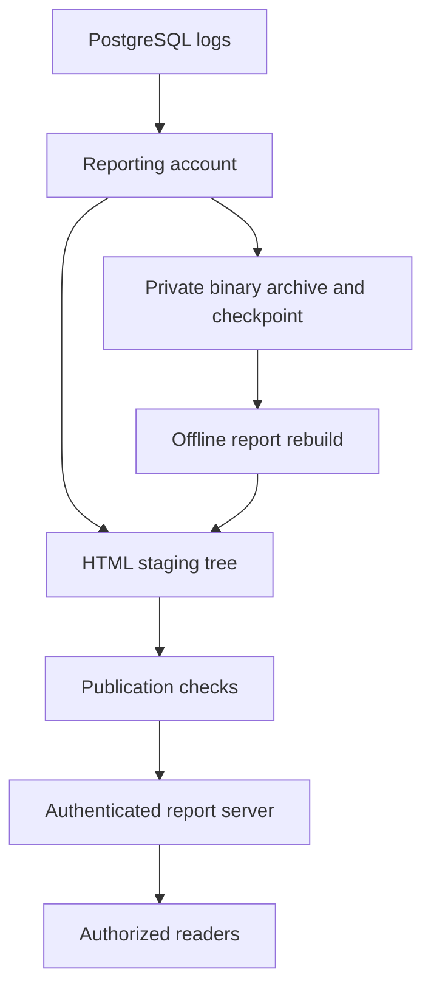

# Keep pgBadger Binary Data Separate from Published HTML

Author: [nawazdhandala](https://www.github.com/nawazdhandala)

Tags: PostgreSQL, PgBadger, Security, Observability

Description: Use pgBadger's separate state and HTML directories, preserve incremental progress, and check publication contents before exposing reports through a web server.

A pgBadger reporting directory can contain more than pages. Incremental mode retains binary analysis and a collection checkpoint alongside generated output unless you choose separate destinations. Serving that whole directory can make internal analysis files downloadable, even when directory listing is disabled.

The cleaner arrangement is to keep collection state in a private location and publish only the generated presentation. pgBadger provides this directly through `-O` and `-H`. This tutorial uses **pgBadger 13.3**, explains the ownership boundaries, and includes a small publication check. Local tests exercised initial collection, an appended log, a repeated run, and reconstruction of HTML from retained binaries.

## Give the two directories different jobs

The [official option reference](https://github.com/darold/pgbadger/blob/v13.3/README) defines `-H`/`--html-outdir` for incremental HTML output while binaries remain under `-O`/`--outdir`.

| Location | Contains | Needs access |
|---|---|---|
| Private state directory | Daily binaries and default `LAST_PARSED` checkpoint | Reporting job and backup process |
| HTML staging directory | Calendar, daily/weekly pages, JavaScript and CSS | Reporting job and publication process |
| Published directory | Reviewed presentation files | Web server; authorized report readers through HTTP |

`LAST_PARSED` records collection progress. It belongs with the job's state, not in a browser download area. The HTML staging and published directories can be the same in a simple installation, but a separate publication step makes it easier to review a complete tree before readers see it.



Separating files does not anonymize reports. HTML can still contain literal SQL samples, user names, client addresses and database names. Give it the access controls appropriate for those contents.

## Create an isolated reporting layout

Prerequisites are pgBadger 13.3, a reporting account that can read the intended logs, and writable parent directories provisioned for that account. Use new paths for this demonstration; do not point it at a live archive while changing its layout.

```bash
set -euo pipefail
umask 027
state=/srv/pgbadger/private/shop
html=/srv/pgbadger/staging/shop

if [ -e "$state" ] || [ -e "$html" ]; then
  echo 'Choose unused state and HTML directories.' >&2
  exit 1
fi
mkdir "$state" "$html"
chmod 700 "$state"
chmod 750 "$html"
pgbadger --version
```

Replace the paths and expect version 13.3. The state directory is accessible only to its owner under ordinary Unix permissions. The HTML directory also permits its group to traverse and read it. Provision the publication account's group access deliberately; this example does not change users or group membership.

Run the web server as a different account from the reporting job. Otherwise an owner-only state directory does not separate their privileges. Also check parent-directory permissions and any access control lists used by your environment.

## Generate reports into the separate destinations

Replace the closed log path and prefix with the actual PostgreSQL log format. This example expects plain text duration records with the fields shown:

```bash
log_file=/archive/postgresql/closed.log
prefix='%m [%p]: user=%u,db=%d,app=%a,client=%h '

pgbadger -I -X -f stderr -p "$prefix" \
  -O "$state" -H "$html" "$log_file"
```

`-I` enables incremental collection. `-X` writes shared JavaScript and CSS separately. `-O` remains the state location on every subsequent run; `-H` selects the HTML tree. Both directories must exist.

For the tested November fixture, the state directory contained date-based `.bin` files and `LAST_PARSED`. The HTML tree contained `index.html`, date-based pages, weekly pages and a `13/` asset directory. It contained no binaries or default checkpoint.

Keep the same state directory when processing the next input. Moving only the HTML destination is different from starting a new collection history. In our fixture, adding a third statement increased the aggregate from two to three; processing the unchanged input again kept the total at three. That test does not replace a log-rotation and late-arrival policy for a real installation.

## Check the staged tree before publishing it

Save the following as `check_publication.py` and run it using Python 3.11. It permits only the file types produced by this HTML-only example and rejects symbolic links, which could point outside the staging tree.

```python
import sys
from pathlib import Path

root = Path(sys.argv[1])
if root.is_symlink() or not root.is_dir():
    raise SystemExit("Expected a real staging directory")
if not (root / "index.html").is_file():
    raise SystemExit("Missing report index")

allowed = {".html", ".css", ".js"}
failures = []
count = 0
for path in root.rglob("*"):
    relative = str(path.relative_to(root))
    if path.is_symlink():
        failures.append(f"symbolic link: {relative}")
    elif path.is_dir():
        continue
    elif not path.is_file() or path.suffix not in allowed:
        failures.append(f"unexpected file: {relative}")
    else:
        count += 1
if failures:
    raise SystemExit("\n".join(failures))
print(f"Checked {count} presentation files")
```

The [Python path API](https://docs.python.org/3.11/library/pathlib.html) supplies the file and symbolic-link checks. Run the helper after the writer finishes, on the same stable tree your publication process will copy:

```bash
python3 check_publication.py "$html"
```

A successful run prints a file count. A stray binary, `LAST_PARSED`, JSON export or symbolic link fails the check. If you intentionally add another presentation format, review its contents and extend the rule explicitly.

This is a packaging check, not a content sanitizer or a defense against a malicious process racing to change the directory. It does not inspect SQL sensitivity, validate every HTML link or replace filesystem isolation.

## Rebuild HTML without moving the private archive

A separate destination makes recovery straightforward. Provision a new empty HTML directory, then rebuild from the existing state:

```bash
rebuilt=/srv/pgbadger/staging/shop-rebuilt
mkdir "$rebuilt"
pgbadger -I -X -O "$state" -H "$rebuilt" --rebuild
python3 check_publication.py "$rebuilt"
```

The expected result is a new calendar and eligible daily and weekly reports. Retain the original job's per-database and calendar options if applicable. For a monthly page, explicitly keep incremental mode when using `-H`:

```bash
pgbadger -I -X -H "$rebuilt" \
  --month-report 2026-11 "$state"
```

In 13.3, omitting `-I` in that split-destination monthly command fails the `-H` mode check. The [tagged source](https://github.com/darold/pgbadger/blob/v13.3/pgbadger) also shows that the default checkpoint is located under `-O` and resources follow the HTML destination.

Our rebuild preserved state-file hashes, retained three recorded queries, and produced local asset references that resolved to existing files. These checks used synthetic logs; no production web server or authentication flow was exercised.

## Publish only the reviewed presentation

Configure the serving root to point at the published HTML tree. For example, NGINX's [root directive](https://nginx.org/en/docs/http/ngx_http_core_module.html#root) controls how request paths map to filesystem paths. Review all aliases and other routes too; a safe root does not help if a separate route exposes the private archive.

Require authentication and transport protection according to your existing internal reporting policy. Disabling directory listing alone is insufficient because a reader can request a known filename directly. Test a normal page, its assets, and attempted requests for the checkpoint and a known binary path through the actual serving configuration.

Finally, back up private analysis and collection state separately from the published presentation. Retaining old HTML is not proof that its corresponding binaries remain available for rebuilding. Document both retention policies so a web cleanup does not silently become a loss of historical analysis.
