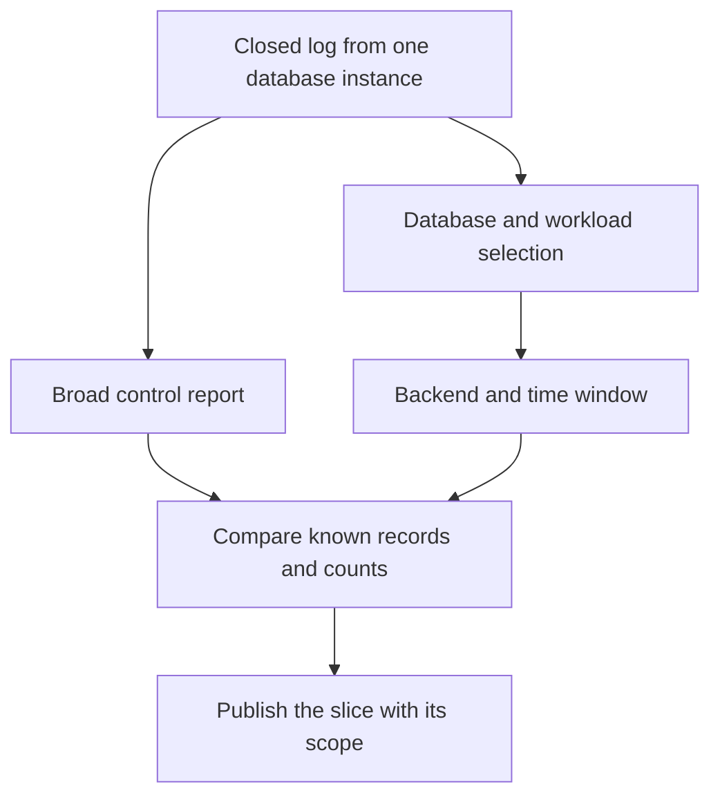

# Slice pgBadger Reports by Database, User, Application, Client, or Session

Author: [nawazdhandala](https://www.github.com/nawazdhandala)

Tags: PostgreSQL, PgBadger, Troubleshooting, Logging

Description: Narrow pgBadger reports to a workload or backend, verify combined filters, and handle a tested session-filter limitation in version 13.3.

An incident report is easier to read when it answers a specific question: what did the checkout application do against the shop database during the failure? A server-wide report may bury that activity under unrelated jobs. Conversely, a report narrowed too far can hide the workload that caused contention.

Use slices as different views of the same evidence. Keep the original log and a broad report, then add filters one at a time. This guide uses **pgBadger 13.3** and synthetic text logs. The tests confirmed the main workload filters and exposed a limitation in its documented session-ID option, so that option needs an explicit verification step.

## Make sure the identity is present

For PostgreSQL text logs, the prefix identifies the process and connection associated with each record. The example prefix below includes everything used in this tutorial:

```text
'%m [%p] session=%c line=%l user=%u,db=%d,app=%a,client=%h '
```

The surrounding quotes show the trailing space. Pass the contents as the `-p` argument. It must match your actual log format; changing a parser argument does not add missing fields to old logs.

| Field | Meaning | Useful question |
|---|---|---|
| `%d` | Database | Which database received the work? |
| `%u` | Database user | Which login role executed it? |
| `%a` | Application name | Which labeled client workload issued it? |
| `%h` | Remote host | Which address did PostgreSQL see? |
| `%p` | Backend process ID, or PID | What did this server process execute? |
| `%c` | Session identifier | Which process lifetime does the record belong to? |
| `%l` | Per-session log line number | Where does a record fall within that session? |

The session ID combines the process start time and PID in hexadecimal. It is different from both the decimal PID and the line counter. Preserve the database-instance identity as well when collecting logs from several servers. [PostgreSQL log prefix fields](https://www.postgresql.org/docs/18/runtime-config-logging.html)

Application names are client-supplied labels. They help separate workloads but are not a security boundary or proof of ownership. A shared pool may also make the server-visible user or client address less specific than the original request's identity. Verify a representative record before choosing a filter. [Application connection parameters](https://www.postgresql.org/docs/18/libpq-connect.html#LIBPQ-PARAMKEYWORDS)

## Start with a repeatable baseline

Run these examples in Bash with pgBadger 13.3 installed and permission to read a closed log. Replace the input path and prefix; use new output filenames:

```bash
log_file=/archive/postgresql/incident.log
prefix='%m [%p] session=%c line=%l user=%u,db=%d,app=%a,client=%h '

pgbadger -f stderr -p "$prefix" \
  -o incident-all.html "$log_file"
```

Keep these variables in the same shell for subsequent commands. The baseline establishes the available time range and query count. If it has no queries, fix parsing or input coverage before diagnosing filters.



## Select the workload with the real option names

The inclusion switches are `--dbname`, `--dbuser`, `--appname` and `--dbclient`. There is no need to invent parallel names such as `--include-db`. [pgBadger 13.3 options](https://github.com/darold/pgbadger/blob/v13.3/README)

For the shop database alone:

```bash
pgbadger -f stderr -p "$prefix" \
  --dbname shop -o incident-shop.html "$log_file"
```

Then select a particular combination:

```bash
pgbadger -f stderr -p "$prefix" \
  --dbname shop --dbuser app \
  --appname checkout --dbclient 10.0.0.10 \
  -o incident-checkout.html "$log_file"
```

Different dimensions narrow the population together. The second command requires the selected database, user, application and client. It does not mean “any record matching any one of these values.”

Within a dimension, repeated values select alternatives. This example accepts either application name:

```bash
pgbadger -f stderr -p "$prefix" \
  --appname checkout --appname worker \
  -o incident-two-apps.html "$log_file"
```

The tagged implementation also accepts comma-separated values for these workload options. Repeating the switch makes a command easier to review. Use observed names and addresses, and test punctuation-sensitive names instead of assuming that every inclusion and exclusion switch has identical pattern semantics. [Argument aggregation and filtering implementation](https://github.com/darold/pgbadger/blob/v13.3/pgbadger)

A blank application field will not match `checkout`. Likewise, a client filter should use the address in the database log, which may be a proxy's address. Adding more filters cannot recover an identity that the input never recorded.

## Narrow a backend without confusing it with a request

A PID identifies a PostgreSQL server process. It can serve many statements, and the operating system can reuse the number after that process exits. Use it with a known time window and logs from one instance:

```bash
pgbadger -f stderr -p "$prefix" \
  --include-pid 81 \
  --begin '2026-11-25 09:59:59' \
  --end '2026-11-25 10:00:05.999' \
  -o incident-backend-81.html "$log_file"
```

Replace all three example values using the recorded incident. Check the first and last intended records against the chosen bounds; the example begins before the first fixture record and includes milliseconds in its end bound. These are log timestamps; establish their timezone before comparing them with an application's timeline. A backend slice still contains every qualifying query on that process, not just one HTTP request.

The fixture deliberately reused PID 81 for a later session. PID alone retained three queries; the bounded interval retained the two earlier queries. This demonstrates why process identity needs time context.

## Verify session filtering before relying on it

The 13.3 help documents `--include-session ID` for `%c`. However, the tested text-log path did not select the expected session. This is a diagnostic example, not a verified replacement for the PID-and-time command:

```bash
pgbadger -f stderr -p "$prefix" \
  --include-session '6b055a00.51' \
  -o session-filter-check.html "$log_file"
```

In the eight-query fixture, two records carried that session ID. The resulting report contained zero queries. Source review found that the stored value used by the filter came from `t_session_line`, while `%c` was parsed into `t_session_id`. Testing a line-counter value instead produced a different selection; that is not a valid session-selection workaround. [Pinned parser implementation](https://github.com/darold/pgbadger/blob/v13.3/pgbadger)

Before adopting a different release or format, repeat a small acceptance test with two sessions, known query counts and distinct markers. Confirm both that the intended session remains and that the other disappears. Until that passes, use a verified backend/time slice and inspect the original session fields. Do not relabel the result as exact session isolation when PID reuse or incomplete time boundaries remain possible.

## Check the result against evidence

These are observed results from the local eight-query fixture:

| Selection | Retained queries |
|---|---:|
| All input | 8 |
| Database `shop` | 7 |
| User `reporter` | 1 |
| Application `checkout` | 6 |
| Client `10.0.0.11` | 2 |
| Shop, app user, checkout, client `10.0.0.10` together | 3 |
| Checkout or worker | 7 |
| PID 81 | 3 |

Inspect expected query examples as well as totals. Equal counts can conceal a wrong selection. If a slice becomes empty, remove the last filter, confirm the field's actual value, and check whether the input covers the needed period.

Keep excluded workloads available in the control report when investigating locks or resource pressure. Record the input files, time window, filter command and pgBadger version beside each result. These local tests establish behavior for the pinned parser and fixture; they do not validate a production pool, every log format or all event categories.
