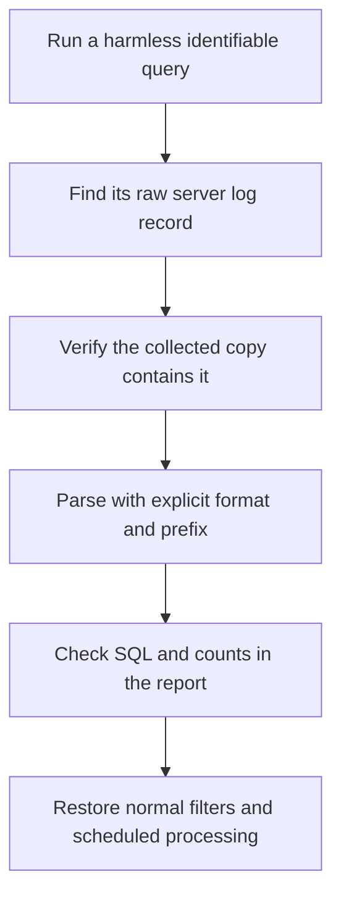

# pgBadger Found Zero Queries: Fix Log Format, Prefix, and Query Logging

Author: [nawazdhandala](https://www.github.com/nawazdhandala)

Tags: PostgreSQL, PgBadger, Troubleshooting, Logging

Description: Diagnose empty pgBadger query reports by checking the actual log contents, effective PostgreSQL settings, input format, line prefix, and report filters.

A successful pgBadger run does not prove that it recognized SQL statements. It can read every byte of a file containing only connection events, or finish parsing a file with the wrong prefix, and still produce an empty query report.

Trace one known query through three stages: PostgreSQL emits the statement, the collected file retains it, and pgBadger recognizes it. This separates a logging problem from a transport problem or a parser mismatch without immediately enabling unrestricted query logging across production.

The commands below target **pgBadger 13.3**. Local parser tests used that release and Perl 5.34.1. A disposable PostgreSQL 14.17 instance supplied a real stderr query record; the setting descriptions were also checked against PostgreSQL 18 documentation. The older local database was a test fixture, not a version recommendation.

## Determine what is actually missing

Compare the report's total query count with its unique normalized query count. Normalization groups similar statements with different literal values. A duration-only record can contribute timing information without supplying SQL text for those groups.

| Observed input or report | First explanation to investigate |
|---|---|
| Connection and checkpoint events, no SQL | Query logging may be disabled or below threshold |
| `duration: ... ms` without a statement | Duration logging supplies no query text by itself |
| Duration and SQL present, but zero queries | Input format, prefix, or parser filters may be wrong |
| Total queries positive, query detail empty | Missing SQL text or query-report options |
| Probe present locally but absent in exported file | Wrong instance, rotation window, or log transport |

These are starting hypotheses. Inspect a small protected copy of the source log before changing server settings. Logs can contain application data; do not paste an entire production log into a public debugging service.



## Read effective settings from the relevant session

Connect to the affected database with an authorized diagnostic account. Run this read-only query:

```sql
SELECT name, setting, unit, context, source, pending_restart
FROM pg_settings
WHERE name IN (
  'log_destination', 'logging_collector', 'log_line_prefix',
  'log_min_duration_statement', 'log_duration', 'log_statement',
  'lc_messages'
)
ORDER BY name;
```

`setting` is the effective value in that session. `source` helps distinguish a configuration-file value from a session override. `pending_restart` identifies changes that still require a restart. Settings observed in an administrator's session do not necessarily match application sessions with role, database, or connection options. [PostgreSQL pg_settings](https://www.postgresql.org/docs/18/view-pg-settings.html)

Check the source log for the incident period too. Today's `log_line_prefix` may differ from the prefix used to write yesterday's file. Changing configuration now does not rewrite historical logs.

`log_min_duration_statement = -1` disables that logging mechanism; zero logs all completed statements, and positive values establish a duration threshold. A report built from thresholded logs describes the captured slow statements, not the entire workload. `log_duration` alone does not force SQL text into the log. [PostgreSQL logging settings](https://www.postgresql.org/docs/18/runtime-config-logging.html)

## Create one controlled marker

If policy permits, use a dedicated diagnostic session with permission to change the logging settings. Execute the following as separate statements in `psql`, for example from a saved SQL file. Do not turn it into one multi-statement `psql -c` string when checking individual statement records.

```sql
BEGIN;
SET LOCAL application_name = 'pgbadger_probe';
SET LOCAL log_statement = 'none';
SET LOCAL log_duration = off;
SET LOCAL log_min_duration_statement = 0;
SELECT 42 AS pgbadger_probe;
ROLLBACK;
```

The query returns `42` and changes no application tables. `SET LOCAL` limits these overrides to the transaction; `ROLLBACK` restores the previous session settings. An insufficiently privileged account will fail instead of changing the configuration. Use an approved account rather than broadening an application's permissions for this check. [PostgreSQL SET](https://www.postgresql.org/docs/18/sql-set.html)

Find `pgbadger_probe` in the server's actual log destination, then in the file supplied to pgBadger. Expect a record containing both a duration and `statement: SELECT 42 AS pgbadger_probe;`. Other diagnostic statements may also appear.

If the server record is absent, verify the connection endpoint, logging destination and effective settings before investigating the parser. When PostgreSQL's logging collector is enabled, `current_logfiles` records its current destinations. External service managers and managed databases may collect stderr elsewhere. Enabling the collector itself requires a server restart; do not schedule one merely because a report is empty. [Logging destinations and collector](https://www.postgresql.org/docs/18/runtime-config-logging.html#RUNTIME-CONFIG-LOGGING-WHERE)

## Match format and prefix independently

The input format tells pgBadger which kind of record to read. `stderr`, `syslog`, CSV and JSON are different representations. A JSON envelope created by a log forwarder is not automatically PostgreSQL `jsonlog`. Preserve or extract the original message according to the forwarder's documented schema.

For stderr, the prefix describes the fields before the PostgreSQL message. Supply the prefix that wrote the file, including punctuation and spaces. pgBadger documents timestamp and process/session identifiers as important prefix fields. Its `-f` option selects input format and `-p` supplies a custom prefix. [pgBadger 13.3 documentation](https://github.com/darold/pgbadger/blob/v13.3/README)

For a file written with `%m %u@%d %p %a : `, use:

```bash
pgbadger -f stderr -p '%m %u@%d %p %a : ' -v \
  -x text -o diagnostic.txt /path/to/postgresql.log
```

Replace the path with a protected log copy and replace the prefix if yours differs. Here `%m` is a timestamp with milliseconds, `%u` the user, `%d` the database, `%p` the process ID, and `%a` the application name. `-v` exposes parser diagnostics; the text report makes counts and captured SQL easy to inspect.

In the local test, the same real query record produced one query with the correct custom prefix, zero with an incompatible prefix, and zero when incorrectly treated as syslog. This demonstrates why “parsed 100%” is not sufficient evidence.

## Test the analyzer with a known fixture

If the source file remains ambiguous, create this one-line synthetic log in an empty diagnostic directory. It contains no real customer data:

```bash
cat > probe.log <<'LOG'
2026-11-25 01:02:03 UTC [4242]: user=app,db=shop,app=probe,client=127.0.0.1 LOG:  duration: 12.345 ms  statement: SELECT 42 AS pgbadger_probe;
LOG
pgbadger -f stderr \
  -p '%t [%p]: user=%u,db=%d,app=%a,client=%h ' \
  -o probe.html probe.log
```

The generated report should contain one query and the probe SQL. This command was executed with pgBadger 13.3. If it works while the real file does not, compare the actual representations rather than reinstalling the analyzer immediately.

A second local fixture containing only a duration produced one total query but zero unique normalized queries. A checkpoint-only fixture produced zero queries. Those outcomes explain two different kinds of “empty” report; neither can be repaired by inventing SQL that was never logged.

## Remove filters and stale state from the diagnosis

Run the small copied sample as a new, nonincremental analysis. Initially omit database, user, client, time, query and session filters. Confirm that `--disable-query` is not suppressing the relevant sections. In the fixture test, selecting a different database with `-d` correctly reduced the count to zero. [pgBadger command options](https://pgbadger.darold.net/documentation.html)

Check the exact scheduled command, not just the command you remember configuring. Incremental processing and saved offsets can intentionally skip already processed data. Preserve that state while debugging; a separate output directory and a fresh standalone invocation avoid mixing diagnostic results with scheduled reports.

Once the marker survives the full path, restore filters one at a time. Choose a sustainable logging threshold or sampling policy for routine collection, record that policy alongside the report, and monitor log volume. Keep the repaired prefix and format explicit in the scheduled job so a future logging-format change is visible rather than silently producing another empty report.
