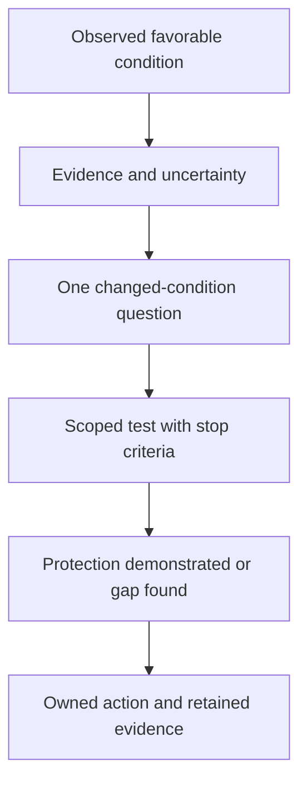

# Turn Postmortem Luck into Safeguards You Can Test

Author: [nawazdhandala](https://www.github.com/nawazdhandala)

Tags: Postmortem, SRE, Incident Response

Description: Analyze favorable incident conditions, separate real safeguards from assumptions, and turn uncertain protection into scoped tests and accountable improvements.

“We were lucky traffic was low” can be a useful postmortem observation. It becomes actionable when the team explains what low traffic protected, how that protection was observed, and what should happen when demand is higher.

The purpose is not to imagine the worst possible incident. It is to find conditions that helped this response but cannot yet be relied on during the next one.

Google's example postmortem includes a section for favorable circumstances alongside what went well and poorly. Use that section as a starting point for investigation, rather than a list of reasons to feel relieved. [Example postmortem](https://sre.google/sre-book/example-postmortem/)

## Start with the outcome that needs explaining

Consider a fictional report-generation service. A malformed report template caused repeated failures. Retried jobs occupied workers, and some valid reports waited too long. Responders paused the affected template, then cleared the backlog.

The review identifies four apparently fortunate circumstances:

- Incoming work was below the usual afternoon level.
- A spare worker pool was already running.
- An engineer who understood the retry behavior was available.
- Another customer-facing service continued operating normally.

None of those statements, by itself, explains the amount of protection provided. Low arrivals might have reduced contention, but worker slots could still have been exhausted by retries. The spare pool might have helped, or it might have received the same failing work.

Before assigning actions, identify the specific outcome: valid reports recovered within the incident window, and the unrelated service's customer checks remained healthy. Then investigate what supported those outcomes.

## Separate a safeguard from a favorable condition

A safeguard is a mechanism intended to reduce a particular risk. A favorable condition is a circumstance that helped on this occasion. A mechanism can exist without being verified for the incident scenario.

| Observation | Initial interpretation | Evidence needed before relying on it |
|---|---|---|
| Arrival rate was low | Favorable workload condition | Arrival, retry, queue, and worker-occupancy measurements from the same period |
| Spare workers were available | Possible capacity safeguard | Routing evidence showing which jobs they processed and whether they had independent limits |
| A specialist recognized the symptom | Successful human adaptation | Their diagnostic reasoning, access needs, and information sources |
| An unrelated service stayed healthy | Possible isolation safeguard | Separate resource boundaries and customer-facing measurements |
| An alert fired | Detection mechanism operated | Whether it reached someone early enough to influence response |

Do not call skilled improvisation “just luck.” Interview the responder about the clues they used. That knowledge may support a better diagnostic view, a documented escalation path, or a rehearsal for other responders. Requiring one person to remain permanently available is not a sustainable safeguard.

Likewise, do not dismiss an existing protection because it appears in the luck section. Google's published postmortem example describes separately managed infrastructure that remained unaffected. The relevant question is what boundary preserved that separation and whether future changes could remove it. [Postmortem culture](https://sre.google/workbook/postmortem-culture/)

## Write a condition-and-evidence ledger

Replace “could have been much worse” with a short record that another engineer can review.

For the fictional report incident, one entry might read:

| Field | Example entry |
|---|---|
| Observed condition | Accepted report arrivals were below the afternoon reference period |
| Evidence | Linked arrival-rate graph, queue-age graph, and worker-occupancy samples |
| Possible protection | Lower arrivals may have left more capacity for valid reports |
| Uncertainty | Retry work was not measured separately, so its share of occupancy is unknown |
| Changed condition to examine | The same failing-template behavior at a defined higher arrival rate |
| Proposed protection | Bound retry work and preserve capacity for valid reports |
| Next evidence | A scoped staging exercise with separate valid-job and retry measurements |

Use the actual values, time ranges, and evidence links in a real ledger. “Below normal” is too vague if normal means a different customer mix or report size.

Keep alternative explanations visible. Pausing the template and adding workers close together may prevent the incident record from establishing which action produced the improvement. That uncertainty is a reason to investigate, not permission to credit both actions with independently restoring service.

## Turn counterfactuals into questions

A counterfactual asks what might have happened if one condition had been different. It is a hypothesis about an unobserved situation, not another event in the timeline.

Useful questions include:

- Could valid reports meet their deadline if arrivals reached the chosen peak workload?
- Could the next on-call identify the failing template without the specialist?
- Could replacement workers become useful if the spare pool started empty?
- Would the unrelated service remain healthy if shared database connections were exhausted?

Change one important condition at a time initially. Combining peak traffic, an unavailable specialist, a failed database, and expired credentials creates a difficult scenario without revealing which assumption mattered.

Avoid invented precision. The incident does not establish that a missing safeguard would have caused a two-hour outage or affected a particular percentage of customers. Record those consequences as estimates only when a model and its assumptions support them.

The diagram describes a review process. It does not imply that every question requires a disruptive experiment; configuration inspection or a focused interview may resolve some gaps.

## Design an exercise that can answer the question

For the report service, start in a dedicated staging environment with synthetic reports and no production destinations. Confirm that its queues, credentials, and downstream storage are isolated before generating failures.

Write the exercise contract before running it:

1. **Baseline:** demonstrate that valid synthetic reports meet the chosen completion target at the specified arrival rate and report-size mix.
2. **Controlled change:** introduce one known failing template while holding that workload constant. Cap test duration and generated jobs.
3. **Measurements:** distinguish valid completions, retries, rejected work, queue age, and worker occupancy. Record the configuration revision.
4. **Pass criteria:** valid reports continue meeting the agreed target, and retry work remains within the configured bound.
5. **Stop criteria:** stop on unexpected destination access, exceeded resource limits, or loss of the measurements needed to judge safety.
6. **Recovery:** stop the generator, remove the test condition, and confirm that synthetic queues drain and baseline behavior returns.

Choose thresholds from the service's requirements and the staging environment's capacity. A passing small test does not establish production peak capacity when database sizes or downstream limits differ.

AWS Fault Injection Service provides one concrete model for stopping experiments: its stop conditions use CloudWatch alarms against defined thresholds. Whatever tooling you use, retain a separate recovery procedure; stopping an experiment should not be assumed to undo every effect. [AWS FIS stop conditions](https://docs.aws.amazon.com/fis/latest/userguide/stop-conditions.html)

This exercise is a proposed method, not a test performed for this article.

## Assign the smallest useful improvement

Each important gap needs an owner, a decision date, and observable completion criteria. “Add resilience” is too broad. “Cap retries per report and demonstrate that valid reports retain their completion target in the recorded staging scenario” connects a change to evidence.

Some findings warrant preserving an existing boundary rather than adding a new mechanism. If separate worker pools protected another service, document that property in the architecture review criteria. A future consolidation should explicitly assess the protection it removes.

Prioritize plausible recurrence conditions and meaningful customer consequences. A gap involving normal afternoon demand deserves different treatment from a speculative combination of several unrelated failures. When work is deferred, retain the uncertainty, interim protection, responsible decision-maker, and review date.

Close the luck entry when its disposition is clear: protection demonstrated within stated limits, an improvement verified, or a documented risk decision. The useful result is a precise statement of what the team can rely on next time, with evidence that another responder can inspect.
