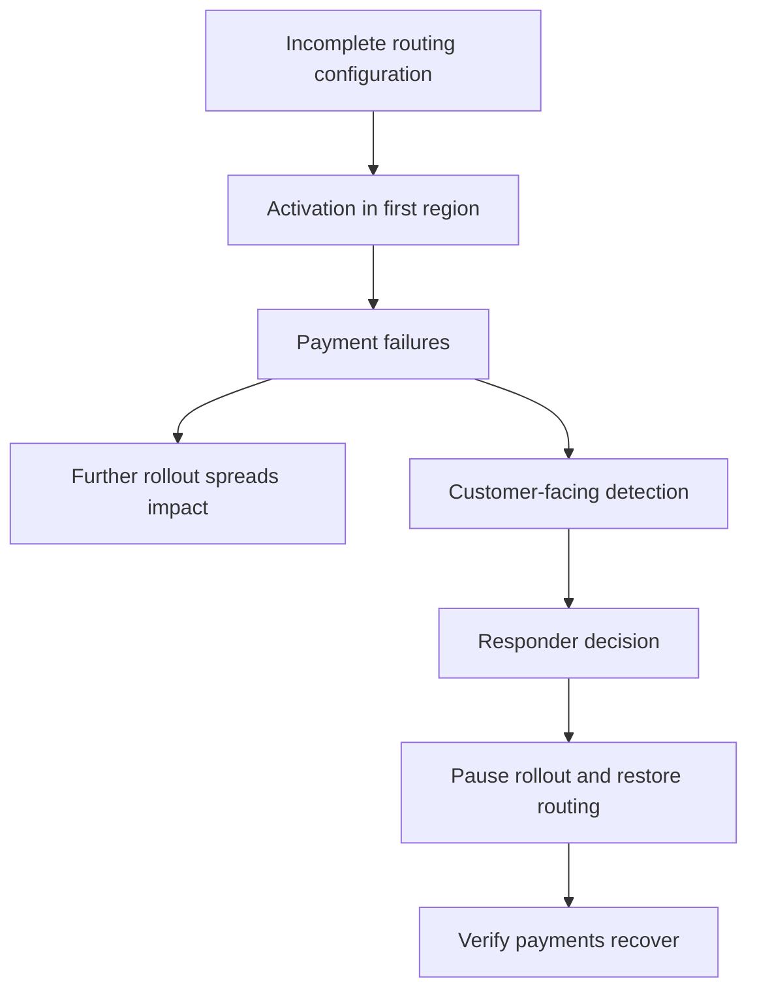

# Classify Postmortem Actions by the Protection They Provide

Author: [nawazdhandala](https://www.github.com/nawazdhandala)

Tags: Postmortem, SRE, Incident Management

Description: Separate prevention, detection, mitigation, and blast-radius actions so an incident review produces complementary safeguards with meaningful acceptance criteria.

A postmortem can produce ten action items while leaving the main failure path unchanged. Five new alerts help people notice a problem, but they do not necessarily stop it from happening or make recovery possible.

Classifying actions by the protection they provide helps expose those gaps. The useful question is: if this action had been complete, which part of the incident would have changed, and what evidence would demonstrate that change?

Google's postmortem guidance criticizes vague actions and an excessive focus on mitigation without adequate prevention. Its case study also shows why limiting damage matters: safeguards from an earlier incident reduced the scope and speed of a later one. [Postmortem culture](https://sre.google/workbook/postmortem-culture/)

## Define four effects before assigning labels

These categories are a practical review vocabulary, not a universal standard that every organization must adopt.

| Category | Question it answers | Typical evidence |
|---|---|---|
| Prevention | What stops this specific failure mechanism from occurring? | The known unsafe input or transition is rejected, while valid behavior still works |
| Detection | How do we learn that a meaningful failure is happening? | A representative symptom produces an actionable signal at the intended destination |
| Mitigation | How do we reduce ongoing harm or restore service? | A rehearsed response changes the failing customer outcome within stated limits |
| Blast-radius reduction | What limits how many customers, resources, or regions one failure can affect? | A fault remains inside the intended boundary under a defined scenario |

“Blast radius” means the reach of a failure. In this article, mitigation focuses on reducing ongoing harm, while blast-radius reduction focuses on containing its scope. An organization's broader definition of mitigation may include both.

The labels can overlap. Select a primary category based on the intended acceptance test, and record secondary benefits when they matter. Avoid lengthy debates over vocabulary when the expected behavior is already clear.

## Map the incident before classifying the work

Consider a fictional payment-routing incident. A configuration update omitted a processor required by one payment method. The deployment tool activated it in every region. Requests using that method failed, and responders restored the prior configuration.

A useful failure path is:

This is a simplified example, not a measured incident timeline. It highlights separate places where protection could act. Validation can stop the incomplete configuration. A customer check can detect the failure. A tested restoration procedure can reduce its duration. A rollout boundary can limit the affected regions.

Keep the affected payment method visible. A healthy overall request rate could hide a serious failure in a smaller but important customer journey.

## Prevention: specify the mechanism being blocked

“Improve configuration validation” needs a narrower contract. For this incident, a concrete proposal is to reject a routing configuration that lacks a required processor for any enabled payment method.

Its acceptance criteria should include both directions:

- The incident's invalid configuration is rejected before activation.
- Other missing-required-route cases are rejected.
- Valid configurations still pass.
- Every supported activation path uses the check, including emergency tooling.
- The rejection explains which requirement failed without exposing credentials.

A schema check that accepts the shape of a document may still miss an invalid business relationship. Valid JSON is not proof that each enabled payment method has an operational route.

A regression test prevents a known bug from silently returning through the tested path. It does not establish that every future configuration error is impossible. State the protected mechanism and preserve that limitation in the action record.

## Detection: verify the signal reaches a decision

An alert rule existing in a repository is only part of a detection action. For the payment example, identify the customer operation, affected cohort, observation delay, routing destination, and response expected from the recipient.

A useful acceptance test could introduce a controlled payment-method failure in staging, confirm that the check recognizes it, and verify delivery to a test notification destination. Record whether the signal clears after recovery. Use synthetic payment facilities that cannot charge real customers.

A service-level objective, or SLO, expresses the reliability target for a customer-visible operation. Google's alerting guidance evaluates strategies by precision, recall, detection time, and reset time. Those distinctions help prevent “more alerts” from becoming the only success measure. [Alerting on SLOs](https://sre.google/workbook/alerting-on-slos/)

An alert may improve response time while allowing the same failure to recur. Keep that distinction explicit when reporting the action as completed.

## Mitigation: demonstrate that responders can change the outcome

For this example, mitigation means pausing further activation and restoring an approved previous routing configuration.

The action needs more than a rollback button. Specify who may invoke it, how the previous revision is identified, which environments it affects, and how responders confirm that the payment method works again.

Rehearse the complete procedure in an appropriate test environment. Record the starting state, permissions, selected revision, restoration result, and customer-level verification. A deployment status of “successful” is weaker evidence than the previously failing operation succeeding.

Check reversibility before making restoration automatic. An older configuration may depend on credentials, endpoints, or data formats that have since changed. Configuration restoration also does not undo payments already attempted or reconcile uncertain transaction outcomes. Those require their own approved handling.

If the safe recovery path remains manual, document that honestly. Automation is useful when it preserves the same checks and scope controls, not merely because it runs faster.

## Blast-radius reduction: identify the actual boundary

A staged rollout could activate the configuration in one region, observe it, and require a gate before proceeding. A canary is an initial release to a limited portion of the system that helps evaluate a change before broader exposure. Google describes it as a way to reduce the cost of learning whether a release is safe. [Canarying releases](https://sre.google/workbook/canarying-releases/)

For the example, verify that a failure in the first region prevents further activation. Define the observation interval and evaluation signals. A regional rollout that advances faster than its monitoring can observe the symptom provides less protection than its diagram suggests.

Also inspect shared dependencies. If all regions read the same immediately updated configuration object, separate deployment jobs do not create independent activation boundaries.

The bulkhead pattern separates resources so a failure in one pool need not exhaust the others. Microsoft's guidance emphasizes both the isolation achieved and its cost and operational complexity. The same review principle applies here: verify the actual boundary, rather than inferring isolation from naming or organizational ownership. [Bulkhead pattern](https://learn.microsoft.com/en-us/azure/architecture/patterns/bulkhead)

## Make coverage visible without demanding four tickets

For the fictional incident, the review can record:

| Action | Primary effect | Completion evidence |
|---|---|---|
| Reject incomplete payment routing | Prevention | Invalid and valid configuration cases tested through activation paths |
| Check each supported payment method | Detection | Controlled failure, notification receipt, and recovery clearing demonstrated |
| Rehearse previous-configuration restoration | Mitigation | Authorized responder restores the route and verifies the customer operation |
| Gate activation between regions | Blast-radius reduction | A first-region failure blocks further rollout |

Do not require one new ticket in every category. Existing protections may already be sufficient. Record their evidence and identify the remaining uncertainty. Conversely, do not count one vague “improve rollout safety” ticket as four verified protections.

A combined feature may need separate acceptance checks. Automatic rollout pausing contains further exposure; it does not necessarily restore the first affected region. A rollback action can mitigate that region, but only if it is compatible with the changed state.

## Prioritize by the remaining failure path

Assign an owner, decision or delivery date, and evidence location to each accepted action. Prioritize the changes that close important exposed paths, accounting for implementation cost and operational risk.

A narrowly scoped preventive check may be ready quickly while regional isolation requires architectural work. Ship the useful protection when validated, and document the remaining exposure. Do not describe the whole incident class as solved simply because the first ticket closed.

At follow-up, ask what can still happen: can the unsafe change enter, can it go unnoticed, can responders recover, and how far can it spread? Those answers make the action list a practical account of improved protection rather than a count of completed tasks.
