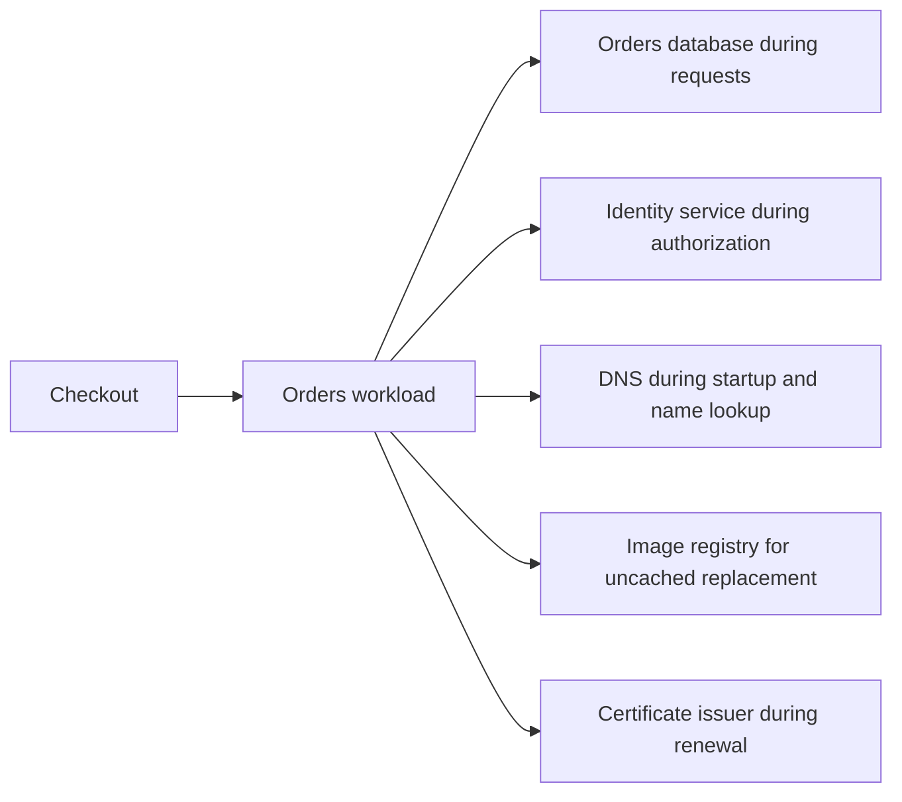

# Use Postmortems to Find Hidden Dependencies and Update Architecture Maps

Author: [nawazdhandala](https://www.github.com/nawazdhandala)

Tags: Postmortem, Architecture, Observability, SRE

Description: Turn incident evidence into an architecture-map update that captures runtime, startup, recovery, and renewal dependencies with owners and validation plans.

The architecture diagram shows an application, its database, and a message queue. During an incident, the team discovers that replacing an application instance also requires an image registry, a credential provider, and a working name-resolution path. None of those dependencies appears on the diagram used for recovery planning.

A postmortem is an opportunity to update the map from observed behavior. The useful result is more than another box: it explains when the dependency matters, how failure appears, who owns it, and what evidence supports the relationship.

AWS's dependency-telemetry guidance includes internal services, shared platforms, DNS, networks, and external services. It specifically identifies undocumented internal interdependencies as a source of unexpected cascading failures. [Dependency telemetry guidance](https://docs.aws.amazon.com/wellarchitected/latest/framework/ops01-bp03.html)

## Start with the recovery surprise

Look for a moment when the system behaved differently from the team's architecture assumptions. A fallback may have contacted the same unhealthy service. A healthy running process may have been impossible to replace. A recovery command may have required an identity service that was itself unavailable.

For a fictional example, an Orders service continues handling requests on existing instances while replacement instances cannot obtain their container image. The original map includes only Checkout, Orders, and the Orders database.

The missing relationship is not “Orders calls the registry on every request.” It is “the platform needs the registry and its access path to start an uncached replacement.” That distinction changes the failure scenario and the appropriate test.

Kubernetes documents how image pull policy, local images, credentials, and configuration affect image startup behavior. Existing image availability must therefore be assessed separately from a fresh-node startup path; it is not a universal guarantee that a cached image bypasses all credential checks. [Kubernetes 1.36 image behavior](https://v1-36.docs.kubernetes.io/docs/concepts/containers/images/)

## Classify dependencies by when they matter

A useful map separates several phases of operation:

| Phase | Example dependency | Question for the review |
|---|---|---|
| Normal requests | Database or identity API | What happens to a customer operation when it is slow or unavailable? |
| Startup | Image registry, configuration source, DNS | Can an uncached replacement become ready? |
| Recovery | Restore artifacts, privileged identity, failover control | Can the team recover while the original failure is still present? |
| Renewal | Certificate or credential issuer | How long can the workload operate before renewal is required? |
| Observation | Telemetry transport and alert delivery | Can responders still detect and understand the failure? |

DNS is the system that resolves names into network addresses. A certificate issuer provides certificates used to establish trust. These services may be quiet during an ordinary request sample and critical at another stage.

Also record the interaction style: synchronous calls wait for a response, asynchronous work continues through messages or queues, and batch work runs as a grouped job. AWS's distributed-system guidance recommends identifying these styles because their failure handling differs. [Dependency interaction styles](https://docs.aws.amazon.com/wellarchitected/latest/framework/rel04-bp01.html)

## Build an evidence list for each new connection

Gather the records that explain the surprising behavior: startup errors, deployment events, configuration references, failed recovery steps, trace spans, or a controlled reproduction. Link the evidence to the incident and record what it actually establishes.

For the registry example, a failed image pull and the workload's image reference support an image-startup dependency. They do not by themselves establish whether the failure was registry availability, network access, authentication, certificate trust, or a missing image.

Separate the existence of the dependency from the failure mechanism. The map can confidently include the registry relationship while the postmortem keeps its precise failure cause unresolved.

Record observations by environment and version. A dependency present in one cluster, region, or deployment path may not exist in another. Mark an unverified extrapolation as a hypothesis instead of drawing the same edge everywhere.

## Use traces as evidence, with coverage limits

A distributed trace records related operations as spans. A span is one observed unit of work, such as a database call or an incoming request. Traces can expose synchronous calls and some asynchronous relationships that an old diagram missed.

They are not a complete inventory by default. The OpenTelemetry trace data model describes incomplete traces caused by sampling, filtering, failed export, limits, and partial queries. It also notes that even a sampled trace does not guarantee every span is available to the consumer. [OpenTelemetry trace completeness](https://opentelemetry.io/docs/specs/otel/trace/data-model/)

A registry pull performed by the node runtime may be outside the application instrumentation entirely. A certificate-renewal job may not run during the incident window. Combine tracing with deployment, configuration, and operational evidence rather than treating an absent span as proof that no dependency exists.

## Update the affected part of the map

Start with the smallest useful view and retain links to supporting detail. The following fictional map includes relationships uncovered or confirmed during review:



Arrows here mean “depends on under the stated condition.” They are not a packet-flow diagram: the workload's platform can perform some operations on its behalf. The view is deliberately scoped to these reviewed relationships, not a claim that every Orders dependency is shown.

If the map mixes logical dependencies with physical network paths, label that distinction. Otherwise, a reader might infer that the application process itself pulls images or directly contacts the certificate issuer.

## Keep a dependency record behind the diagram

A diagram label has limited room. Store the operational details in a maintained record that can be linked from the map. This JSON example is a proposed documentation format, not a standard schema for a particular service catalog:

```json
{
  "consumer": "orders-workload",
  "dependency": "internal-image-registry",
  "phase": "startup-and-recovery",
  "condition": "replacement node lacks the required image",
  "interaction_owner": "platform-runtime",
  "failure_effect": "replacement cannot become ready",
  "evidence_ids": ["E-9", "E-14"],
  "evidence_status": "observed-in-incident",
  "consumer_owner": "orders-team",
  "dependency_owner": "platform-team",
  "next_check": "uncached staging-node startup exercise",
  "review_after": "2026-12-09"
}
```

Here E-9 and E-14 are fictional references to a startup event and configuration record. In a real record, they should resolve to access-controlled evidence rather than credentials or pasted log dumps.

Add timeout, retry, cache lifetime, fallback, and capacity-limit details when they affect the relationship. Record whether the fallback has been verified. “There is a backup” is incomplete if both paths require the same registry, identity provider, or network route.

## Check shared failure points in proposed recovery paths

Walk the recovery procedure using the updated map. Identify prerequisites that the incident itself could remove. Two application regions can still share a credential issuer or a single artifact source.

For each claimed alternative, ask what remains common, how much state is cached, when that state expires, and which operation requires fresh access. A successful request on a warm instance does not validate cold startup, and a successful startup does not validate later renewal.

Treat these as separate scenarios with explicit expected outcomes. Do not collapse them into one “resilience tested” checkbox.

## Turn the map change into a controlled validation task

Use staging, synthetic traffic, and an approved test boundary. For the example, prepare a replacement node without the application image, verify the registry access path, and confirm the workload reaches its documented readiness state. Record the exact image and platform configuration used.

A separate exercise can evaluate the approved recovery path when the primary registry is unavailable. Define the abort condition and restoration procedure before introducing the fault. Do not remove shared production infrastructure simply to see what happens.

The article proposes these exercises; it does not report a live cluster test. The point is to make the new architectural claim verifiable and to distinguish an observed dependency from a tested recovery capability.

## Maintain the map after the review

Assign an owner to merge the map update and link it from the postmortem, runbook, and relevant change review. Keep the observation date and a revisit trigger, especially when the relationship depends on credentials, caches, or deployment tooling.

Future changes should update the record when they remove or alter the dependency. The postmortem then leaves behind an operationally useful improvement: the next responder can see what the service needs to run, restart, recover, and remain healthy over time.
