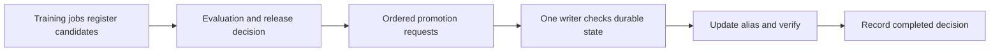

# Prevent Concurrent Model Promotions from Moving Aliases Out of Order

Author: [nawazdhandala](https://www.github.com/nawazdhandala)

Tags: MLflow, MLOps, Model Versioning, Concurrency

Description: Route model promotions through one controlled writer, reject stale release decisions, and preserve uncertain writes instead of letting late training jobs replace champion.

Two training jobs finish near each other. Each passes its own checks, reads the current production alias, and decides to update it. The newer approved release writes first. Then the older job's delayed request replaces it.

Both jobs can report success. The registry has accepted two valid updates, but the final selection violates the intended release order.

Prevent this by separating training from promotion. Training jobs produce candidates; one controlled workflow decides which approved candidate may move the production alias.

## Understand the missing concurrency guarantee

In **MLflow 3.18.0**, `set_registered_model_alias(name, alias, version)` has no expected-current-version or expected-generation argument. A read followed by this write is not a compare-and-swap operation, meaning an update conditional on the state remaining unchanged. [Alias API](https://mlflow.org/docs/latest/api_reference/python_api/mlflow.client.html#mlflow.client.MlflowClient.set_registered_model_alias), [Pinned SQL implementation](https://github.com/mlflow/mlflow/blob/v3.18.0/mlflow/store/model_registry/sqlalchemy_store.py)

Reading champion immediately before writing therefore does not solve the race. Another writer can act between those requests. Moving the coordination into a model tag has the same problem if competing jobs read and overwrite it independently.

Give production alias-write permission only to the promotion service or controlled release identity. Every administrative override must be coordinated with that workflow. A lock cannot protect against a writer that bypasses it.

## Order approved decisions, not registry numbers

Assign a monotonically increasing decision generation to each authorized release decision. “Monotonic” means the sequence moves forward; it is separate from model version numbering.

For example:

| Decision generation | Model version | Meaning |
|---|---|---|
| 100 | 8 | Earlier approved release |
| 101 | 7 | Later decision selecting a different evaluated candidate |
| 102 | 6 | Explicitly approved recovery to a retained version |

A later decision can intentionally choose a lower model version. The policy orders release intent, not training completion, metric values, or artifact registration time.

The authority assigning generations must also validate approval and bind each generation to one target and version. An untrusted training job must not invent a larger number to bypass review.



Serialize per registry, registered model, and alias. Unrelated models need not share one global bottleneck.

## A runnable example for one Unix host

The following example uses Python 3.11, `mlflow==3.18.0`, a local SQLite journal, and `fcntl.flock`. All participating publisher processes must run on the same Unix host and use the same state directory on a suitable local filesystem. It is not a multi-host controller.

The lock covers the state check, alias update, and completion record. Python documents `flock` as a Unix file-locking interface; SQLite provides explicit commit support for retaining the journal between process executions. [Python fcntl](https://docs.python.org/3.11/library/fcntl.html), [Python sqlite3](https://docs.python.org/3.11/library/sqlite3.html)

Configure these inputs through the release workflow:

| Input | Required meaning |
|---|---|
| `MLFLOW_TRACKING_URI`, `MLFLOW_REGISTRY_URI` | Approved endpoints, with normal credential configuration |
| `REGISTRY_ID`, `MODEL_NAME` | Stable registry identifier and exact registered model |
| `PROMOTION_STATE_DIR` | Persistent local directory dedicated to this controller |
| `BASELINE_VERSION` | Existing champion during the first controlled adoption |
| `DECISION_GENERATION`, `APPROVED_VERSION` | Authorized positive generation and numeric model version |

Bootstrap while other alias writers are disabled. The alias must already exist. Protect the state directory from edits by training jobs and retain it with release records. Deleting the journal resets the remembered ordering and defeats the protection.

Save this as `promote.py` and run it with those inputs:

```python
import fcntl
import os
import sqlite3
from pathlib import Path
from mlflow import MlflowClient

state = Path(os.environ['PROMOTION_STATE_DIR']).resolve()
state.mkdir(parents=True, exist_ok=True)
name = os.environ['MODEL_NAME']
registry_id = os.environ['REGISTRY_ID']
version = os.environ['APPROVED_VERSION']
generation = int(os.environ['DECISION_GENERATION'])
if generation < 1 or not version.isdigit() or int(version) < 1:
    raise ValueError('Use a positive decision generation and numeric version')
client = MlflowClient(
    tracking_uri=os.environ['MLFLOW_TRACKING_URI'],
    registry_uri=os.environ['MLFLOW_REGISTRY_URI'],
)
target = f'{registry_id}/{name}@champion'

with (state / 'writer.lock').open('a') as lock:
    fcntl.flock(lock, fcntl.LOCK_EX)
    db = sqlite3.connect(state / 'journal.sqlite')
    try:
        db.execute('''CREATE TABLE IF NOT EXISTS state (
            slot INTEGER PRIMARY KEY CHECK(slot=1), target TEXT,
            generation INTEGER, version TEXT, pending_generation INTEGER,
            pending_version TEXT)''')
        db.execute('INSERT OR IGNORE INTO state VALUES (1, ?, 0, ?, NULL, NULL)',
                   (target, os.environ['BASELINE_VERSION']))
        db.commit()
        row = db.execute('SELECT target, generation, version, '
                         'pending_generation FROM state WHERE slot=1').fetchone()
        if row[0] != target:
            raise RuntimeError('Journal belongs to a different target')
        if row[3] is not None:
            raise RuntimeError('Unresolved write: reconcile before promoting')
        current = str(client.get_model_version_by_alias(name, 'champion').version)
        if current != row[2]:
            raise RuntimeError('Alias differs from the recorded selection')
        if generation < row[1]:
            raise RuntimeError('Stale decision rejected')
        if generation == row[1]:
            if version != row[2]:
                raise RuntimeError('Decision generation reused for another version')
            print('Already applied')
        else:
            db.execute('UPDATE state SET pending_generation=?, pending_version=? '
                       'WHERE slot=1', (generation, version))
            db.commit()
            client.set_registered_model_alias(name, 'champion', version)
            actual = str(client.get_model_version_by_alias(name, 'champion').version)
            if actual != version:
                raise RuntimeError('Alias readback mismatch; pending write retained')
            db.execute('UPDATE state SET generation=?, version=?, '
                       'pending_generation=NULL, pending_version=NULL WHERE slot=1',
                       (generation, version))
            db.commit()
            print(f'Applied decision {generation}: version {version}')
    finally:
        db.close()
```

After generation 101 completes, generation 100 is rejected. Repeating generation 101 with the same version reports `Already applied`; reusing it for a different version fails. A higher generation can select an earlier version for an authorized recovery.

The code does not perform model-quality checks or authenticate the approval record. Those are prerequisites handled by the controlled release workflow.

## Retain uncertainty before making the external write

The journal records a pending decision before calling MLflow. If the process fails or the call raises, that pending record prevents another publisher from proceeding automatically.

This matters because a timeout does not prove the server rejected the request. It may have applied the alias change while its response was lost. A process can also fail after a successful update but before recording completion.

On an unresolved write, stop promotion and reconcile the decision record, alias, and request outcome. Ensure the earlier request can no longer complete before advancing. An alias value that happens to match the desired version at one instant is not sufficient proof that no older request remains in flight.

The example deliberately provides no automatic “clear pending” command. Recovery must establish whether the decision completed, failed definitively, or needs an explicit compensating release. Preserve that evidence when updating the journal through a reviewed recovery procedure.

## Know the boundary of the protection

A single-host file lock is advisory: all publishers must cooperate. Do not delete or replace the lock file while the controller is running, put independent copies on several hosts, or treat a shared network path as a proven distributed lock.

For multiple hosts, use a durable request queue and a controlled publisher architecture with explicit failover and unresolved-request handling. A lease expiring does not necessarily stop an old process from sending a late write. Fencing requires the protected write path to reject obsolete ownership tokens; the plain MLflow alias API does not accept such a token. Redis's distributed-lock guidance also calls out fencing as a protection for these cases. [Distributed-lock guidance](https://redis.io/docs/latest/develop/clients/patterns/distributed-locks/)

Finally, observe the controller: rejected stale generations, unexpected alias drift, time spent pending, last completed decision, and actual loaded deployment version. Moving champion remains separate from reloading serving workers.

Local tests used two competing publisher processes against MLflow 3.18.0 with SQLite. The higher decision generation won; duplicate, stale, conflicting, recovery, and drift cases behaved as described. A simulated lost response after an applied write left a pending record and blocked the next publisher. These checks did not exercise a remote server, real network partition, multi-host failover, or production permission policy.
