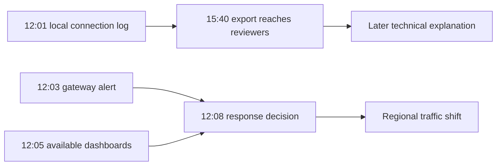

# Prevent Hindsight Bias in Incident Postmortems

Author: [nawazdhandala](https://www.github.com/nawazdhandala)

Tags: Postmortem, Incident Response, SRE

Description: Reconstruct the information available at each decision, separate event time from discovery time, and improve response systems without rewriting history.

After an incident, a diagnostic log may make the failure look obvious. The postmortem then asks why responders did not act on it sooner. The log became available only hours after service recovered.

Hindsight bias is the tendency for knowledge of the outcome to change how predictable the earlier situation appears. In incident review, it can turn a difficult decision under uncertainty into an apparently simple mistake. Etsy's account of blameless postmortems explicitly recognizes this problem and emphasizes the circumstances in which people acted. [Etsy's postmortem approach](https://www.etsy.com/codeascraft/blameless-postmortems)

The practical defense is to reconstruct the information available at the decision point, alongside the later technical explanation. Neither record should overwrite the other.

## Track when information became usable

An event timestamp answers when something happened. It does not establish when a responder could see it, understand it, or connect it to the incident.

Consider this fictional regional API incident:

| Evidence | Event time, UTC | Available to the response team | Limit |
|---|---|---|---|
| Local connection log records exhaustion | 12:01 | 15:40, after a diagnostic export | It was not in the on-call dashboard or incident channel |
| Gateway error alert fires | 12:03 | 12:03 | Shows user-visible errors, not their mechanism |
| Application dashboard shows normal CPU and high dependency latency | 12:05 observation | 12:05 | Does not show connection occupancy |
| Team chooses a regional traffic shift | 12:08 | Recorded in the incident channel then | Based on the evidence available at that point |
| Gateway errors return to normal | 12:12 | 12:12 | Confirms recovery, not the underlying cause by itself |

The 12:01 log belongs in the eventual technical chronology. It does not belong in the evidence available for the 12:08 decision unless another source shows that responders actually had access to it then.

This distinction also applies to dashboards reconstructed later. A query run after the incident may use different labels, longer retention, corrected instrumentation, or filters that nobody had identified during the response.

## Distinguish accessible, noticed, and understood

Information can exist somewhere without being operationally available. A log might require permissions the responder lacked, a slow support request, or knowledge of an undocumented host. A metric may be visible but buried among hundreds of panels.

Record the actual boundary:

- Accessible: the responder could retrieve it with the tools and permissions available.
- Noticed: there is evidence the responder saw or discussed it.
- Understood: the responder connected it to an interpretation or possible action.

Do not assume the final step from the first. Conversely, do not label evidence inaccessible merely because nobody happened to use it. Preserve uncertainty when the record does not establish who saw what.

Google's blameless-postmortem guidance focuses on the information and conditions surrounding decisions, rather than attributing failure to an individual's character. That creates room to investigate tool access, workload, and incomplete information directly. [Google SRE guidance](https://sre.google/sre-book/postmortem-culture/)

## Reconstruct a consequential decision

Choose a few decisions that materially affected the response: whether to fail over, restart a dependency, pause writes, or wait for additional evidence. Reconstruct each one using a short decision record.

For the fictional 12:08 traffic shift:

| Field | What the record should establish |
|---|---|
| Goal | Restore API availability while avoiding an unsafe state change |
| Signals | Gateway errors, high dependency latency, normal application CPU |
| Working interpretation | The affected region or its dependencies might be unhealthy |
| Options considered | Shift traffic, investigate further, or restart a component |
| Constraints | Continuing user impact, incomplete connection telemetry, known traffic-shift procedure |
| Expected result | Healthy-region capacity absorbs traffic; errors decrease |
| Reassessment signal | Destination saturation or unchanged errors would require another action |

These are facts to recover from records and accounts, not blanks the author should fill with a tidy story. If nobody remembers whether a restart was considered, say that. Do not manufacture a deliberation because it makes the decision look more systematic.

Etsy's facilitation guide recommends seeking descriptions of how events unfolded and how practitioners recognized situations. That helps uncover the cues and expectations behind a decision instead of immediately demanding a final explanation. [Debriefing facilitation guide](https://extfiles.etsy.com/DebriefingFacilitationGuide.pdf)

## Review the decision before revealing the final diagnosis

A useful review exercise is to prepare an evidence packet containing only material available by the decision time. Include the runbook version, visible dashboards, known risks, and operational constraints. Ask a reviewer who was not involved to describe reasonable next steps and what additional information would change them.

Then reveal the later evidence and compare the two views. This is a proposed facilitation technique, not a controlled measurement of decision quality. Reviewers may already know the outcome, and you cannot make them forget it. The value is in exposing where the discussion depends on information that arrived later.

Do not use the exercise to demand one “correct” answer. Two options may both have been reasonable, with different risks. A good outcome also does not prove a good decision process: an unsafe action can succeed by luck.

For the fictional case, learning about connection exhaustion may suggest a targeted restart for future incidents. It does not establish that choosing a traffic shift at 12:08 was unreasonable given the available evidence and documented procedure.

## Rewrite sentences that smuggle in later knowledge

Watch for words such as “obviously,” “simply,” and “should have known.” Replace them with the missing operational detail.

| Hindsight-shaped wording | Evidence-aware wording |
|---|---|
| The team ignored the connection problem | Connection occupancy was absent from the dashboards used during response; host logs were exported afterward |
| They wasted five minutes checking the application | Responders used CPU and error panels to test the application-saturation hypothesis |
| Restarting the client would have fixed it immediately | A later staging test recovered after a client restart; production timing and side effects were not reproduced |
| The status page proved the dependency was healthy | The team saw a green status page; its update time and coverage limited what that indicated |

The replacement should remain accurate, not become an excuse. If a documented signal was available and deliberately dismissed, record the reasoning and consequences. Blameless analysis still examines decisions; it avoids pretending the final answer was obvious beforehand.

## Improve the conditions for the next decision

Turn the reconstructed information gap into an improvement that can be verified. For the fictional incident, adding connection occupancy to the response dashboard is more specific than telling responders to inspect connections sooner.

Other useful changes might include making a safe diagnostic export available to the on-call role, displaying the age of cached health information, or adding clear reassessment criteria to the traffic-shift procedure. Validate access, interpretation, and response time in a rehearsal; a new panel is not useful merely because it exists.

Keep these proposals tied to observed gaps. Do not add a dozen mandatory checks to every incident because each would have helped in one retrospective case. A longer checklist can delay mitigation and increase attention demands.

## Keep two accounts in the final postmortem

The final document should explain both how the system failed and how the response unfolded with partial information. Use evidence links and clearly marked later findings to connect them. PagerDuty's postmortem workflow calls for a supported timeline and collaborative review, providing a useful structure for checking those distinctions. [Review workflow](https://docs.pagerduty.com/ops-guides/postmortem-best-practices/step-by-step)

Before approval, check whether every claimed missed signal was actually available, whether the author has invented a responder's thought process, and whether an unsuccessful action is judged only by its outcome. Ask whether someone reading the document could understand why the chosen action made sense then, even if a different action would now be preferred.

That record gives future responders something they can use: better cues, clearer options, and safer ways to revise a working hypothesis while the outcome is still unknown.
