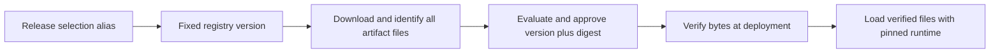

# What Should Production Pin: Model Version, Alias, or Artifact Digest?

Author: [nawazdhandala](https://www.github.com/nawazdhandala)

Tags: MLflow, Model Versioning, MLOps, Python

Description: Choose the right role for model aliases, numeric registry versions, and artifact digests, then verify that production receives the exact bytes approved for release.

Use an alias to select a release candidate, a registry version to preserve lineage, and a verified artifact digest to identify the approved bytes. Production deployments usually need the version and digest together. The alias remains useful as a release-management pointer.

These identifiers answer different questions. An alias says which version a team currently recommends. A version identifies a record in a particular registry. A digest identifies content according to a specified hashing format. None of them, by itself, proves that a model is safe, available, or compatible with the serving runtime.

## Compare the guarantees

| Reference | What it identifies | What can still change or fail |
|---|---|---|
| `models:/account-score@champion` | The version currently assigned to an alias | Alias reassignment changes later resolutions |
| `models:/account-score/17` | Version 17 of that model in the configured registry | Registry context, artifact availability, and inadequately protected artifact bytes |
| Artifact digest | Exact content covered by that digest | Availability, approval, runtime compatibility, and excluded files |
| Runtime image digest | A specific container image reference | External model files, configuration, data, and services |

MLflow supports both numeric version and alias references. Reassigning an alias affects subsequent loads through that alias. It does not retroactively replace model objects already loaded into a process. [MLflow registry workflow](https://mlflow.org/docs/latest/ml/model-registry/workflow/)

A numeric version needs its context. Version 17 in a development registry is not necessarily related to version 17 in production. Keep the registry identity, registered model name, and version together in the release record.

## Understand the artifact gap

A registry stores metadata about an artifact location. In MLflow's SQL-backed registry, the model version's download location is resolved from stored metadata; registering a version does not make an arbitrary underlying filesystem or object-store path immutable. [MLflow 3.18.0 registry implementation](https://github.com/mlflow/mlflow/blob/v3.18.0/mlflow/store/model_registry/sqlalchemy_store.py)

Suppose version 17 points to files in a writable storage location. Replacing those files can change what a new process loads without creating version 18. Pinning the numeric version prevents alias drift, but it does not compensate for storage that permits replacement.

Retention and byte verification address different problems. Retention keeps the approved object available. Verification checks that the object fetched is the one approved. For S3, Object Lock protects specific object versions; it does not prevent a new version from being added under the same key. Resolve and retain the intended object version rather than assuming a bare key always retrieves the protected one. [S3 Object Lock](https://docs.aws.amazon.com/AmazonS3/latest/userguide/object-lock.html)

## Resolve during release preparation

Treat alias resolution as part of preparing a proposed deployment. Read it once, capture the numeric version, and evaluate that fixed reference. Avoid looking up the alias independently in every rollout step.



For example, one replica might resolve `champion` before a promotion and another afterward. Both successfully start, but they serve different versions. That is acceptable only when the rollout deliberately tracks and controls the mixture.

The following example records an alias selection and later verifies its artifact directory. It uses **MLflow 3.18.0** and **Python 3.11**. It is a release audit utility, not a model server or an approval system.

Configure `MLFLOW_TRACKING_URI` and `MLFLOW_REGISTRY_URI` using your normal environment and credentials. Set `MODEL_NAME`, `MODEL_ALIAS`, and a nonsecret `REGISTRY_LABEL`, such as `production-eu`. These are your actual registry values; the label is an operator check, not proof of server identity.

Save this as `pin.py` in an empty working directory:

```python
import hashlib
import json
import os
import sys
import tempfile
from pathlib import Path
import mlflow
from mlflow import MlflowClient

mlflow.set_tracking_uri(os.environ['MLFLOW_TRACKING_URI'])
mlflow.set_registry_uri(os.environ['MLFLOW_REGISTRY_URI'])
client = MlflowClient()
record = Path('model-pin.json')

def tree_digest(root):
    files = []
    for path in sorted(root.rglob('*')):
        if path.is_symlink():
            raise RuntimeError('Model artifacts must not contain symlinks')
        if path.is_file():
            with path.open('rb') as handle:
                digest = hashlib.file_digest(handle, 'sha256').hexdigest()
            files.append([path.relative_to(root).as_posix(), digest])
        elif not path.is_dir():
            raise RuntimeError('Unsupported artifact file type')
    if not files:
        raise RuntimeError('Empty model artifact')
    raw = json.dumps(files, ensure_ascii=True, separators=(',', ':')).encode()
    return hashlib.sha256(raw).hexdigest()

mode = sys.argv[1]
if mode == 'record':
    selected = client.get_model_version_by_alias(
        os.environ['MODEL_NAME'], os.environ['MODEL_ALIAS']
    )
    pin = {'registry_label': os.environ['REGISTRY_LABEL'],
           'name': selected.name, 'version': str(selected.version),
           'digest_algorithm': 'sorted-path-sha256-json-v1'}
elif mode == 'verify':
    pin = json.loads(record.read_text())
    if pin['registry_label'] != os.environ['REGISTRY_LABEL']:
        raise RuntimeError('Registry context differs from approved record')
    if pin['digest_algorithm'] != 'sorted-path-sha256-json-v1':
        raise RuntimeError('Unsupported digest format')
else:
    raise SystemExit('Use: pin.py record | verify')

if not str(pin['version']).isdigit():
    raise RuntimeError('Expected a numeric registered model version')
uri = f"models:/{pin['name']}/{pin['version']}"
with tempfile.TemporaryDirectory(prefix='model-pin-') as directory:
    local = Path(mlflow.artifacts.download_artifacts(
        artifact_uri=uri, dst_path=directory
    ))
    actual = tree_digest(local)
    if mode == 'record':
        pin['artifact_digest'] = actual
        with record.open('x') as handle:
            json.dump(pin, handle, indent=2)
        print(f'Recorded {uri}; submit this record for approval')
    else:
        if actual != pin['artifact_digest']:
            raise RuntimeError('Model artifact bytes differ from approved record')
        print(f'Artifact verification passed for {uri}')
```

MLflow's artifact download API accepts model URIs and returns the local download path. This script hashes file contents and relative filenames in sorted order. Its named algorithm describes this application's directory fingerprint; it is not an OCI image digest or a standard MLflow digest field. [Artifact download API](https://mlflow.org/docs/latest/api_reference/python_api/mlflow.artifacts.html#mlflow.artifacts.download_artifacts)

The directory must remain stable during download and evaluation. Protect the source from concurrent modification. A fingerprint of a mixed download is still a fingerprint, but not evidence of a coherent training artifact.

## Approve the record, then verify it

Run the two modes in their respective release stages:

```bash
python pin.py record
python pin.py verify
```

`record` creates `model-pin.json` without overwriting an existing file. It captures the selected numeric version and digest. Submit that record with evaluation evidence for approval; generating a checksum does not grant approval.

`verify` uses the numeric version in the record, even if the alias has moved. It fails when downloaded artifact content differs. Provide the record through an authenticated deployment mechanism so an attacker or mistaken job cannot simply replace both the files and their expected digest.

The script deletes its temporary download on exit and does not deserialize the model. In a serving integration, retain the verified directory and load that exact local path before it can change. Fetching the model again after verification opens another opportunity to retrieve different bytes. Verification must be adjacent to the actual load, not just a historical CI report.

Hash the complete model artifact, including preprocessing, code, tokenizer files, and model configuration. Hashing only `MLmodel` verifies its metadata file, not every file it references. External dependencies need their own retained identities and checks.

## Test the guarantees independently

The local validation used two synthetic models in a SQLite-backed MLflow registry. After recording version 1, moving `champion` to version 2 did not change which version the verifier checked.

A controlled edit to version 1's backing weight file then changed a fresh model load's output from 10 to 99. The registry still reported version 1. Verification rejected the changed content. Added and removed artifact files also caused rejection.

These tests demonstrate the difference between registry identity and byte identity in the local setup. They did not test an object-lock service, a container registry, production storage permissions, or an authenticated approval workflow.

## Pin the runtime without freezing maintenance

A container image digest can pin the serving image. Docker documents pulling by digest to select a fixed image; a mutable tag does not offer the same selection guarantee. An image that downloads model files at startup still needs a separate model artifact check. [Docker digest references](https://docs.docker.com/reference/cli/docker/image/pull/#pull-an-image-by-digest-immutable-identifier)

Record the intended runtime platform and test the approved model with that runtime. Identical weights can fail to load with incompatible framework versions or produce different numerical behavior on another accelerator stack. Pinning makes the chosen combination explicit; compatibility testing establishes whether it works.

A pinned image also does not receive fixes automatically. Rebuild, evaluate, and approve a new runtime digest when dependencies need updating. Keep the previous approved combination available for a controlled rollback.

## Choose a policy for each consumer

For a long-running production service, deploy a fixed version, verified artifact digest, and tested runtime identity. Report the loaded identifiers in startup logs or deployment metadata.

For a scheduled batch job that intentionally follows the current champion, resolve the alias once at job start and save the resulting version and digest with the job's outputs. This preserves an explanation of what actually ran even when policy permits following a moving pointer.

For interactive experiments, alias-based loading may be convenient, but record the resolved version before comparing results. When verification fails in production, stop that candidate from becoming ready and investigate the storage or release mismatch. Do not silently recompute an expected digest or fall back to whichever alias happens to resolve.
