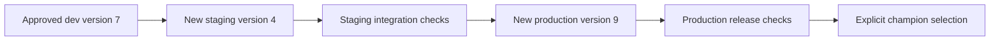

# Promote MLflow Models Across Environments with copy_model_version

Author: [nawazdhandala](https://www.github.com/nawazdhandala)

Tags: MLflow, MLOps, Model Versioning, Python

Description: Promote a fixed MLflow model version through development, staging, and production with explicit destination versions, validation gates, and artifact-access checks.

Promoting a model means making a particular trained artifact available under the rules of another environment. It should not mean retraining unexpectedly, selecting whichever candidate finished last, or assuming that a successful registry operation changed production traffic.

MLflow's `copy_model_version` API creates a new version under another registered model. This supports a simple workflow with separate development, staging, and production model names. MLflow also describes promoting training and deployment code across environments for more mature workflows; choose deliberately which approach your release process needs. [Environment promotion guidance](https://mlflow.org/docs/latest/ml/model-registry/workflow/#promoting-an-mlflow-model-across-environments)

This tutorial uses **MLflow 3.18.0**, Python 3.11, and three registered models in one open-source MLflow registry. It does not describe arbitrary transfer between independent registry servers or Databricks Unity Catalog migration.

## Define the environment boundaries first

Use distinct names such as:

| Environment | Registered model | Purpose |
|---|---|---|
| Development | `dev.forecasting.demand` | Register training outputs and evaluate candidates |
| Staging | `staging.forecasting.demand` | Test the selected artifact with deployment integration |
| Production | `prod.forecasting.demand` | Retain approved releases and production selections |

Names make the intent visible, but do not enforce access control. Provision the models and their permissions before promotion. Training jobs should not gain production write access merely because they can read the registry.

Confirm that the promotion identity can read the source and create destination versions, while the eventual serving identity can read the destination and its underlying artifacts. Registry permissions and artifact-storage permissions are separate concerns.

Keep environment checks distinct. A tag such as `checks.dev=passed` records development evidence; it should not automatically satisfy staging or production approval.

## Freeze the source before crossing the boundary

Suppose the selected development model is version 7. Copy `models:/dev.forecasting.demand/7`, not a moving `latest` reference. If your selection starts with an alias, resolve it once and record the numeric version before evaluation and promotion.

The destination receives its own version number. Development version 7 might become staging version 4 and production version 9. Those numbers identify entries within different registered models; they are not expected to match.



The numbers illustrate a workflow, not output that every registry will produce. Record the version returned by each copy operation.

## Understand what copy means on your backend

The public API requires a `models:/` source URI and creates the destination registered model if it does not exist. A typo can therefore create an unintended destination. The example below checks that the destination already exists. [Pinned public API](https://github.com/mlflow/mlflow/blob/v3.18.0/mlflow/tracking/client.py)

For the open-source SQLite backend tested here, copying creates a destination version whose `source` refers to the source model version. The underlying download location resolves to the existing artifact location. This operation does not independently duplicate the model files into a production bucket. [Copy implementation](https://github.com/mlflow/mlflow/blob/v3.18.0/mlflow/store/model_registry/abstract_store.py), [SQL registry implementation](https://github.com/mlflow/mlflow/blob/v3.18.0/mlflow/store/model_registry/sqlalchemy_store.py)

Consequently, a production registry entry does not make source artifacts disposable. Preserve the actual files, runtime assets, and required retention. If environments require physically separate storage or independent availability, design and verify an artifact-transfer process rather than assuming this API provides one.

Other registry backends can implement copying differently. Check the behavior and permissions of the backend you actually use.

## Copy one fixed candidate and record the result

In a virtual environment with `mlflow==3.18.0`, configure `MLFLOW_TRACKING_URI` and `MLFLOW_REGISTRY_URI` for the intended registry and supply authentication through your normal credential mechanism.

For a development-to-staging promotion, set these nonsecret inputs:

| Variable | Example |
|---|---|
| `SOURCE_MODEL` | `dev.forecasting.demand` |
| `SOURCE_VERSION` | `7` |
| `DESTINATION_MODEL` | `staging.forecasting.demand` |
| `DESTINATION_ENV` | `staging` |
| `PROMOTION_ID` | Your unique release-workflow identifier |

Save and run this script only after the source version has passed the required development review. It creates a destination version, records its identity, and adds traceability tags. It does not assign a serving alias.

```python
import json
import os
from mlflow import MlflowClient

client = MlflowClient(
    tracking_uri=os.environ['MLFLOW_TRACKING_URI'],
    registry_uri=os.environ['MLFLOW_REGISTRY_URI'],
)
source_name = os.environ['SOURCE_MODEL']
source_version = os.environ['SOURCE_VERSION']
destination = os.environ['DESTINATION_MODEL']
environment = os.environ['DESTINATION_ENV']
promotion_id = os.environ['PROMOTION_ID']
if not source_version.isdigit() or int(source_version) < 1:
    raise ValueError('Choose an explicit positive source version')
if source_name == destination:
    raise ValueError('Source and destination must differ')
client.get_registered_model(destination)  # Reject a missing destination.
source = client.get_model_version(source_name, source_version)
if source.status != 'READY':
    raise RuntimeError('Source version is not ready')

source_uri = f'models:/{source_name}/{source_version}'
copied = client.copy_model_version(source_uri, destination)
print(json.dumps({
    'promotion_id': promotion_id,
    'source_uri': source_uri,
    'destination_uri': f'models:/{destination}/{copied.version}',
}), flush=True)
client.set_model_version_tag(destination, copied.version,
                             'promotion.id', promotion_id)
client.set_model_version_tag(destination, copied.version,
                             'promotion.source_uri', source_uri)
client.set_model_version_tag(destination, copied.version,
                             f'checks.{environment}', 'pending')
```

Persist the printed result in the release record. `READY` describes registration state, not prediction quality. The tags support review and discovery; they are not an authorization mechanism.

This sequence is not transactional. If tagging fails after the copy succeeds, the destination version still exists. Inspect and reconcile that version rather than blindly repeating the copy.

## Validate the destination as its actual consumer

Test the numeric destination URI with the staging runtime and identity. Verify model loading, input signature, preprocessing assets, representative predictions, resource use, and required dependency access.

Loading can use `mlflow.pyfunc.load_model` with the returned URI, followed by the model's representative test inputs. Use your model's expected schema and quality thresholds rather than inventing a generic prediction test. [Python model loading](https://mlflow.org/docs/latest/api_reference/python_api/mlflow.pyfunc.html#mlflow.pyfunc.load_model)

The default copy implementation carries source version tags and description, but does not automatically make the destination a serving champion. Review inherited metadata so a generic source `validation_status=passed` cannot accidentally authorize production. Use environment-specific checks and a controlled approval record.

Once staging evidence is accepted, run the same copy procedure with the exact staging model and version as the source and the precreated production model as the destination. Capture the newly returned production version independently.

## Select production only after its release checks

Creating a production version and moving traffic are separate steps. After the production checks and approval, a serialized release workflow can update the intended alias:

```python
import os
from mlflow import MlflowClient

client = MlflowClient(
    tracking_uri=os.environ['MLFLOW_TRACKING_URI'],
    registry_uri=os.environ['MLFLOW_REGISTRY_URI'],
)
name = os.environ['PRODUCTION_MODEL']
version = os.environ['APPROVED_PRODUCTION_VERSION']
client.set_registered_model_alias(name, 'champion', version)
actual = client.get_model_version_by_alias(name, 'champion')
if str(actual.version) != version:
    raise RuntimeError('Champion readback differs from the approved version')
```

The approved version input must come from the release decision, not from selecting the newest destination version. Retain the previous selection and its compatible runtime for recovery. Updating an alias does not reload an already-running model object; follow the serving platform's deployment procedure and verify what it loaded.

## Handle retries and retention explicitly

`copy_model_version` does not accept an idempotency key. Repeating a successful request creates another destination version. A promotion identifier tag helps reconciliation, but does not make concurrent requests atomic or prevent duplicate copies.

After an ambiguous timeout, inspect destination versions and the workflow record before retrying. If several copies exist, identify their source, results, and intended release; do not infer approval from the largest number.

Local tests for this article used synthetic models and SQLite. They verified both promotion hops, independent destination numbering, inherited metadata, successful destination loading, unchanged aliases until explicit selection, and shared underlying download locations. They also confirmed that repeating a copy creates an additional version. No hosted permissions, physical storage migration, real model quality gate, or production rollout was tested.
