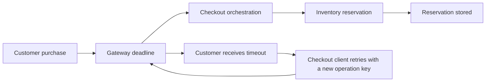

# Review a Cross-Team Incident When No Service Owns the Whole Failure

Author: [nawazdhandala](https://www.github.com/nawazdhandala)

Tags: Postmortem, Incident Response, SRE

Description: Review incidents that emerge between services by tracing customer operations, checking interface assumptions, and assigning verifiable work across teams.

The gateway team sees a timeout. The checkout team sees a failed request. The inventory team sees a successful reservation. Each team's dashboard can be accurate while the customer experiences a broken purchase.

A cross-team postmortem needs to explain how those local outcomes combined. Searching for one service to “own the incident” too early can hide the interface assumptions that made the failure possible.

The review still needs an accountable coordinator and concrete action owners. Shared causation should not become shared ambiguity.

## Give the review an owner before assigning the cause

Choose a review lead who can maintain the incident record, obtain evidence, resolve unanswered questions, and coordinate decisions. That role does not mean the lead's service caused the incident or that their team must implement every correction.

Invite people who understand the customer journey, the involved service boundaries, and the response itself. Include a product or support representative when the customer effect cannot be inferred reliably from service metrics.

Google's incident-response guidance distinguishes managing the response from resolving the technical problem. The same separation is useful after the incident: coordinating a review and explaining a particular component are different responsibilities. [Incident coordination](https://sre.google/workbook/incident-response/)

Agree on a concise question such as: “How did one purchase attempt produce multiple inventory reservations while the customer received an error?” That keeps the scope concrete without deciding the answer in advance.

## Trace one customer operation across boundaries

Start with a representative operation whose evidence is sufficiently complete. Then check whether the pattern explains the broader affected cohort. A single trace is an example, not automatically a measurement of every customer.

Consider this fictional interaction:

The arrows show the proposed interaction to investigate. They do not prove that a timeout caused a retry or that every retry created another reservation; those claims need records from the relevant components.

In the worked example, the gateway stops waiting after two seconds, while the inventory operation completes after three. The checkout client retries the same customer intent through the gateway using a new operation key. Inventory treats the second key as a separate reservation. These numbers and behaviors are invented for explanation, not recommended settings.

## Build an assumption table, not a blame table

Ask each team what its service expected from the caller and promised to the next component. Compare those expectations with the documented contract and observed behavior.

| Boundary | Assumption to check | Evidence to request |
|---|---|---|
| Gateway to checkout client | A timeout means the operation did not complete | Gateway result, downstream lifecycle, and cancellation handling |
| Checkout to inventory | Retrying with a new key is safe | Retry configuration, operation-key generation, and reservation records |
| Inventory to checkout | Each distinct key represents a distinct intent | API contract and duplicate-handling behavior |
| Reservation to stock availability | Unused reservations expire within the intended interval | Expiration rules, cleanup evidence, and observed age |

An API is an application programming interface: the agreed way one service requests behavior from another. Its contract includes more than field names. Deadlines, retries, side effects, cancellation, and duplicate handling are part of the interaction.

Do not assume that cancelling a call reverses work already performed. For example, gRPC's deadline guidance says the server application is responsible for stopping activity it started for a cancelled call. That is a specific reminder to inspect implementation behavior, not evidence that your own service uses gRPC or handles cancellation correctly. [gRPC deadlines and server work](https://grpc.io/docs/guides/deadlines/)

## Reconstruct the sequence with evidence owners

Give each important claim an evidence reference and an owner who can explain its limits. Link the gateway request, checkout attempt, reservation record, and customer outcome where identifiers permit.

Separate a customer operation from its network attempts. A retry is another attempt at an intended operation; it is not necessarily another purchase. If identifiers change at every hop, record how the mapping was established and where it remains uncertain.

The AWS Builders' Library explains how caller-provided identifiers can express intent for idempotent APIs. Idempotent behavior means that repeating the same intended operation does not introduce additional side effects. Your review should establish the actual key scope, duplicate semantics, and retention period rather than merely recommending “add idempotency.” [Retry intent and idempotent APIs](https://aws.amazon.com/builders-library/making-retries-safe-with-idempotent-APIs/)

Include decisions during response too. Perhaps inventory's success metric delayed its team's involvement, while checkout's error metric pointed toward the gateway. That information explains coordination and detection gaps without making either metric inherently dishonest.

## Test competing explanations before agreeing on one

The fictional pattern could have several explanations: a new retry policy, a changed deadline, slower inventory processing, or a pre-existing mismatch exposed by increased traffic. Distinguish the trigger from conditions that allowed impact to spread.

For each explanation, state what observation would support it and what would weaken it. A retry configuration change matters only if the affected workload used it. A latency increase matters only if its timing and cohort fit the observed failures.

Avoid treating the last deployed service as the default cause. Also avoid an artificial compromise in which every team receives an equal share of blame. The evidence may show different contributions, or it may leave some questions unanswered.

Google's blameless-postmortem guidance emphasizes understanding contributing conditions and improving systems. Apply that approach to team boundaries as well as individual actions. [Blameless postmortems](https://sre.google/sre-book/postmortem-culture/)

## Turn boundary findings into linked deliverables

Assign each implementation task to the team that can change and operate that component. Assign the end-to-end acceptance decision to an explicitly named owner with input from the affected teams.

For the example, the proposed work might be:

| Deliverable | Responsible owner | Completion evidence |
|---|---|---|
| Preserve one operation identity across retries of the same intent | Checkout team | Duplicate-attempt tests and a documented key contract |
| Enforce the agreed duplicate semantics | Inventory team | Concurrent duplicate requests do not create extra reservations |
| Align deadline and cancellation expectations | Gateway and checkout owners, with one task lead | Reviewed timeout behavior and a controlled delayed-response test |
| Detect abandoned reservation buildup | Inventory operations owner | A tested signal and a clear response procedure |
| Verify the customer journey after all changes | Named journey owner | Integrated acceptance results reviewed by all involved teams |

A task involving two teams still needs one accountable lead. Split large deliverables when each part has different deployment or validation dependencies. Link the tasks so “done” on one side does not hide a remaining requirement on the other.

## Rehearse the failure at the boundary

Use a controlled test environment and synthetic customer operations. The purpose is to test the interaction, not to reproduce customer harm in production.

Exercise at least three relevant cases: a response arriving after the caller stops waiting, repeated attempts for the same intent, and concurrent attempts with the same identity. Also test a genuinely new intent so deduplication does not suppress legitimate work.

Specify the expected result before running the test. For example, repeated attempts for one intent should produce one effective reservation under the agreed contract, while a new purchase should remain independent. Decide what the customer sees when the outcome is still uncertain.

Record actual results, configuration versions, and evidence. Passing separate service unit tests does not establish that the combined journey behaves correctly. This article proposes those tests; it does not claim they were run against a real checkout system.

## Close the review with explicit boundaries

The final postmortem should name the customer impact, supported interaction, remaining unknowns, action owners, and integrated validation plan. Preserve a dissenting technical interpretation when evidence has not resolved it, with the next investigation step.

If no team currently owns the customer journey's acceptance criteria, make that missing responsibility a decision to resolve rather than quietly assigning every task to the review lead.

The useful outcome is a clearer system contract and a way to verify it. Every service can retain its own ownership while the organization takes responsibility for what happens between them.
