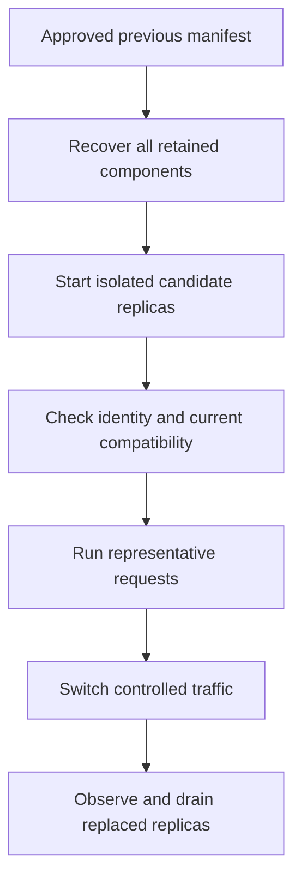

# Roll Back a Complete Model Release with One Versioned Manifest

Author: [nawazdhandala](https://www.github.com/nawazdhandala)

Tags: Model Versioning, MLOps, Rollback, Deployment

Description: Restore a compatible combination of model weights, application code, prompts, data snapshots, and configuration, then verify it before switching production traffic.

A model release starts returning poor answers. You restore yesterday's weights, but the service still uses today's prompt, preprocessing code, and retrieval index. The deployment looks rolled back while its behavior represents a combination nobody evaluated.

Make the rollback unit a complete release manifest: a versioned record identifying the components that must run together. Then recover that combination beside the current service, test it against current dependencies, and deliberately switch traffic. This guide concentrates on that recovery procedure, including the evidence needed to avoid a partial rollback.

## Identify what must move together

A manifest names retained artifacts; it does not create backups or make external systems reversible. Preserve the approved manifest and everything required to reconstruct its release before deploying a replacement.

| Component | Identity to retain | Recovery check |
|---|---|---|
| Weights | Complete artifact digest, tokenizer and preprocessing assets | Files exist and load in the retained runtime |
| Code | Serving image digest and source revision | Image starts on the target platform |
| Prompt | Exact template version and rendering implementation | Rendered messages match approved fixtures |
| Data | Retrieval snapshot or reference-data revision | Restored data has the expected records and access controls |
| Configuration | Effective behavior-changing settings and digest | Thresholds, feature flags, timeouts and routing are applied |

Record credentials by purpose, not secret value. Old releases should use current authorized credentials. A rollback must not resurrect revoked access or obsolete tenant permissions.

An MLflow alias selects a model version, but changing it does not coordinate every other component or replace models already loaded by running processes. Resolve numeric versions when preparing the release and keep registry context with them. [MLflow registry workflow](https://mlflow.org/docs/latest/ml/model-registry/workflow/)

## Separate release data from live business state

“Roll back data” needs a precise meaning. A read-only product taxonomy or retrieval corpus can often be restored into a separate versioned location. Orders, payments, conversations, and newly collected events cannot simply be replaced with yesterday's copy without losing subsequent activity.

For live stores, ask whether the old code can read and write the current schema. A removed column, changed event format, or new mandatory field can make an otherwise valid old release unusable. Prefer additive schema changes that keep the previous application compatible during the rollback window. If compatibility is absent, stop and choose an explicitly planned recovery or forward repair.

Database point-in-time recovery is a separate operation with its own recovery target and reconciliation plan. PostgreSQL, for example, restores a base backup and replays archived write-ahead logs. A model manifest does not perform or substitute for that process. [PostgreSQL 18 recovery documentation](https://www.postgresql.org/docs/18/continuous-archiving.html)

For retrieval, restore into an isolated collection and verify both results and authorization. Qdrant collection snapshots have deployment-specific limits, including node-local behavior in distributed installations and exclusion of collection aliases. Preserve the application-to-collection mapping separately. [Qdrant snapshots](https://qdrant.tech/documentation/snapshots/)

## Recover beside the active release

Freeze competing promotion jobs and record the current release identity. Select an approved previous manifest from the release record, not whichever registry alias happens to resolve during the incident.



Fetch and verify artifacts before startup. A container image digest fixes the selected image, but does not cover model files downloaded later. Check those files independently and load the verified local copies. [Docker image digest references](https://docs.docker.com/reference/cli/docker/image/pull/#pull-an-image-by-digest-immutable-identifier)

Restore release-owned data to a separate location. Start candidate replicas with the old prompt, configuration and runtime together. Keep them outside general traffic while testing. Disable external side effects in smoke tests, or use approved test accounts and destinations.

Kubernetes rollback alone is insufficient: Deployment revisions restore the Pod template, not arbitrary external resources. Referencing the same mutable ConfigMap name can therefore recover old containers with newer settings. Use release-specific configuration identities; immutable ConfigMaps can help prevent in-place edits. [Deployment rollback](https://kubernetes.io/docs/concepts/workloads/controllers/deployment/#rolling-back-a-deployment), [immutable ConfigMaps](https://kubernetes.io/docs/concepts/configuration/configmap/#immutable-configmaps)

## Gate routing on observed component identities

Have the startup loader report what it actually loaded after integrity verification. Do not populate every field by blindly echoing requested configuration. Collect reports from every candidate replica that may receive traffic through authenticated operational access.

This illustrative manifest uses an application-owned schema. Replace the uppercase placeholders with actual approved identities. A data snapshot name must resolve to retained, immutable content in your system.

```json
{
  "format": 1,
  "release_id": "support-41",
  "components": {
    "weights": "sha256:APPROVED_WEIGHTS_DIGEST",
    "code": "registry.example/support@sha256:APPROVED_IMAGE_DIGEST",
    "prompt": "sha256:APPROVED_PROMPT_DIGEST",
    "data": "APPROVED_RETRIEVAL_SNAPSHOT_ID",
    "config": "sha256:APPROVED_CONFIGURATION_DIGEST"
  }
}
```

Save the real manifest as `release.json`. Your deployment adapter must produce `reports.json`, a JSON array with one object per candidate: `replica`, `release_id`, `components`, `ready`, and `smoke_passed`. The last two fields are Boolean results from actual startup and request checks. This is not a built-in Kubernetes or MLflow endpoint.

Save the following as `gate.py`. It requires Python 3.11, no third-party packages, and an approved manifest SHA-256 obtained from your authenticated release system. SHA-256 identifies the manifest bytes; a checksum supplied by an untrusted candidate is not an approval. [Python hashlib](https://docs.python.org/3.11/library/hashlib.html)

```python
import hashlib
import json
import sys
from pathlib import Path

raw = Path(sys.argv[1]).read_bytes()
if hashlib.sha256(raw).hexdigest() != sys.argv[2]:
    raise SystemExit('Manifest does not match the approved digest')
manifest = json.loads(raw)
keys = {'weights', 'code', 'prompt', 'data', 'config'}
expected = manifest['components']
if manifest.get('format') != 1 or not manifest.get('release_id'):
    raise SystemExit('Unsupported or incomplete manifest')
if set(expected) != keys or not all(
    isinstance(value, str) and value.strip() for value in expected.values()
):
    raise SystemExit('Expected five explicit component identities')

reports = json.loads(Path(sys.argv[3]).read_text())
if not isinstance(reports, list) or not reports:
    raise SystemExit('No candidate replicas were checked')
seen = set()
for report in reports:
    replica = report['replica']
    if not isinstance(replica, str) or not replica or replica in seen:
        raise SystemExit('Missing or duplicate replica identity')
    seen.add(replica)
    if report.get('release_id') != manifest['release_id']:
        raise SystemExit(f'{replica}: release differs')
    if report.get('components') != expected:
        raise SystemExit(f'{replica}: component identities differ')
    if report.get('ready') is not True or report.get('smoke_passed') is not True:
        raise SystemExit(f'{replica}: readiness or smoke check failed')
print(f"Verified {len(seen)} candidate replicas for {manifest['release_id']}")
print('Traffic has not been changed; routing approval is a separate step')
```

Run it after collecting fresh reports:

```bash
python3.11 gate.py release.json APPROVED_MANIFEST_SHA256 reports.json
```

Replace `APPROVED_MANIFEST_SHA256` with the approved 64-character digest. Success prints the verified replica count and release identity; a mismatch exits unsuccessfully. The script does not change routing, execute model code, restore data, or validate the truth of a replica's report. Your adapter must ensure the report set covers all eligible replicas and is still current when routing changes.

Local tests with Python 3.11.13 accepted two matching synthetic reports. They rejected a mismatch in each of the five components, duplicate or missing replicas, failed readiness, failed smoke checks, an altered release identity, and an unapproved manifest. These tests validate the gate logic, not a live rollback.

## Prove behavior before moving requests

A process can be healthy while its answers are wrong. Replay a small approved request set covering preprocessing, expected output structure, retrieval results, tenant isolation, and important decision boundaries. For nondeterministic generation, evaluate defined properties rather than requiring identical wording.

Test current client inputs and current external-service contracts. Yesterday's passing evaluation does not prove compatibility after a schema or API change. Compare latency and memory with the capacity available now; the previous runtime may require resources no longer allocated.

Record the manifest digest, candidate replica identities, evaluation revision, results, and operator decision. Missing artifacts, unavailable hosted model versions, or incompatible live state are reasons to block the candidate, not silently substitute a newer component.

## Switch traffic and verify the completed rollback

Use one deployment controller or a serialized operational procedure. Recheck that the active release has not changed since the rollback began. Two independent jobs switching model and prompt aliases can recreate the mixed release this process is designed to prevent.

Move controlled traffic to the verified candidates, observe request failures and behavior, then expand according to the incident plan. Tag operational evidence with the loaded release identity so you can distinguish errors from old and replacement replicas. Drain in-flight requests before removing replaced instances; long-running jobs may need to finish under their original release.

Keep both releases available until the observation window closes. If the recovered release fails, returning traffic to the newer release is another explicit deployment decision. Neither direction reverses tool calls, emails, payments, or writes already completed. Reconcile those effects separately and retain the evidence explaining which release processed them.
