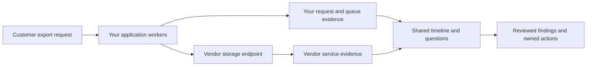

# Run a Shared Postmortem with a Cloud Provider or Vendor

Author: [nawazdhandala](https://www.github.com/nawazdhandala)

Tags: Postmortem, Incident Response, SRE

Description: Build a shared incident review with a cloud provider or vendor using scoped evidence, reconciled timelines, explicit unknowns, and verifiable actions.

“The provider had an incident” is useful context, but it does not explain your customers' entire experience. Your application may have recovered later because of queued work, repeated retries, or a dependency that stayed unhealthy after the provider's headline recovery time.

A shared postmortem connects the two sides of that boundary. It should explain the observed interaction, identify improvements each organization controls, and preserve uncertainty where one side cannot see the other's evidence.

You do not need access to every internal system at the vendor. You do need a precise exchange of questions, scoped observations, and reviewable conclusions.

## Start with the customer journey and the boundary

Name the customer operation that failed and identify where it crossed into the provider's service. For example, an export worker may call a managed object-storage endpoint before marking a customer job complete.

The two evidence paths are separate because the organizations observe different parts of the operation. Your client may record a timeout without knowing whether the vendor received the request. The vendor may observe service recovery while your old requests remain queued.

Keep the review focused on that boundary before expanding into unrelated architecture. Document region, endpoint, operation, affected resource cohort, and relevant client configuration, while keeping identifiers inside the agreed sharing channel.

## Gather the right provider record

Collect the provider event identifier, support-case reference, report revision, and publication time. A screenshot of a public status page is not necessarily an account-specific impact statement.

AWS Health explicitly distinguishes public events from events specific to an account or organization. Public events can describe a regional issue even when your account does not use the affected service. Use the applicable account and resource context when linking an event to your incident. [AWS Health event scope](https://docs.aws.amazon.com/health/latest/ug/aws-health-concepts-and-terms.html)

Azure similarly describes its public status page as a channel for particular broad-impact or communication-failure scenarios, while most service issue communications are targeted through Service Health. A quiet public page is therefore not sufficient evidence that your workload had no provider-side issue. [Azure public and targeted communications](https://learn.microsoft.com/en-us/azure/service-health/azure-status-overview)

Do not promise your team that every vendor will provide a joint meeting, internal logs, or a detailed report. Confirm what your actual support arrangement offers. A structured written exchange can still support a useful shared review.

## Agree on the review's working rules

Choose one coordinator on your side and request a technical contact through the established vendor channel. Clarify who can answer implementation questions, who can approve shared wording, and who owns follow-up requests.

Agree on the purpose: explain the failure interaction and improve resilience. Keep contractual credit discussions or commercial negotiations in their appropriate process so they do not replace the technical review.

Specify the evidence-sharing channel, intended recipients, retention expectations, and restrictions on redistribution. Share the smallest useful sample of request identifiers and sanitized records. Do not upload an unrestricted log dump simply because it may contain a useful line.

Maintain an open-question list with an owner and next review date. This prevents “waiting for the vendor” from becoming an indefinite status with no concrete request.

## Build a two-sided timeline

Use UTC, identify the source of each timestamp, and distinguish the event time from the time someone reported it. Retain known clock uncertainty instead of forcing a misleading exact order.

Here is a fictional example:

| Time, UTC | Observation | Evidence owner |
|---|---|---|
| 14:02 | Export workers begin recording elevated storage timeouts | Your team |
| 14:05 | Provider publishes an initial service notice | Provider |
| 14:18 | Provider reports recovery of the affected service cohort | Provider |
| 14:19 | New application storage calls return to normal | Your team |
| 14:30 | Previously queued export jobs finish processing | Your team |

The first notice is not necessarily the start of the underlying provider failure. The provider's 14:18 recovery and your 14:30 backlog completion can both be correct because they measure different milestones.

Ask whether the provider's affected cohort includes your endpoint and resources. Compare request identifiers where both parties can do so. Matching timestamps alone establish a useful correlation, not proof that every failed customer operation had the same cause.

## Ask questions that another engineer can answer

Replace “Why did your service break our system?” with requests tied to a specific observation.

| Your observation | Focused question |
|---|---|
| Client requests timed out after 30 seconds | Did these sampled request IDs reach the service, and what outcome was recorded? |
| Retries continued after service recovery | Was throttling or partial recovery still present for this resource cohort? |
| A failover attempt used the same endpoint | Which dependencies remained shared by the attempted recovery path? |
| Public recovery preceded workload recovery | What measurement and population defined the provider's recovery time? |
| A support response changed its explanation | Which report revision supersedes the earlier statement? |

Define “request ID” as the correlation identifier used to connect records across systems. It is not universally available, and different layers may generate different identifiers. Record where mapping is impossible rather than inventing a join between unrelated values.

A vendor may be unable to release underlying logs. Request a bounded statement of what was checked, which cohort it covers, and any remaining uncertainty. Label that statement as provider-supplied evidence rather than implying that your team independently inspected the service internals.

## Separate findings from attribution

Maintain three categories in the shared draft: observations both sides accept, explanations supported by available evidence, and questions still unresolved.

For the fictional export incident, the application records can establish the timeout and backlog windows. The provider report may establish a storage-service disruption. Whether a particular retry policy extended customer delay requires evidence about that policy and the queue, not merely agreement that retries are often problematic.

Keep disagreements visible in neutral language. “The provider reports recovery at 14:18; our new-request latency recovered at 14:19; the difference has not been explained” is more useful than choosing one timestamp and discarding the other.

Provider reports can evolve. Azure Service Health distinguishes preliminary and final post-incident reviews, or PIRs. Preserve which version supported each conclusion and revisit the shared draft when a later report changes it. [Preliminary and final PIR labels](https://learn.microsoft.com/en-us/azure/service-health/service-health-event-tags)

## Assign actions on both sides of the boundary

An action needs an owner, a concrete outcome, and evidence of completion. Google's postmortem guidance emphasizes actionable follow-up rather than a document that merely records the outage. [Postmortem follow-through](https://sre.google/workbook/postmortem-culture/)

Your team might own a controlled test of retry limits and queue drainage after dependency recovery. Define the test's workload, recovery condition, and acceptable completion time. The provider might own an investigation or a service change, but record it as requested until the vendor actually accepts it.

Track a provider commitment with its reference and confirmation date. “Vendor fixed it” should not close your application resilience action. Likewise, deploying a client change does not establish that the vendor's underlying defect is resolved.

If an improvement depends on both sides, split it into linked deliverables with an accountable owner for each. For example, the provider clarifies documented throttling behavior and your team verifies the client policy against that behavior.

## Publish what is known and keep the review open where needed

Complete your internal review even if a provider answer is pending. Record the gap, its owner, the current operating risk, and the next follow-up date. Update the review when evidence arrives.

Before sharing an external account, confirm which vendor material may be quoted or linked. Preserve your customer impact and recovery milestones even when some provider implementation details remain restricted.

A useful shared postmortem ends with an explanation of the interaction, explicit limits on the evidence, and owned work that can be verified. It should help the next responder distinguish a provider failure from the application's response to that failure, including the period after the provider reports recovery.
