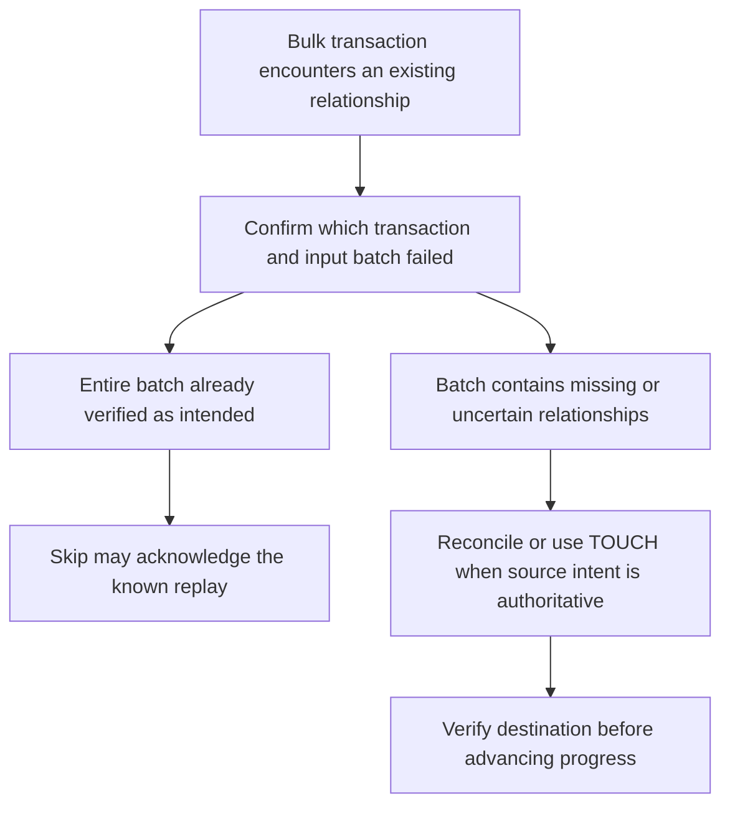

# Resume SpiceDB Bulk Imports When Relationships Already Exist

Author: [nawazdhandala](https://www.github.com/nawazdhandala)

Tags: SpiceDB, Data Migration, Go, Authorization

Description: Reproduce duplicate failures, compare Skip and TOUCH recovery, and avoid marking a mixed batch complete when its missing relationships were never written.

Your bootstrap import stops because one relationship already exists. The input batch also contains relationships that have never been loaded. Retrying with a strategy called `Skip` sounds like it should ignore the duplicate and import everything else.

That assumption is unsafe for the Go helper examined here. With **authzed-go 1.9.0**, a duplicate conflict under `Skip` returns success for the entire attempted batch without writing its missing relationships. You must distinguish a known-complete replay from a mixed batch before choosing that behavior. [Pinned retry helper](https://github.com/authzed/authzed-go/blob/v1.9.0/v1/retryable_client.go)

## Find the transaction boundary first

The raw `ImportBulkRelationships` API uses a client stream: the client sends one or more messages, then closes the stream and receives the final response. All relationships in that RPC belong to one transaction. An existing relationship causes that transaction to fail; previously acknowledged RPCs remain separate committed work. [Bulk API contract](https://github.com/authzed/api/blob/e89c0a673a7e234081ed186bd91dd8a30e3e2b03/authzed/api/v1/permission_service.proto)

A message successfully sent over the network is not a committed batch. If the final response is lost, the outcome can be ambiguous. Persist progress at acknowledged transaction boundaries and reconcile uncertain ones rather than inferring success from the last message sent.

Authzed distinguishes message chunks from the overall transaction size and advises keeping transactions within what the datastore can comfortably handle. More messages inside one stream do not create smaller commits. [Bulk import guidance](https://authzed.com/docs/spicedb/ops/data/bulk-operations)

## Choose recovery based on the batch's meaning

For duplicate conflicts in the pinned Go helper:

| Strategy | Result | Appropriate interpretation |
|---|---|---|
| `Fail` | Returns an error | Stop and investigate overlap or incorrect input |
| `Skip` | Returns nil after the conflicting bulk call | Do not infer that missing rows were loaded |
| `Touch` | Falls back to `WriteRelationships` using `TOUCH` | Create missing relationships and update existing ones to the supplied representation |

`Skip` can fit a recovery process that has independently established that the entire immutable batch is already present as intended. It is not a per-relationship deduplicator. The helper's implementation, rather than the short strategy name, defines this behavior. [Conflict branches](https://github.com/authzed/authzed-go/blob/v1.9.0/v1/retryable_client.go)



## Reproduce the mixed-batch trap

This program uses **Go 1.25.8**, **authzed-go 1.9.0**, and **SpiceDB 1.57.1**. Use an empty disposable SpiceDB memory datastore with authenticated TLS. The program writes its lab schema and creates three uniquely named documents. Do not point it at production.

Set `SPICEDB_ENDPOINT` to the gRPC address, `SPICEDB_TOKEN` to its credential, and `SPICEDB_CA_FILE` to the trusted CA bundle. Save this as `main.go` in a new directory:

```go
package main

import (
    "context"
    "fmt"
    "os"
    "time"

    pb "github.com/authzed/authzed-go/proto/authzed/api/v1"
    authzed "github.com/authzed/authzed-go/v1"
    "google.golang.org/grpc"
    "google.golang.org/grpc/codes"
    "google.golang.org/grpc/credentials"
    "google.golang.org/grpc/metadata"
    "google.golang.org/grpc/status"
)

func must(err error) {
    if err != nil { panic(err) }
}
func env(key string) string {
    value := os.Getenv(key)
    if value == "" { panic("Set " + key) }
    return value
}
func relationship(document, user string) *pb.Relationship {
    return &pb.Relationship{
        Resource: &pb.ObjectReference{ObjectType: "document", ObjectId: document},
        Relation: "viewer",
        Subject: &pb.SubjectReference{Object: &pb.ObjectReference{
            ObjectType: "user", ObjectId: user,
        }},
    }
}

func main() {
    tls, err := credentials.NewClientTLSFromFile(env("SPICEDB_CA_FILE"), "")
    must(err)
    client, err := authzed.NewRetryableClient(env("SPICEDB_ENDPOINT"),
        grpc.WithTransportCredentials(tls))
    must(err)
    defer client.Close()
    ctx, cancel := context.WithTimeout(context.Background(), 30*time.Second)
    defer cancel()
    ctx = metadata.AppendToOutgoingContext(ctx,
        "authorization", "Bearer " + env("SPICEDB_TOKEN"))
    _, err = client.WriteSchema(ctx, &pb.WriteSchemaRequest{Schema: `
        definition user {}
        definition document {
            relation viewer: user
            permission view = viewer
        }`})
    must(err)

    for _, trial := range []struct {
        name string
        strategy authzed.ConflictStrategy
        wantError, wantBob bool
    }{
        {"fail", authzed.Fail, true, false},
        {"skip", authzed.Skip, false, false},
        {"touch", authzed.Touch, false, true},
    } {
        id := fmt.Sprintf("resume-%s-%d", trial.name, time.Now().UnixNano())
        alice, bob := relationship(id, "alice"), relationship(id, "bob")
        _, err = client.WriteRelationships(ctx, &pb.WriteRelationshipsRequest{
            Updates: []*pb.RelationshipUpdate{{
                Operation: pb.RelationshipUpdate_OPERATION_CREATE,
                Relationship: alice,
            }},
        })
        must(err)
        batch := []*pb.Relationship{bob, alice}
        stream, err := client.ImportBulkRelationships(ctx)
        must(err)
        must(stream.Send(&pb.ImportBulkRelationshipsRequest{Relationships: batch}))
        _, err = stream.CloseAndRecv()
        if status.Code(err) != codes.AlreadyExists {
            panic(fmt.Sprintf("Expected duplicate conflict, got %v", err))
        }
        err = client.RetryableBulkImportRelationships(ctx, batch, trial.strategy)
        if (err != nil) != trial.wantError {
            panic(fmt.Sprintf("Unexpected recovery result: %v", err))
        }
        check, checkErr := client.CheckPermission(ctx, &pb.CheckPermissionRequest{
            Consistency: &pb.Consistency{Requirement: &pb.Consistency_FullyConsistent{
                FullyConsistent: true,
            }},
            Resource: bob.Resource, Permission: "view", Subject: bob.Subject,
        })
        must(checkErr)
        allowed := check.Permissionship == pb.CheckPermissionResponse_PERMISSIONSHIP_HAS_PERMISSION
        if allowed != trial.wantBob { panic("Unexpected Bob permission") }
        fmt.Printf("%s: error=%t bob_allowed=%t\n", trial.name, err != nil, allowed)
    }
}
```

The TLS helper loads the trusted CA and leaves hostname verification enabled. Authentication is attached to the request context; there is no embedded credential. [gRPC TLS helper](https://pkg.go.dev/google.golang.org/grpc@v1.80.0/credentials#NewClientTLSFromFile)

Initialize and run the new module:

```bash
go mod init example.com/spicedb-import-resume
go get github.com/authzed/authzed-go@v1.9.0
go mod tidy
go run .
```

Expected output:

```text
fail: error=true bob_allowed=false
skip: error=false bob_allowed=false
touch: error=false bob_allowed=true
```

Each trial starts with Alice already present and Bob absent. The raw stream fails, including its attempted new Bob relationship. The helper then demonstrates why a nil error from `Skip` does not establish completeness. These checks were run locally against the memory datastore; they are not a production SQL or clock-consistency test.

## Bound batches for the fallback path too

In authzed-go 1.9.0, the fallback submits the supplied relationships in one ordinary `WriteRelationships` request. It does not subdivide an oversized slice despite the internal function's batching-oriented name. Keep each helper call within your server's configured ordinary write limit and acceptable message size. The documented default write limit is 1,000 relationships; configuration can change it. [Fallback source](https://github.com/authzed/authzed-go/blob/v1.9.0/v1/retryable_client.go), [Write limits](https://authzed.com/docs/spicedb/ops/data/bulk-operations)

Do not mix up this Go helper with `zed import`. In zed 1.2.1, that command directly performs batched ordinary `TOUCH` writes; it is a different entry point with different controls. There is no `--skip-duplicates` flag implied by this article. [Pinned CLI import](https://github.com/authzed/zed/blob/v1.2.1/internal/cmd/import.go)

## Treat TOUCH as a real permission update

`TOUCH` is useful when replaying the same desired relationship representation. It is not “leave existing data alone.” A source export may contain old grants or older caveat data; applying it can replace newer intent. A revocation made after the export can be undone by recreating its relationship. [Relationship operations](https://authzed.com/docs/spicedb/ops/data/writing-relationships)

Before recovery, establish whether the snapshot or a newer change stream owns each resource's current state. Fence conflicting writers during a baseline replay or use an application version protocol that rejects obsolete mutations. Retrying faster does not solve that ordering problem.

## Advance progress only with evidence

Retain immutable batch identity, input checksum, transformation version, expected relationship count, and the recovery strategy used. Distinguish “bulk committed,” “replayed through TOUCH,” “skipped after independent verification,” and “outcome unknown.”

Compare destination relationships and representative allowed and denied decisions before declaring the partition complete. Check both missing and extra relationships. A count alone can hide an unwanted grant replacing a missing one.

For a lost final response, revisit the whole transaction boundary using its unchanged input. Never discard the remainder of a mixed batch merely because one duplicate was found. Recovery is complete when the intended destination state is verified, not when an exception stops appearing.
