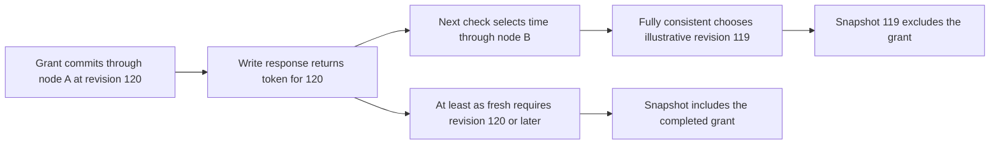

# Why SpiceDB Fully Consistent Reads Can Miss CockroachDB Writes

Author: [nawazdhandala](https://www.github.com/nawazdhandala)

Tags: SpiceDB, CockroachDB, Authorization, Consistency

Description: Understand SpiceDB's CockroachDB revision selection, carry a write token into checks, and investigate stale authorization without relying on sleeps.

A relationship write succeeds. Your application immediately checks permission with `fully_consistent`, yet the answer appears to describe the old state. With SpiceDB backed by CockroachDB, that sequence is possible even when the write committed successfully.

Authzed documents this specific exception: `fully_consistent` does not guarantee read-after-write consistency with the CockroachDB datastore. The recommended mechanism is the completed write's ZedToken with `at_least_as_fresh`. [CockroachDB consistency caveat](https://authzed.com/docs/spicedb/concepts/consistency#fully-consistent)

This article explains the database boundary behind that exception and gives you a focused staging check. The implementation discussion is pinned to **SpiceDB 1.57.1**; the commands use **zed 1.2.1**.

## Follow the revision, not the flag's name

A revision identifies the database state used for a permission calculation. SpiceDB must evaluate all the relationships involved in that calculation against a coherent snapshot, including relationships reached through groups or parent objects.

In the pinned implementation, the fully consistent request path calls the datastore's `HeadRevision`. The CockroachDB driver obtains that revision using `cluster_logical_timestamp()`. Its snapshot reader then passes the chosen revision into queries using `AS OF SYSTEM TIME`. These are separate steps: first choose a time, then evaluate the relationships at that time. [Consistency middleware](https://github.com/authzed/spicedb/blob/v1.57.1/pkg/middleware/consistency/consistency.go), [CockroachDB driver](https://github.com/authzed/spicedb/blob/v1.57.1/internal/datastore/crdb/crdb.go), [Snapshot reader](https://github.com/authzed/spicedb/blob/v1.57.1/internal/datastore/crdb/reader.go)

CockroachDB describes `cluster_logical_timestamp()` as the current transaction's logical timestamp. HLC means hybrid logical clock: it combines a physical-time component with a logical counter. It is not an application-wide acknowledgment that every preceding request used a smaller timestamp. [Function reference](https://www.cockroachlabs.com/docs/stable/functions-and-operators#system-info-functions)

The following numbers illustrate ordering only; they are not real CockroachDB timestamps:



The database may have the committed data and still correctly exclude it from an explicitly older snapshot. CockroachDB's `AS OF SYSTEM TIME` is specifically a historical-read mechanism. This explains why checking replication health alone does not establish that the authorization request selected the right revision. [Historical reads](https://www.cockroachlabs.com/docs/stable/as-of-system-time)

## Understand the clock boundary

Authzed explains that the timestamp selected through one CockroachDB node can lag a recent write's timestamp from another node because their clocks can differ. Its documentation cites a default maximum offset of 500 milliseconds; your deployment's configured bound may differ. The issue concerns SpiceDB's explicit revision selection, not a general failure of CockroachDB's ordinary read-after-write behavior. The write overlap strategy does not remove this read-side clock difference. [Documented exception and overlap behavior](https://authzed.com/docs/spicedb/concepts/consistency#fully-consistent)

Do not turn that bound into an application sleep. A delay adds latency, leaves the required dependency implicit, and encourages later maintainers to treat an observed timing value as a correctness contract. Clock synchronization remains important operational work, but the request should carry the write it depends on. Cockroach Labs discusses clock offsets and their operational tradeoffs separately. [Clock-management guidance](https://www.cockroachlabs.com/blog/clock-management-cockroachdb/)

## Compare requests in an isolated permissions system

Use Bash, `jq`, zed 1.2.1, and a disposable SpiceDB system. For investigating this particular behavior, that system must use CockroachDB with the topology and driver configuration you intend to evaluate. Do not overwrite a production schema to run this example.

Set `SPICEDB_ENDPOINT`, `SPICEDB_TOKEN`, and `SPICEDB_CA_FILE` through your normal secure environment setup. The endpoint is the gRPC address, and the CA file contains the certificate authority trusted to sign its TLS certificate.

```bash
set -euo pipefail
: "${SPICEDB_ENDPOINT:?Set the isolated gRPC endpoint}"
: "${SPICEDB_TOKEN:?Supply the isolated system credential}"
: "${SPICEDB_CA_FILE:?Set the trusted CA bundle path}"
zed_lab() {
  zed --endpoint "$SPICEDB_ENDPOINT" --token "$SPICEDB_TOKEN" \
    --certificate-path "$SPICEDB_CA_FILE" "$@"
}
```

Save this minimal schema as `clock-check.zed`:

```zed
definition user {}
definition document {
  relation reader: user
  permission view = reader
}
```

In the same shell, write the schema and create a uniquely named document relationship. `TOUCH` creates or updates that exact relationship. Capture the successful response's token before checking anything:

```bash
zed_lab schema write clock-check.zed >/dev/null
resource="document:clock-check-$(date +%s)-$$"
write_token=$(zed_lab relationship touch "$resource" reader user:alice \
  --json | jq -er '.writtenAt.token')
```

These commands create authorization data in the isolated fixture. Keep the token opaque: do not decode it into a timestamp, compare token strings, or construct one from a wall clock. The client flag names and write response follow the pinned CLI implementation. [Relationship command](https://github.com/authzed/zed/blob/v1.2.1/internal/commands/relationship.go), [Permission command](https://github.com/authzed/zed/blob/v1.2.1/internal/commands/permission.go)

Compare the two request forms immediately:

```bash
zed_lab permission check "$resource" view user:alice \
  --consistency-full --json
zed_lab permission check "$resource" view user:alice \
  --consistency-at-least "$write_token" --json
```

The token-bearing check should return `PERMISSIONSHIP_HAS_PERMISSION`, assuming no other writer changes this fixture. A fully consistent check may also allow access, and usually observing success does not disprove the documented edge case. A single request is not a controlled clock-skew experiment.

For this article, both command forms were exercised locally against an in-memory SpiceDB server over verified TLS. That verifies the CLI and token path. It does **not** reproduce distributed CockroachDB clock behavior; the explanation of that behavior comes from official documentation and tagged source review.

## Carry the dependency through the application

In the pinned middleware, the minimum-freshness path compares the supplied revision with the server's optimized revision and selects the later one. That is why a valid write token from the same datastore can impose the missing lower bound without demanding a particular historical snapshot. [Revision selection implementation](https://github.com/authzed/spicedb/blob/v1.57.1/pkg/middleware/consistency/consistency.go)

Store or forward the token from the mutation that the next action must observe. For a revocation-sensitive operation, an earlier grant token is insufficient. If another service performs the check, the token must cross that service boundary too. A token held only by the administrator's browser cannot constrain a request made by somebody else's session.

Treat this as an application contract: “this check must include this completed change.” Define what happens when token persistence fails after a successful relationship write. Retrying a request without its required token changes the contract and can reintroduce the very behavior you are debugging.

## Gather evidence before changing database settings

Use a narrow incident record:

| Evidence | What it distinguishes |
|---|---|
| Successful write response and request identifier | Committed mutation versus failed or ambiguous write |
| Resource, subject, permission, and schema version | Freshness issue versus a different authorization question |
| Exact consistency mode and token provenance | Missing freshness requirement versus a properly constrained request |
| Direct SpiceDB result versus application response | Datastore evaluation versus application or proxy caching |
| Concurrent grant/revoke activity | Old snapshot versus a newer legitimate state change |
| SpiceDB version and CockroachDB topology | Relevant implementation and deployment boundary |

Keep relationship details and credentials out of broadly accessible logs. Preserve tokens through the intended application path rather than publishing them as diagnostic identifiers.

If the token-bearing check fails, investigate its error and datastore association instead of substituting `fully_consistent` as an automatic fallback. If it succeeds while the application still denies access, inspect the token's journey and surrounding caches. The durable correction is an explicit ordering requirement that survives every request hop.
