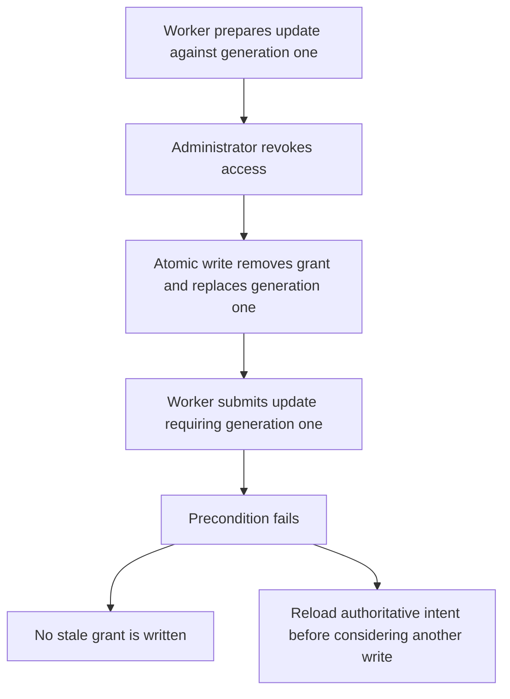

# Stop Stale SpiceDB Writers from Restoring Revoked Access

Author: [nawazdhandala](https://www.github.com/nawazdhandala)

Tags: SpiceDB, Authorization, Optimistic Concurrency

Description: Use atomic relationship preconditions and a changing generation marker to reject stale SpiceDB updates without silently undoing a revocation.

A background worker reads an old sharing configuration. An administrator removes Alice's access. The worker eventually applies its earlier calculation with `TOUCH`, restoring the relationship the administrator just deleted.

Read-after-write tokens cannot prevent that write. They help subsequent reads observe a change; they do not reject a later mutation based on obsolete application state. This problem needs a condition checked inside the write transaction.

SpiceDB's `WriteRelationships` accepts optional preconditions and applies its updates atomically. If a precondition fails, the entire request fails. The useful question is therefore: which relationship proves that the writer's assumptions are still current? [Write API contract](https://github.com/authzed/api/blob/e89c0a673a7e234081ed186bd91dd8a30e3e2b03/authzed/api/v1/permission_service.proto)

## Make the guard change whenever access changes

One application-level design is a generation marker: a relationship whose subject identifies the current version of a document's access configuration. Every cooperating writer requires the old marker, replaces it with a never-reused marker, and changes the actual access relationships in the same request.



This is optimistic concurrency: workers prepare independently, then verify that their starting state remains valid when committing. The marker is an application convention, not a built-in SpiceDB version field. Its safety depends on every relevant writer participating.

An existence check on Alice's grant alone is weaker. A delete followed by a new grant can make the same relationship exist again. Never reusing generation identifiers avoids that particular “changed and changed back” ambiguity.

## Build a small, isolated fixture

The example uses **SpiceDB 1.57.1** with its HTTPS API enabled and Python 3's standard library. Run it only in an empty disposable permissions system. The script writes the entire lab schema and modifies access relationships.

Save this as `guard.zed`:

```zed
definition user {}
definition epoch {}
definition document {
  relation viewer: user
  relation generation: epoch
  permission view = viewer
}
```

The generation relation does not grant `view`. Its subject is merely a unique marker. In a real deployment, restrict relationship-write credentials to the services enforcing your mutation protocol; end users should not be able to bypass it.

Set `SPICEDB_HTTP_URL` to the isolated HTTPS origin, `SPICEDB_TOKEN` to its credential, and `SPICEDB_CA_FILE` to the trusted CA bundle. Save the following Python blocks, in order, as `guard_demo.py` beside the schema:

```python
import json
import os
import ssl
import urllib.error
import urllib.request
import uuid
from pathlib import Path

base = os.environ["SPICEDB_HTTP_URL"].rstrip("/")
if not base.startswith("https://"):
    raise ValueError("Use the isolated HTTPS endpoint")
tls = ssl.create_default_context(cafile=os.environ["SPICEDB_CA_FILE"])

def post(route, body):
    request = urllib.request.Request(
        base + route, data=json.dumps(body).encode(), method="POST",
        headers={"Authorization": "Bearer " + os.environ["SPICEDB_TOKEN"],
                 "Content-Type": "application/json"},
    )
    with urllib.request.urlopen(request, context=tls, timeout=10) as response:
        return json.load(response)

resource = {"objectType": "document", "objectId": "guard-" + uuid.uuid4().hex}

def update(operation, relation, subject_type, subject_id):
    return {"operation": "OPERATION_" + operation, "relationship": {
        "resource": resource, "relation": relation,
        "subject": {"object": {"objectType": subject_type,
                               "objectId": subject_id}},
    }}

def require_generation(value):
    return {"operation": "OPERATION_MUST_MATCH", "filter": {
        "resourceType": "document", "optionalResourceId": resource["objectId"],
        "optionalRelation": "generation",
        "optionalSubjectFilter": {"subjectType": "epoch", "optionalSubjectId": value},
    }}

def write(updates, conditions=()):
    return post("/v1/relationships/write", {
        "updates": updates, "optionalPreconditions": list(conditions),
    })
```

`post` authenticates each request and verifies the server certificate. `update` constructs one relationship mutation. `require_generation` narrows the condition to one document and one marker; matching any generation would not protect a stale writer. The field names are protobuf JSON names used by the HTTP API. [HTTP API](https://authzed.com/docs/spicedb/api/http-api)

Initialize the disposable resource with Alice's grant and a marker:

```python
post("/v1/schema/write", {"schema": Path("guard.zed").read_text()})
old = uuid.uuid4().hex
new = uuid.uuid4().hex
write([
    update("CREATE", "generation", "epoch", old),
    update("CREATE", "viewer", "user", "alice"),
])
```

A production worker must associate its marker with the state used to calculate the update. Read the marker and relationship inputs from the same SpiceDB snapshot; combining a fresh marker with old cached inputs defeats the guard. If the authoritative intent lives in another database, coordinate that database's version separately. Here, `old` deliberately represents a paused worker's starting point.

Now let the revocation finish before that worker resumes:

```python
revoked = write([
    update("DELETE", "viewer", "user", "alice"),
    update("DELETE", "generation", "epoch", old),
    update("CREATE", "generation", "epoch", new),
], [require_generation(old)])

try:
    write([
        update("TOUCH", "viewer", "user", "alice"),
        update("DELETE", "generation", "epoch", old),
        update("CREATE", "generation", "epoch", uuid.uuid4().hex),
    ], [require_generation(old)])
except urllib.error.HTTPError as error:
    failure = json.load(error)
    reasons = {detail.get("reason") for detail in failure.get("details", [])}
    expected = "ERROR_REASON_WRITE_OR_DELETE_PRECONDITION_FAILURE"
    if expected not in reasons:
        raise RuntimeError(failure) from error
    print("Stale writer rejected")
else:
    raise RuntimeError("Stale writer unexpectedly committed")

answer = post("/v1/permissions/check", {
    "consistency": {"atLeastAsFresh": revoked["writtenAt"]},
    "resource": resource, "permission": "view",
    "subject": {"object": {"objectType": "user", "objectId": "alice"}},
})
if answer["permissionship"] != "PERMISSIONSHIP_NO_PERMISSION":
    raise RuntimeError(answer)
print("Alice remains denied")
```

Run it with `python3 guard_demo.py`. Expected output is `Stale writer rejected`, then `Alice remains denied`. An unrelated error is not counted as a successful conflict test.

The revocation's token constrains the final permission check. The precondition protects the mutation itself. These mechanisms solve different parts of the sequence.

## Know exactly what the server checks

`MUST_MATCH` requires at least one relationship matching its filter. `MUST_NOT_MATCH` requires none. Neither evaluates a computed permission, checks your application database, nor compares ZedTokens. In the pinned server, these checks run through the read-write transaction before the relationship updates. [Precondition implementation](https://github.com/authzed/spicedb/blob/v1.57.1/internal/services/v1/preconditions.go), [Transactional write path](https://github.com/authzed/spicedb/blob/v1.57.1/internal/services/v1/relationships.go)

This means a broad “no viewer exists” condition is not equivalent to “my configuration version is current.” Nor can a separate permission check followed by an unconditional write provide the same atomic protection.

The example's single active marker is also an invariant your writer must preserve. SpiceDB does not enforce “exactly one generation relationship” from this schema. Initialization must be controlled, every successful change must replace the marker, and repair tools must obey the same rules. Treat multiple active markers as a protocol error. A document marker covers only writers that advance it; changes to group membership or inherited permissions need an appropriate coordination scope of their own.

## Resolve a conflict without undoing the revocation

When a stale grant fails, reload the authoritative sharing intent before deciding whether another write is appropriate. Do not simply fetch the new marker and attach it to the old grant request. That would turn the guard into a retry delay while still resurrecting access.

If a grant wins a genuine race first, the revoker's old-marker request can fail instead. The application must refresh its state and complete the still-authorized revocation, or report that it has not completed. A rejected request is not evidence that the requested access change happened.

Separate a confirmed precondition failure from a network timeout with an unknown commit outcome. Record operation identity and expected marker transitions so recovery can determine what happened. Never claim a cross-database transaction: an application row and this SpiceDB request still need their own coordination design.

The local review exercised the published sequence over verified TLS and additional simultaneous guarded writes against an in-memory server. Production SQL isolation, queue delivery, application decisions, and bypass writers remain separate integration concerns. Start rollout by inventorying every relationship writer; one unconditional repair job can defeat an otherwise correct protocol.
