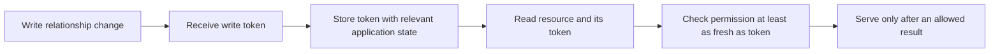

# Guarantee Read-After-Write Authorization with SpiceDB ZedTokens

Author: [nawazdhandala](https://www.github.com/nawazdhandala)

Tags: SpiceDB, Authorization, Consistency

Description: Carry write tokens into permission checks, verify grants and revocations, and preserve the freshness requirement through application storage and caches.

An administrator grants Alice access to a document, the write succeeds, and the next page load says she is forbidden. The same ordering problem is more serious after a revocation: a permission check could use a snapshot from before the access change.

SpiceDB lets each read express how fresh its data must be. The default latency-oriented behavior can choose a cached revision. To require a check to include a particular completed write, capture that write's ZedToken and send it with `at_least_as_fresh`. [Read-after-write behavior](https://authzed.com/docs/spicedb/concepts/read-after-write)

A ZedToken is an opaque marker for a datastore revision. It is not a bearer credential and does not itself grant access. Its role is to establish a minimum freshness requirement for a later request.

## Understand the exact guarantee

`at_least_as_fresh` means the permission calculation uses data at least as recent as the supplied revision. It can use a newer revision. It does not freeze the result at the moment the token was issued, reserve access, or incorporate every future write. [Consistency API definition](https://github.com/authzed/api/blob/e89c0a673a7e234081ed186bd91dd8a30e3e2b03/authzed/api/v1/permission_service.proto)

For example, a token from Alice's grant cannot require a later check to include Bob's subsequent revocation of that grant. The application must carry the revision associated with the change it needs reflected. This is why token storage and propagation are part of the authorization design rather than optional logging details.



The token establishes ordering between the write and check. It does not create an atomic transaction between SpiceDB and your application database.

## Run a small grant-and-revoke rehearsal

The examples use **SpiceDB 1.57.1**, **zed 1.2.1**, Bash, and `jq`. Use an isolated staging permissions system with no unrelated schema or relationships. Supply its authenticated gRPC endpoint and trusted CA bundle through your environment. These examples change only a disposable document relationship, but the schema write describes the entire lab system.

```bash
set -euo pipefail
: "${SPICEDB_ENDPOINT:?Set the isolated staging endpoint}"
: "${SPICEDB_TOKEN:?Supply the staging credential securely}"
: "${SPICEDB_CA_FILE:?Set the trusted CA bundle path}"
zed_stage() {
  zed --endpoint "$SPICEDB_ENDPOINT" --token "$SPICEDB_TOKEN" \
    --certificate-path "$SPICEDB_CA_FILE" "$@"
}
```

Keep the same shell session for subsequent commands. No certificate-verification bypass is needed. The CLI's `--consistency-at-least` flag supplies the API's `at_least_as_fresh` requirement. [Pinned permission commands](https://github.com/authzed/zed/blob/v1.2.1/internal/commands/permission.go)

Save this schema as `document.zed`:

```zed
definition user {}

definition document {
  relation viewer: user
  permission view = viewer
}
```

Write the schema and establish that Alice initially lacks access:

```bash
schema_token=$(zed_stage schema write document.zed --json |
  jq -er '.writtenAt.token')
zed_stage permission check document:roadmap view user:alice \
  --consistency-at-least "$schema_token" --json
```

Expect `PERMISSIONSHIP_NO_PERMISSION`. Next, grant Alice the viewer relationship and retain the exact write token:

```bash
grant_token=$(zed_stage relationship touch document:roadmap viewer user:alice \
  --json | jq -er '.writtenAt.token')
zed_stage permission check document:roadmap view user:alice \
  --consistency-at-least "$grant_token" --json
```

Expect `PERMISSIONSHIP_HAS_PERMISSION`. `TOUCH` is an idempotent relationship update, so repeating this exact grant does not produce a duplicate-create error. It is still a real authorization change, not merely a cache refresh. [Relationship operations](https://authzed.com/docs/spicedb/ops/data/writing-relationships)

Now revoke the same disposable relationship:

```bash
revoke_token=$(zed_stage relationship delete document:roadmap viewer user:alice \
  --json | jq -er '.writtenAt.token')
zed_stage permission check document:roadmap view user:alice \
  --consistency-at-least "$revoke_token" --json
```

Expect `PERMISSIONSHIP_NO_PERMISSION`. In this CLI version, the exact relationship-delete command uses `WriteRelationships` with a delete operation, so its response contains `writtenAt`. Do not confuse it with the separate filter-based `DeleteRelationships` API and its response shape. [zed relationship implementation](https://github.com/authzed/zed/blob/v1.2.1/internal/commands/relationship.go)

## Distinguish a freshness floor from a historical snapshot

For a diagnostic demonstration immediately after the revocation, request the exact older grant snapshot:

```bash
zed_stage permission check document:roadmap view user:alice \
  --consistency-at-exactly "$grant_token" --json
```

Within the datastore's retained history, this can return Alice's historical allowed result. It is deliberately asking a different question. Do not use that old exact snapshot to authorize current access after a revocation. Exact-snapshot requests can also fail when their revision has been garbage-collected. [Exact versus minimum consistency](https://authzed.com/docs/spicedb/concepts/consistency)

A minimum-freshness check using the old grant token is likewise insufficient to demand inclusion of the later revocation. It may select newer data, but the caller has not required that. Use the revocation token when that change is the required boundary.

The local rehearsal verifies these token-bearing requests against an in-memory server. It does not demonstrate how often an unqualified production check would be stale, or measure a distributed datastore's latency.

## Preserve the requirement in application requests

For the HTTP API, a permission-check body has this shape. Replace the token placeholder with the stored write token; object and subject identities must come from your authenticated application request:

```json
{
  "consistency": {
    "atLeastAsFresh": {"token": "REPLACE_WITH_WRITE_TOKEN"}
  },
  "resource": {"objectType": "document", "objectId": "roadmap"},
  "permission": "view",
  "subject": {
    "object": {"objectType": "user", "objectId": "alice"}
  }
}
```

This is the JSON body for `POST /v1/permissions/check`; it is not a complete authenticated HTTP command. SDKs may use language-specific field names such as `at_least_as_fresh`, while protobuf JSON uses `atLeastAsFresh`. [HTTP API](https://authzed.com/docs/spicedb/api/http-api), [CheckPermission request fields](https://github.com/authzed/api/blob/e89c0a673a7e234081ed186bd91dd8a30e3e2b03/authzed/api/v1/permission_service.proto)

For a single interaction, returning the token to the initiating client can support that client's next check. For access changes that must affect other readers, persist the required token alongside the resource or relevant application version and load it on the server. A token known only to the administrator's browser does not automatically reach Alice's session.

For permissions inherited through a group or parent resource, a token stored only on a document may miss changes to that shared relationship. Your propagation design must carry the revision for the dependency that changed; this lab covers a direct document grant.

Treat the resource state and its required authorization revision as one application-level unit. Do not serve new sensitive content with an older stored token merely because token persistence failed. Likewise, serialize or version concurrent updates to that field so a delayed older operation cannot overwrite a newer required revision. Tokens are opaque: lexical sorting or decoding them is not a supported way to choose a maximum.

## Handle failures without silently weakening consistency

| Failure | Required response |
|---|---|
| Relationship write fails | Do not claim the access change succeeded |
| Write succeeds but application token persistence fails | Record and reconcile the partial operation before exposing dependent state |
| Token-bearing check fails | Return a controlled error or denial according to policy; do not retry without the token |
| Check returns no permission | Deny; freshness is not evidence that access should be granted |
| Application cache returns an older authorization decision | Invalidate or bypass that cache when it cannot satisfy the required revision |

For schemas with caveats, a conditional result needs the appropriate context and evaluation; it is not an unconditional allow. The simple lab has no caveats.

Add acceptance tests for immediate grants, immediate revocations, a second reader who did not initiate the change, malformed tokens, and failure between the SpiceDB write and application commit. Verify that proxies and application caches preserve the requirement too. A correctly configured SpiceDB call cannot repair a request path that serves a cached decision without making that call.

Keep the freshness requirement explicit from the successful write through the final permission decision. That gives the application a precise read-after-write contract while allowing SpiceDB to reuse suitable cached revisions. [Authzed consistency guidance](https://authzed.com/docs/spicedb/best-practices#use-zedtokens-and-at-least-as-fresh-for-best-caching)
