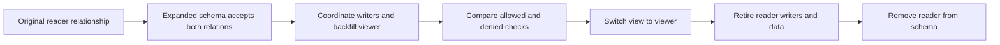

# Roll Out a SpiceDB Schema Migration Without Breaking Existing Access

Author: [nawazdhandala](https://www.github.com/nawazdhandala)

Tags: SpiceDB, Authorization, Database Migration

Description: Rehearse a relation migration with preserved access, negative checks, controlled backfill, and a cleanup boundary that makes rollback risks explicit.

Renaming a relation in an authorization schema is a data migration. Existing relationships still refer to the old name, application writers may still use it, and permission expressions can change access even when the new schema is perfectly valid.

SpiceDB protects schema type safety: it rejects removing a relation that still has relationships. It does not guarantee that a valid permission expression preserves your intended access. Changing `view` from one relation to another can revoke access immediately if the new relation has not been populated. [Schema migration rules](https://authzed.com/docs/spicedb/modeling/migrating-schema)

This walkthrough migrates `document#reader` to `document#viewer`, preserving the public permission name `view`. The commands were exercised with **SpiceDB 1.57.1** and **zed 1.2.1** against a disposable in-memory server over certificate-verified TLS. That checks the small migration fixture, not production database performance or concurrent writers. [SpiceDB release](https://github.com/authzed/spicedb/releases/tag/v1.57.1), [zed release](https://github.com/authzed/zed/releases/tag/v1.2.1)

## Establish the migration boundary

Use an isolated, empty staging permissions system for the example. These schema files describe the entire fixture. In production, schema writes must retain every unrelated definition and permission that remains in use; do not paste this small schema over a real application's model.

Provide the staging endpoint, access token, and trusted CA certificate bundle through your approved environment setup. The helper requires all three and keeps TLS verification enabled. Run the subsequent shell examples in the same Bash session with `zed` and `jq` installed:

```bash
set -euo pipefail
: "${SPICEDB_ENDPOINT:?Set the isolated staging gRPC endpoint}"
: "${SPICEDB_TOKEN:?Supply the staging credential securely}"
: "${SPICEDB_CA_FILE:?Set the trusted CA bundle path}"

zed_stage() {
  zed --endpoint "$SPICEDB_ENDPOINT" --token "$SPICEDB_TOKEN" \
    --certificate-path "$SPICEDB_CA_FILE" "$@"
}
```

The helper only supplies connection options. Schema and relationship operations below are real writes to that isolated system. The pinned CLI supports these schema, relationship, and permission commands. [zed schema command](https://github.com/authzed/zed/blob/v1.2.1/internal/commands/schema.go), [Relationship commands](https://github.com/authzed/zed/blob/v1.2.1/internal/commands/relationship.go)

## Capture both allowed and denied behavior

Save this as `01-original.zed`:

```zed
definition user {}

definition document {
  relation reader: user
  permission view = reader
}
```

A relation stores facts, while a permission computes an answer from those facts. Here Alice has the reader relationship; Bob has none. [SpiceDB schema language](https://authzed.com/docs/spicedb/concepts/schema)

```bash
zed_stage schema write 01-original.zed
token=$(zed_stage relationship touch document:roadmap reader user:alice \
  --json | jq -er '.writtenAt.token')
zed_stage permission check document:roadmap view user:alice \
  --consistency-at-least "$token" --json
zed_stage permission check document:roadmap view user:bob \
  --consistency-at-least "$token" --json
```

Expect `PERMISSIONSHIP_HAS_PERMISSION` for Alice and `PERMISSIONSHIP_NO_PERMISSION` for Bob. The write returns a ZedToken, an opaque revision marker. Passing it to subsequent checks requests a snapshot at least as fresh as that write. Keep tokens opaque rather than parsing or comparing them yourself. [Consistency requirements](https://authzed.com/docs/spicedb/concepts/consistency)

In your application, the baseline should also include revoked users, group membership, tenant boundaries, and any conditional relationships. Positive checks alone can miss a migration that accidentally broadens access.

## Expand the schema before changing writers

Save `02-expanded.zed`:

```zed
definition user {}

definition document {
  relation reader: user
  relation viewer: user
  permission view = reader + viewer
  permission view_next = viewer
}
```

The `+` is a union: either relation grants `view`. The temporary `view_next` permission lets you test the new path independently while existing callers continue checking `view`.

```bash
token=$(zed_stage schema write 02-expanded.zed --json |
  jq -er '.writtenAt.token')
zed_stage permission check document:roadmap view user:alice \
  --consistency-at-least "$token" --json
zed_stage permission check document:roadmap view_next user:alice \
  --consistency-at-least "$token" --json
```

Alice should still pass `view` and fail `view_next`. That difference proves the old data remains effective and the new relation is not magically populated by the schema write.



## Coordinate grants and revocations during backfill

For an online production migration, update every relationship writer before the bulk copy. Both grants and revocations must affect the old and new representations while the union is active. A revocation that deletes only `viewer` still leaves access through `reader`.

Use one `WriteRelationships` request for paired changes where possible; its batch updates are atomic within SpiceDB. That does not make a separate application-database transaction atomic with SpiceDB. Inventory background jobs, imports, administrative tools, and retry queues, not just the main API handler. [Relationship write operations](https://authzed.com/docs/spicedb/ops/data/writing-relationships)

Backfill order matters. If an old snapshot contains Alice's grant, copying it after a newer revocation can recreate access. Use a controlled writer pause or an ordered change/reconciliation process that prevents stale copies from winning. Merely choosing an idempotent write operation does not solve that race.

This lab has no concurrent application writers and only one relationship to copy:

```bash
token=$(zed_stage relationship touch document:roadmap viewer user:alice \
  --json | jq -er '.writtenAt.token')
zed_stage permission check document:roadmap view_next user:alice \
  --consistency-at-least "$token" --json
zed_stage permission check document:roadmap view_next user:bob \
  --consistency-at-least "$token" --json
```

Alice must pass and Bob must fail. `TOUCH` makes retrying this particular write safe from duplicate-creation errors. A real backfill must preserve complete relationship semantics, including subject relations, caveats and expiration where used; copying only object IDs can change authorization.

Before switching, compare old and candidate answers over a representative corpus and reconcile the actual data. Equal relationship counts are insufficient: two sets can have the same size and different members. Authzed's validation tools support explicit expected permission outcomes. [Schema testing tools](https://authzed.com/docs/spicedb/modeling/validation-testing-debugging)

## Switch permission evaluation while retaining the old relation

Save `03-cutover.zed`:

```zed
definition user {}

definition document {
  relation reader: user
  relation viewer: user
  permission view = viewer
  permission view_next = viewer
}
```

```bash
token=$(zed_stage schema write 03-cutover.zed --json |
  jq -er '.writtenAt.token')
zed_stage permission check document:roadmap view user:alice \
  --consistency-at-least "$token" --json
zed_stage permission check document:roadmap view user:bob \
  --consistency-at-least "$token" --json
```

The public permission name is unchanged, so callers keep using `view`. Observe both unexpected denials and unexpected grants before retiring the old data. Keep writer compatibility through the planned rollback interval.

Rollback is conditional on data freshness. Restoring the union after old relationships stop receiving revocations could restore access that should remain revoked. Record the last synchronized point and reconcile subsequent changes before considering such a rollback.

## Clean up only after the old writers have stopped

Save `04-final.zed` with the obsolete relation removed:

```zed
definition user {}

definition document {
  relation viewer: user
  permission view = viewer
  permission view_next = viewer
}
```

At this point, writing that final schema while the lab's old `reader` relationship still exists should be rejected. That is a useful safety check, not a reason to bypass validation. In production, verify that old writers, delayed retries, and import jobs have stopped before deleting obsolete relationships. [Contingent schema changes](https://authzed.com/docs/spicedb/modeling/migrating-schema)

For this one-record disposable fixture, delete only the explicitly identified old relationship, then write the final schema:

```bash
zed_stage relationship delete document:roadmap reader user:alice
token=$(zed_stage schema write 04-final.zed --json |
  jq -er '.writtenAt.token')
zed_stage permission check document:roadmap view user:alice \
  --consistency-at-least "$token" --json
zed_stage permission check document:roadmap view user:bob \
  --consistency-at-least "$token" --json
```

Alice remains allowed and Bob remains denied. The temporary `view_next` permission is retained here; remove it separately once no diagnostic or application caller depends on it. Keep schema versions, backfill checkpoints, verification results, and the cleanup decision together. Once old data is removed, returning to the previous representation requires reconstructing current relationships, not simply restoring an old schema file.
