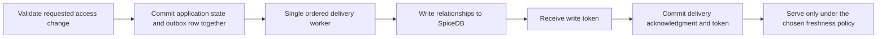

# Keep Application Data and SpiceDB in Sync with an Outbox

Author: [nawazdhandala](https://www.github.com/nawazdhandala)

Tags: SpiceDB, Transactional Outbox, CQRS, Authorization

Description: Compare synchronous writes, transactional outboxes, and CQRS, then rehearse ordered permission updates and recovery without claiming cross-database atomicity.

An application saves “Alice no longer has access” in its database, then crashes before deleting the SpiceDB relationship. The user interface reports a revocation that the authorization system has not received.

Reversing the calls creates a different failure window. A successful SpiceDB update cannot be rolled back by aborting an unrelated SQL transaction. This is the dual-write problem: one business action changes two independently committed systems. [Authzed's dual-write discussion](https://authzed.com/blog/the-dual-write-problem)

The solution starts with deciding which system owns the intended access state and what users may do while the other system catches up.

## Choose the consistency contract first

| Approach | Useful when | Remaining responsibility |
|---|---|---|
| Synchronous application transaction plus SpiceDB call | The request should wait for authorization work | Ambiguous responses, failed SQL commits, and safe compensation |
| Transactional outbox | Application data is authoritative and updates need durable retry | Delivery ordering, duplicate attempts, and pending-state behavior |
| CQRS with an authoritative event stream | Several views must be rebuilt from ordered changes | Event durability, per-resource ordering, and projection lag |
| Relationships owned only by SpiceDB | Application SQL does not need a duplicate permission record | Resource lifecycle and consistency across application operations |

CQRS means command-query responsibility segregation: the path accepting changes is separated from the views serving queries. It does not automatically provide atomic updates across those views. Authzed describes synchronous, streaming, and asynchronous integration options and explicitly calls out the consistency implications of asynchronous updates. [Relationship integration patterns](https://authzed.com/docs/spicedb/concepts/relationships)

A synchronous workflow can be appropriate, but calling it “two-phase commit” does not make SpiceDB a participant in your SQL transaction. Compensation is a new business operation: blindly deleting a relationship after a failed request can remove a grant another request now legitimately needs.

## Put the intent in the same transaction as the application change

An outbox is a database table containing work that must be delivered. Commit the application change and its outbox row together. A separate worker sends the row to SpiceDB and acknowledges it afterward.



The worker can crash after SpiceDB commits but before acknowledgment. The row remains pending and will be attempted again. This is expected at-least-once delivery, not exactly-once execution. Duplicate handling and order preservation are central outbox requirements. [AWS outbox guidance](https://docs.aws.amazon.com/prescriptive-guidance/latest/cloud-design-patterns/transactional-outbox.html)

## Rehearse a single-worker implementation

This deliberately small lab uses **SpiceDB 1.57.1**, Python 3, and SQLite. It has one document, one user, one delivery worker, and no other relationship writers. It demonstrates failure boundaries, not a production queue framework.

Use an empty disposable SpiceDB system with HTTPS enabled. Set `SPICEDB_HTTP_URL` to its HTTPS origin, `SPICEDB_TOKEN` to its credential, and `SPICEDB_CA_FILE` to its trusted CA bundle. In a fresh directory, save these Python blocks in order as `outbox_demo.py`:

```python
import json
import os
import sqlite3
import ssl
import urllib.request
from pathlib import Path

base = os.environ["SPICEDB_HTTP_URL"].rstrip("/")
if not base.startswith("https://"):
    raise ValueError("An isolated HTTPS endpoint is required")
context = ssl.create_default_context(cafile=os.environ["SPICEDB_CA_FILE"])

def api(route, body):
    request = urllib.request.Request(
        base + route, data=json.dumps(body).encode(), method="POST",
        headers={"Authorization": "Bearer " + os.environ["SPICEDB_TOKEN"],
                 "Content-Type": "application/json"},
    )
    with urllib.request.urlopen(request, context=context, timeout=10) as response:
        return json.load(response)

if Path("outbox.db").exists():
    raise RuntimeError("Use a fresh disposable directory")
db = sqlite3.connect("outbox.db", isolation_level="DEFERRED")
db.executescript("""
CREATE TABLE document (
  id INTEGER PRIMARY KEY CHECK(id = 1), version INTEGER NOT NULL,
  desired_grant INTEGER NOT NULL, applied_version INTEGER NOT NULL,
  zedtoken TEXT
);
CREATE TABLE outbox (
  id INTEGER PRIMARY KEY AUTOINCREMENT, version INTEGER UNIQUE NOT NULL,
  grant_access INTEGER NOT NULL CHECK(grant_access IN (0, 1)),
  delivered INTEGER NOT NULL DEFAULT 0
);
INSERT INTO document VALUES (1, 0, 0, 0, NULL);
""")
api("/v1/schema/write", {"schema": """
definition user {}
definition document {
  relation viewer: user
  permission view = viewer
}
"""})
```

This initializes only the lab database and schema. The HTTPS helper verifies certificates and stops on failed HTTP requests. `DEFERRED` selects SQLite's transactional behavior explicitly; the connection context manager commits successful DML transactions and rolls them back on exceptions. [Python transaction handling](https://docs.python.org/3.13/library/sqlite3.html#how-to-use-the-connection-context-manager), [SQLite transactions](https://www.sqlite.org/lang_transaction.html)

Add the application-side change function:

```python
def enqueue(grant):
    with db:
        db.execute("UPDATE document SET version = version + 1, desired_grant = ? "
                   "WHERE id = 1", (int(grant),))
        version = db.execute("SELECT version FROM document WHERE id = 1").fetchone()[0]
        db.execute("INSERT INTO outbox(version, grant_access) VALUES (?, ?)",
                   (version, int(grant)))
```

Both writes share one local transaction. If inserting the event fails, the application change must not survive on its own.

Now add the worker. It processes the oldest unfinished row and stops on any failure:

```python
def deliver_one(crash_after_write=False):
    row = db.execute("SELECT id, version, grant_access FROM outbox "
                     "WHERE delivered = 0 ORDER BY id LIMIT 1").fetchone()
    if row is None:
        return False
    event_id, version, grant = row
    response = api("/v1/relationships/write", {"updates": [{
        "operation": "OPERATION_TOUCH" if grant else "OPERATION_DELETE",
        "relationship": {
            "resource": {"objectType": "document", "objectId": "outbox-demo"},
            "relation": "viewer",
            "subject": {"object": {"objectType": "user", "objectId": "alice"}},
        },
    }]})
    if crash_after_write:
        raise RuntimeError("Simulated crash before acknowledgment")
    with db:
        db.execute("UPDATE outbox SET delivered = 1 WHERE id = ?", (event_id,))
        db.execute("UPDATE document SET applied_version = ?, zedtoken = ? WHERE id = 1",
                   (version, response["writtenAt"]["token"]))
    return True
```

`TOUCH` tolerates replaying an existing grant; deleting the exact relationship tolerates replaying a removal. Neither makes arbitrary reordering safe: replaying an old grant after a newer revocation can restore access. This worker avoids that sequence by retrying the oldest row before proceeding, under its single-worker assumption. [Relationship operation semantics](https://authzed.com/docs/spicedb/ops/data/writing-relationships)

Finish with a grant followed by a revocation:

```python
enqueue(True)
enqueue(False)
while deliver_one():
    pass
version, applied, token = db.execute(
    "SELECT version, applied_version, zedtoken FROM document WHERE id = 1"
).fetchone()
if version != applied:
    raise RuntimeError("Authorization projection is pending")
answer = api("/v1/permissions/check", {
    "consistency": {"atLeastAsFresh": {"token": token}},
    "resource": {"objectType": "document", "objectId": "outbox-demo"},
    "permission": "view",
    "subject": {"object": {"objectType": "user", "objectId": "alice"}},
})
print(version, applied, answer["permissionship"])
```

Run `python3 outbox_demo.py`. Expect `2 2 PERMISSIONSHIP_NO_PERMISSION`. The returned write token gives the final check a freshness floor. HTTP route and JSON fields follow the official API. [API contract](https://github.com/authzed/api/blob/e89c0a673a7e234081ed186bd91dd8a30e3e2b03/authzed/api/v1/permission_service.proto)

## Decide what pending means for access

An old token cannot require inclusion of an event not yet delivered. If `version > applied_version`, the application knows its authorization projection is behind.

For this document-level design, a sensitive operation can refuse to serve while pending, or wait within a bounded deadline for delivery. A user interface should distinguish “revocation requested” from “revocation effective.” Every access path must enforce the policy; a background consumer bypassing the application gate can still observe the old grant.

That gate must also account for concurrent application changes. Reading equal versions once does not reserve the resource forever. Define a transaction or version-check boundary around the application operation, and extend the coordination scope if group membership or inherited access can change independently.

## Test recovery before adding more workers

The local review exercised normal delivery, rollback when outbox insertion fails, a remote-write failure, and a simulated crash after a successful SpiceDB write. Replaying that pending grant and then delivering the queued revocation produced a final denied result over verified TLS.

For production, add durable event identities, per-resource ordering, bounded retries, ownership or fencing for workers, and reconciliation against authoritative intent. Simply starting a second copy of this script is unsafe: both could select the same row and finish attempts in the wrong order.

Monitor the oldest pending event, repeated failures, desired-versus-applied version gaps, and reconciliation discrepancies. If using CQRS, treat the application database and SpiceDB as projections with independently visible progress. A queue that is empty is useful evidence, but it does not prove that all access paths obey the same authority and freshness rules.
