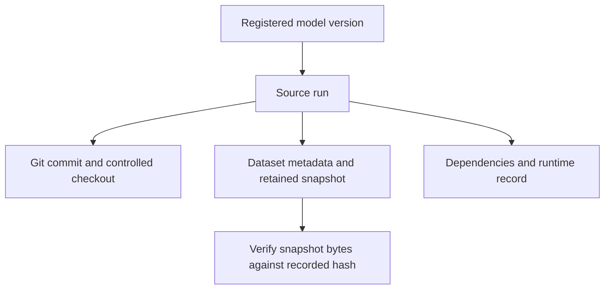

# Trace an MLflow Model Version to Code, Data, and Environment

Author: [nawazdhandala](https://www.github.com/nawazdhandala)

Tags: MLflow, MLOps, Model Versioning, Data Engineering

Description: Build a verifiable lineage chain from an MLflow model version to its source run, Git commit, exact training snapshot, recorded dependencies, and runtime metadata.

A registry entry answers which model version you selected. An incident investigation usually needs more: which code trained it, which data it saw, and which environment produced the artifact.

Lineage is the chain connecting those inputs and outputs. Build the chain while training runs, then verify it from the registered version. A collection of descriptive tags is useful, but it is weaker evidence than tags connected to retrievable, checked artifacts.

This example uses **MLflow 3.18.0**, **scikit-learn 1.9.1**, **pandas 3.1.1**, and **Python 3.11**. It trains a tiny regression model so the provenance steps remain visible.

## Decide what each link must establish

| Link | Evidence to retain | Common gap |
|---|---|---|
| Registered version to training run | Source run ID and registry identity | Manually registered artifacts without a source run |
| Run to code | Full Git commit and controlled checkout state | A commit recorded while local edits changed execution |
| Run to data | Immutable snapshot reference and content verification | A path that now contains different rows |
| Run to environment | Package inventory, Python/runtime details, deployment image identity where applicable | A mutable container tag or incomplete dependency list |
| Model to executable behavior | Packaged preprocessing, signature, and representative checks | Training and serving use different transformations |

MLflow dataset tracking records metadata including a dataset name, digest, source, schema, and profile. Logging dataset metadata does not by itself retain every training byte. A dataset's transformed features can also differ from its original source. [Dataset API](https://mlflow.org/docs/latest/api_reference/python_api/mlflow.data.html)

For this small example, retain the actual CSV alongside its full-file SHA-256 hash. For large or restricted datasets, use an appropriate retained snapshot in controlled storage and record the precise snapshot identifier and verification method instead.

## Prepare a controlled training checkout

Use a dedicated virtual environment with the pinned packages. Configure an existing MLflow experiment whose artifact location is outside the training checkout, and set:

- `MLFLOW_TRACKING_URI` and `MLFLOW_REGISTRY_URI` to the approved endpoints.
- `EXPERIMENT_NAME` to the prepared experiment.
- `REGISTERED_MODEL` to the intended model name.
- `DATASET_PATH` to a CSV with numeric `x` and `y` columns.

Supply normal registry and artifact credentials separately. Run the example from the root of a committed training repository, with the script itself committed. This illustrative data is sufficient:

```csv
x,y
1.0,3.0
2.0,5.0
3.0,7.0
```

The script rejects modified and untracked files using Git's porcelain status format and records `HEAD` as the code revision. These are read-only Git inspections. [Git status](https://git-scm.com/docs/git-status), [Git rev-parse](https://git-scm.com/docs/git-rev-parse)

A clean checkout does not account for ignored files, external services, environment variables, or code downloaded at runtime. Record those inputs separately if they affect training. Run from an isolated checkout that other processes cannot edit during the job.

## Capture the exact bytes used for training

Save this as the committed training script. It reads the CSV once, hashes those bytes, trains from those same bytes, and logs an exact snapshot. This avoids hashing one file revision and later training from another.

```python
import hashlib
import io
import os
import platform
import subprocess
import sys
import tempfile
from pathlib import Path
import mlflow
import mlflow.sklearn
import pandas as pd
from sklearn.linear_model import LinearRegression

status = subprocess.check_output(
    ['git', 'status', '--porcelain=v1', '--untracked-files=all',
     '--ignore-submodules=none'], text=True)
if status:
    raise RuntimeError('Use a clean training checkout')
commit = subprocess.check_output(['git', 'rev-parse', 'HEAD'], text=True).strip()
data_bytes = Path(os.environ['DATASET_PATH']).read_bytes()
data_sha256 = hashlib.sha256(data_bytes).hexdigest()
frame = pd.read_csv(io.BytesIO(data_bytes))
features, target = frame[['x']], frame['y']
requirements = subprocess.check_output(
    [sys.executable, '-m', 'pip', 'freeze'], text=True)
mlflow.set_tracking_uri(os.environ['MLFLOW_TRACKING_URI'])
mlflow.set_registry_uri(os.environ['MLFLOW_REGISTRY_URI'])
mlflow.set_experiment(os.environ['EXPERIMENT_NAME'])

with mlflow.start_run() as run, tempfile.TemporaryDirectory() as scratch:
    snapshot = Path(scratch) / 'training.csv'
    snapshot.write_bytes(data_bytes)
    mlflow.log_artifact(str(snapshot), artifact_path='lineage')
    mlflow.log_input(mlflow.data.from_pandas(frame, name='training_snapshot',
                                           targets='y'), context='training')
    mlflow.set_tags({'lineage.git_commit': commit,
                     'lineage.dataset_sha256': data_sha256})
    mlflow.log_dict({'git_commit': commit, 'dataset_sha256': data_sha256,
                     'python': sys.version, 'platform': platform.platform()},
                    'lineage/provenance.json')
    mlflow.log_text(requirements, 'lineage/requirements.txt')
    model = LinearRegression().fit(features, target)
    mlflow.log_params(model.get_params())
    logged = mlflow.sklearn.log_model(
        model, name='forecast', input_example=features.head(2),
        pip_requirements=requirements.splitlines())
    registered = mlflow.register_model(logged.model_uri,
                                       os.environ['REGISTERED_MODEL'])
    print(f'Run: {run.info.run_id}; model version: {registered.version}')
```

The model is logged and then registered using the returned model URI. The output identifies the run and newly assigned registry version. MLflow's scikit-learn flavor supports an input example and explicit pip requirements for the model artifact. [scikit-learn model logging](https://mlflow.org/docs/latest/api_reference/python_api/mlflow.sklearn.html)

The `lineage.*` tag names are this example's convention, not special MLflow enforcement fields. The snapshot hash is computed over the entire CSV byte sequence using Python's SHA-256 implementation. It complements MLflow's dataset digest rather than assuming the two identifiers have identical meaning. [Python hashlib](https://docs.python.org/3.11/library/hashlib.html)

The small model learns `y = 2x + 1`. A prediction near 9 for `x = 4` checks that the registered artifact loads and executes. It is not a meaningful production accuracy evaluation.

## Walk backward from the registered version

Use a numeric version for an investigation. If the deployment initially used an alias, retrieve the version recorded by that deployment rather than assuming the alias still points to the same artifact.



Set `MODEL_VERSION` to the version being investigated. With the same registry configuration, this read-only inspection retrieves the source run, downloads the retained CSV, and compares its hash:

```python
import hashlib
import json
import os
from pathlib import Path
from mlflow import MlflowClient

client = MlflowClient(
    tracking_uri=os.environ['MLFLOW_TRACKING_URI'],
    registry_uri=os.environ['MLFLOW_REGISTRY_URI'],
)
version = client.get_model_version(os.environ['REGISTERED_MODEL'],
                                   os.environ['MODEL_VERSION'])
if not version.run_id:
    raise RuntimeError('No source run recorded; investigate registration history')
run = client.get_run(version.run_id)
snapshot = client.download_artifacts(run.info.run_id, 'lineage/training.csv')
expected = run.data.tags['lineage.dataset_sha256']
actual = hashlib.sha256(Path(snapshot).read_bytes()).hexdigest()
if actual != expected:
    raise RuntimeError('Training snapshot hash mismatch')
print(json.dumps({'run_id': run.info.run_id,
                  'git_commit': run.data.tags['lineage.git_commit'],
                  'dataset_sha256': actual,
                  'datasets': [item.dataset.name for item in run.inputs.dataset_inputs]},
                 indent=2))
```

A successful result contains the source run ID, full Git commit, matching snapshot hash, and logged dataset names. Downloading artifacts requires access to their storage; registry metadata access alone may not be sufficient.

If the source run is absent, investigate the registration path, source logged model, or external artifact history. Do not manufacture a run association merely to make the report complete. If the hash differs, retain the discrepancy and investigate the artifact and metadata histories before using that snapshot for reproduction.

The hash detects a mismatch against the recorded value. It does not authenticate both the artifact and the metadata if someone can modify both. Protect the evidence through your normal release and storage controls.

## Read the environment record with its limits

Retrieve `lineage/provenance.json` and `lineage/requirements.txt` from the run. The first records Python and platform details; the second captures packages from the interpreter that executed training.

`pip freeze` reports installed packages in requirements format. It is an inventory, not a complete solver-produced lockfile or a promise that the same environment will always be reconstructible. [pip freeze](https://pip.pypa.io/en/stable/cli/pip_freeze/)

For production, retain the actual training and inference image digests, operating-system packages, accelerator libraries, relevant configuration, and available package artifacts where required. Editable installs and local filesystem dependencies need special attention because a requirements line can point outside the retained release.

Rebuilding the environment and rerunning training are separate verification activities. Even complete lineage does not guarantee bit-for-bit model equality across different hardware or nondeterministic training operations. Define whether your requirement is identical artifact bytes, equivalent predictions, or acceptable evaluation results.

## Verify the chain before depending on it

Check that a newly registered version resolves to the intended run, that its snapshot can be retrieved and verified, and that the recorded commit remains accessible. Confirm that the model loads in the intended inference runtime and that preprocessing and signature checks match the release contract.

The local example was executed from a temporary committed Git repository using SQLite and local artifacts. The registered version linked to the expected run and commit; the retrieved CSV matched the original bytes; environment records were retained; and the loaded model predicted approximately 9 for `x = 4`. Modified and untracked checkout states, a hash mismatch, and a missing source run were also checked. No cloud storage permissions or fresh-environment rebuild was tested.

Preserve the run and artifacts for as long as the corresponding model release must remain explainable or recoverable. A lineage report is useful only while its references still lead to evidence someone can inspect.
