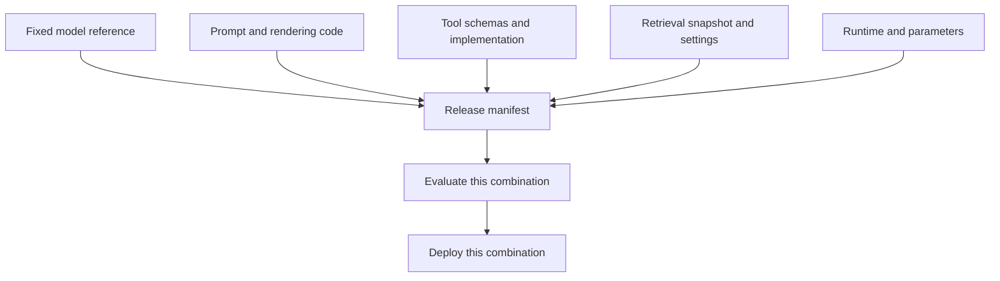

# Version an LLM Application as One Complete Release Snapshot

Author: [nawazdhandala](https://www.github.com/nawazdhandala)

Tags: LLM, Model Versioning, MLOps, Python

Description: Capture model references, prompts, tool code, retrieval data, and generation settings in a verified release snapshot that supports meaningful evaluation and rollback.

Changing a language model is only one way to change an LLM application's behavior. Editing a prompt, rebuilding its search index, or changing a tool's implementation can alter answers while the model identifier stays the same.

Give the complete application configuration a release identity. That identity should describe the combination you evaluated and deployed, including dependencies outside the model registry. It should also make an incomplete rollback visible before traffic reaches it.

This guide builds a small file manifest with **Python 3.11**. The checksum code was tested with **Python 3.11.13**. It does not call an LLM provider or create a live vector database backup.

## Decide what belongs to the release

A release snapshot is a retained description of one approved combination. It is not a promise that every request produces identical text.

| Component | Capture | Common source of drift |
|---|---|---|
| Model | Provider, API family, fixed model identifier, or retained weights and tokenizer | A moving model alias |
| Prompt | Exact templates, message roles, examples, and rendering code | Loading the current production prompt separately |
| Tools | Definitions, schemas, implementation build, and permission policy | Same tool name with changed behavior |
| Retrieval | Index snapshot, source corpus identity, embedding configuration, and filters | Updating the collection in place |
| Parameters | Explicit generation, retrieval, timeout, and retry settings | Defaults changing in an SDK or service |
| Runtime | Application build and locked dependencies | Rebuilding the same source with different packages |

Keep secrets out of this package. Record a credential's logical purpose or configuration reference, while obtaining its value through the deployment's secret mechanism. Credential rotation should not require copying keys into an artifact.



Evaluation results belong to the combination represented by the manifest. A prompt-only change still creates a new application release.

## Separate retained bytes from external references

For a hosted model, a fixed identifier refers to a provider-managed version. You do not possess its weights merely because that identifier appears in a manifest. Check availability and retirement policy when planning recovery. OpenAI's model documentation distinguishes snapshots from aliases; use the appropriate fixed identifier for your provider rather than copying a currently convenient model name. [Model snapshot documentation](https://developers.openai.com/api/docs/models/gpt-4.1)

For a self-hosted model, retain the weights, tokenizer, serving configuration, and required runtime artifacts. A Git commit describing a download URL does not retain the downloaded files.

Prompt registries can help track exact prompt versions. For example, MLflow distinguishes numeric references such as `prompts:/support-answer/7` from movable alias references. Resolve the approved version and capture its actual template in the release. The name and version here are illustrative. [MLflow Prompt Registry](https://mlflow.org/docs/latest/genai/prompt-registry/)

A tool schema alone is also insufficient. Function calling describes a request for an application-provided function; the application executes the tool. Retain both the definition supplied to the model and the implementation it dispatches to. [Function calling guide](https://developers.openai.com/api/docs/guides/function-calling)

If a tool calls a changing inventory service, capture that service contract and its compatibility expectations. Do not pretend the release snapshot freezes live inventory data. Evaluation can use recorded responses, while production continues to use explicitly identified live services.

## Preserve retrieval as a coordinated dependency

Retrieval-augmented generation, or RAG, supplies retrieved documents to a language model. Rebuilding its index can change those documents even when every other setting remains fixed.

Record document IDs and source versions, chunking rules, embedding model and dimensions, index configuration, query filters, ranking configuration, and the number of results requested. Retain access-control rules too: replaying old retrieval behavior must not restore obsolete access rights.

Use the database's supported snapshot or export mechanism. A copied directory from a running database is not automatically consistent. For example, Qdrant collection snapshots are node-local in distributed deployments, and collection aliases are not included in collection snapshots. Recovery must account for all relevant nodes and the mapping used by the application. [Qdrant snapshot documentation](https://qdrant.tech/documentation/snapshots/)

Restore a retained index into a separate test collection and verify representative document lookups before approving it. Check supported database restore versions. Re-embedding the same text later may produce a different index if the embedding model, chunking code, or settings have changed.

## Assemble a frozen release directory

Prepare a staging directory with reviewed files and completed database exports. Stop writers to this directory before hashing it. A practical layout is:

```text
release/
  release.json
  prompt.txt
  tools/schema.json
  tools/implementation.py
  retrieval/index.snapshot
  retrieval/corpus-manifest.json
  runtime.lock
```

`index.snapshot` represents your database's actual supported export, not a format created by the script below. For large artifacts kept elsewhere, retain an immutable object version and verified digest in the directory instead, and extend deployment verification to fetch and check that object.

The following `release.json` uses application-owned keys, not a provider request schema. Replace uppercase placeholders with reviewed values and ensure your adapter applies these settings to supported provider fields.

```json
{
  "release_name": "support-assistant-42",
  "model": {
    "provider": "YOUR_PROVIDER",
    "snapshot_id": "YOUR_APPROVED_FIXED_MODEL_ID"
  },
  "generation": {"max_output_tokens": 512},
  "retrieval": {
    "embedding_revision": "YOUR_FIXED_EMBEDDING_REVISION",
    "top_k": 5,
    "tenant_filter_required": true
  },
  "tools": {"allowlist": ["lookup_order"], "timeout_seconds": 3}
}
```

Store other behavior-changing parameters explicitly rather than relying on defaults. Validate them against the chosen model and API: generation controls are not universally supported across models. OpenAI's Responses API, for instance, documents its own request fields and model-dependent behavior. [Responses API reference](https://developers.openai.com/api/reference/resources/responses/methods/create)

## Build and verify a content manifest

Save this as `snapshot.py` outside the release directory. It hashes every regular file, rejects symbolic links, and refuses to overwrite an existing manifest. Python's `file_digest` reads the file through a binary handle, avoiding loading an entire index into memory. [Python 3.11 hashlib](https://docs.python.org/3.11/library/hashlib.html#hashlib.file_digest)

```python
import hashlib
import json
import sys
from pathlib import Path

root = Path(sys.argv[2]).resolve()
manifest = root / 'manifest.json'

def inventory():
    result = {}
    for path in sorted(root.rglob('*')):
        if path.is_symlink():
            raise RuntimeError(f'Symlink is not allowed: {path}')
        if path == manifest or path.is_dir():
            continue
        if not path.is_file():
            raise RuntimeError(f'Not a regular file: {path}')
        with path.open('rb') as handle:
            result[path.relative_to(root).as_posix()] = (
                hashlib.file_digest(handle, 'sha256').hexdigest()
            )
    if not result:
        raise RuntimeError('Empty release directory')
    return result

if sys.argv[1] == 'build':
    payload = {'format': 1, 'files': inventory()}
    raw = (json.dumps(payload, sort_keys=True, indent=2) + '\n').encode()
    with manifest.open('xb') as handle:
        handle.write(raw)
    print(hashlib.sha256(raw).hexdigest())
elif sys.argv[1] == 'verify':
    if manifest.is_symlink():
        raise RuntimeError('Manifest cannot be a symlink')
    raw = manifest.read_bytes()
    if hashlib.sha256(raw).hexdigest() != sys.argv[3]:
        raise RuntimeError('Manifest differs from approved digest')
    payload = json.loads(raw)
    if payload.get('format') != 1 or payload.get('files') != inventory():
        raise RuntimeError('Release files differ from manifest')
    print('Release files match the approved manifest')
else:
    raise SystemExit('Use: snapshot.py build DIR | verify DIR APPROVED_SHA256')
```

Create and check the manifest:

```bash
python3.11 snapshot.py build release > approved-manifest.sha256
python3.11 snapshot.py verify release "$(cat approved-manifest.sha256)"
```

The build prints a SHA-256 digest identifying the manifest bytes. Verification should print `Release files match the approved manifest`. Keep the approval record outside the release directory. In production, obtain the expected digest from your authenticated release system; a digest supplied alongside untrusted replacement files does not establish who approved them.

The verifier detects added, removed, or modified files. It does not assess whether model identifiers resolve, whether an index can be restored, or whether tools have appropriate permissions. Keep the verified directory immutable while the application consumes it so files cannot change after verification.

## Evaluate, deploy, and recover the same combination

Test realistic questions against the assembled release. Check retrieved document IDs, citations, tool arguments, rejected unauthorized requests, output structure, latency, and cost. Record the evaluation dataset revision and manifest digest with the results. Preserve sampled traces under the appropriate data-retention policy.

Deploy by approved digest, verify dependencies, and run startup smoke checks before accepting requests. Record the loaded release identity with operational telemetry. If replicas report different identities during a rollout, that should be an intentional, observable transition.

Local tests of the manifest script detected changes to each component, missing and added files, symbolic links, a modified manifest, and an incorrect approved digest. Identical files in a copied directory produced the same digest. These were synthetic files, not actual model weights or a restored retrieval service.

For rollback, select a previously evaluated complete release and verify that its external services remain compatible. Restore retrieval into a separate collection when needed, then switch application routing deliberately. A snapshot can restore configuration and retained artifacts; it cannot reverse a tool's already-completed external actions or guarantee identical future model responses.
