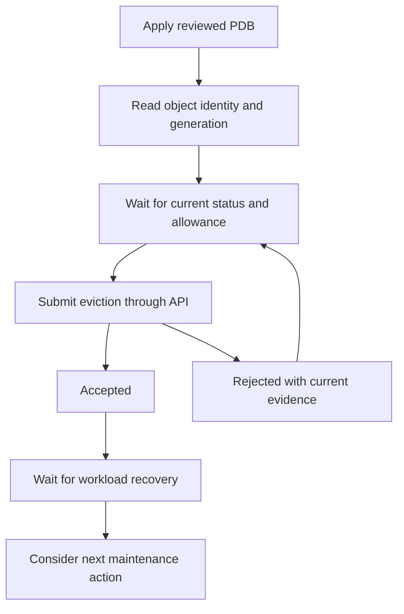

# Wait for PDB Reconciliation Before Automated Evictions

Author: [nawazdhandala](https://www.github.com/nawazdhandala)

Tags: Kubernetes, PodDisruptionBudget, Automation, Troubleshooting

Description: Build a bounded PDB readiness check, reject stale policy observations, and let the eviction API make the final decision without bypassing protection.

An automation job applies a PodDisruptionBudget and immediately starts maintenance. The API accepted the object, but the disruption controller has not yet calculated its status. The first eviction fails, and an impatient retry script treats that failure as a reason to delete the Pod directly.

The safe response is to wait for meaningful evidence and keep using the eviction API. Object creation, controller reconciliation, and permission to evict are separate events. This guide builds that distinction into a small preflight script using **Kubernetes 1.34.0**, **Bash**, and **jq 1.6**.

## Know what reconciliation proves

A PDB's `metadata.generation` identifies its current specification generation. Its `status.observedGeneration` identifies the generation used when updating status. The API documentation says status is valid only when those values match. This mechanism addresses the race described in the original Kubernetes issue. [PDB API fields](https://kubernetes.io/docs/reference/kubernetes-api/policy/pod-disruption-budget-v1/), [Observed-generation design issue](https://github.com/kubernetes/kubernetes/issues/35324)

Matching generations does not mean an eviction is allowed. A perfectly reconciled budget can intentionally have `disruptionsAllowed: 0`. Nor does it mean every recent Pod readiness change has propagated: a Pod becoming unhealthy does not necessarily change the PDB specification's generation.

The pinned eviction implementation returns a budget-related HTTP 429 when its observed generation is behind. It also returns 429 when the budget has no allowance. These are different reasons to wait or investigate. [Kubernetes 1.34 eviction checks](https://github.com/kubernetes/kubernetes/blob/v1.34.0/pkg/registry/core/pod/storage/eviction.go)



The loop needs a deadline. Persistent rejection is useful evidence, not an invitation to bypass protection.

## Establish which budget protects the target

The example uses a PDB named `checkout` in namespace `retail`, protecting running, Ready application Pods labeled `app=checkout`. Replace the names and context before using it. You need permission to read PDBs and Pods; the later dry-run request also requires permission to create `pods/eviction`.

```bash
kubectl --context staging -n retail get pdb -o yaml
kubectl --context staging -n retail get pods -l app=checkout -o wide
```

Check that the intended Pod matches exactly one PDB selector. Inspect all PDBs in the namespace, including selectors with `matchExpressions`. An existing PDB that selects a different workload provides no protection for this target. Multiple matching PDBs are a configuration problem in the pinned eviction implementation, not something a longer sleep repairs.

Compare the stored specification with your reviewed manifest before recording a baseline. Avoid running this procedure while another controller or deployment job is deliberately changing that policy.

## Use a bounded preflight check

Save the following as `wait-pdb.sh`. It reads one object repeatedly without changing the cluster. The timeout defaults to 120 seconds and can be shortened for a rehearsal with `WAIT_SECONDS=10 bash wait-pdb.sh`.

```bash
#!/usr/bin/env bash
set -euo pipefail

ctx=staging
ns=retail
budget=checkout
wait_seconds=${WAIT_SECONDS:-120}
[[ "$wait_seconds" =~ ^[1-9][0-9]*$ ]] || exit 2

read_budget() {
  kubectl --context "$ctx" -n "$ns" --request-timeout=5s \
    get pdb "$budget" -o json
}

baseline=$(read_budget)
uid=$(jq -er '.metadata.uid' <<<"$baseline")
generation=$(jq -er '.metadata.generation' <<<"$baseline")
deadline=$((SECONDS + wait_seconds))

while (( SECONDS < deadline )); do
  current=$(read_budget)
  if ! jq -e --arg uid "$uid" --argjson generation "$generation" '
    .metadata.uid == $uid and .metadata.generation == $generation
  ' <<<"$current" >/dev/null; then
    echo 'PDB was replaced or changed; review the new policy.' >&2
    exit 1
  fi

  if jq -e '
    .status.observedGeneration == .metadata.generation and
    (.status.expectedPods // 0) > 0 and
    (.status.disruptionsAllowed // 0) > 0
  ' <<<"$current" >/dev/null; then
    echo 'Current PDB status permits attempting an eviction.'
    exit 0
  fi

  jq -c '{generation: .metadata.generation, status: .status}' \
    <<<"$current" >&2
  sleep 2
done

echo 'Timed out; leave the workload in place and inspect the last status.' >&2
exit 1
```

The UID identifies the particular object, so deleting and recreating a same-named PDB cannot silently replace the baseline. A specification change also stops the script for review. Each read has a request timeout; API errors stop the script rather than being treated as success. The final read or sleep can extend elapsed time slightly beyond the configured loop deadline.

Missing status, stale status, zero expected Pods, and zero allowance all keep the gate closed. Kubernetes itself forces zero allowance when its calculated expected Pod count is nonpositive. This helps avoid treating an unmatched selector as a successful availability check. [Disruption-controller calculation](https://github.com/kubernetes/kubernetes/blob/v1.34.0/pkg/controller/disruption/disruption.go)

This is a conservative preflight for healthy workloads. Special handling of unhealthy Pods and their eviction policy belongs in a separately reviewed procedure. A successful exit does not reserve an allowance or guarantee that the application can tolerate disruption.

## Preview a specific eviction without deleting its Pod

After the preflight passes, this example targets the current UID of `checkout-0`. Use an actual Pod name from your inspection. Run the block as a unit; it creates only a local JSON request file and sends an explicitly dry-run eviction:

```bash
set -euo pipefail
pod=checkout-0
uid=$(kubectl --context staging -n retail get pod "$pod" \
  -o jsonpath='{.metadata.uid}')

jq -n --arg pod "$pod" --arg uid "$uid" '{
  apiVersion: "policy/v1",
  kind: "Eviction",
  metadata: {name: $pod, namespace: "retail"},
  deleteOptions: {dryRun: ["All"], preconditions: {uid: $uid}}
}' > eviction-preview.json

kubectl --context staging --request-timeout=10s create \
  --raw "/api/v1/namespaces/retail/pods/$pod/eviction" \
  -f eviction-preview.json
```

The raw request uses kubectl's existing authentication and TLS configuration. The UID precondition prevents applying the request to a replacement Pod that happens to reuse the name. `deleteOptions.dryRun` ensures the request does not delete the Pod. [kubectl raw requests](https://kubernetes.io/docs/reference/kubectl/generated/kubectl_create/), [Pinned eviction dry-run handling](https://github.com/kubernetes/kubernetes/blob/v1.34.0/pkg/registry/core/pod/storage/eviction.go)

Success means the API accepted that preview at that moment. It does not consume a durable disruption allowance or authorize a future request. Your maintenance controller must submit the eventual real eviction through the same API and handle a changed answer. Kubernetes' eviction flow performs the budget update as part of processing an actual request. [API-initiated eviction](https://kubernetes.io/docs/concepts/scheduling-eviction/api-eviction/)

## Interpret rejection instead of escalating force

| Evidence | Next action |
|---|---|
| Observed generation behind the specification | Wait within the deadline; investigate controller reconciliation if it persists |
| Current status, zero allowance | Inspect healthy counts, pending replacements, readiness, and intentional protection |
| `expectedPods: 0` | Check selectors, namespace, workload ownership, and controller errors |
| Multiple matching budgets | Correct policy ownership and selector overlap |
| UID conflict or changed PDB generation | Refresh evidence and review the changed target or policy |
| Authentication, authorization, or admission error | Repair the specific access or policy issue |

For a retryable response, honor any server retry guidance and use bounded backoff with jitter in production automation. Save the status message and budget-related causes; HTTP 429 can also represent request throttling. Do not classify every 429 as a readiness failure.

After a real eviction succeeds, wait for the replacement and application recovery before another action. Record the PDB UID and generation, target Pod UID, request result, and recovery evidence. This produces an auditable maintenance sequence while allowing Kubernetes to make each admission decision against the state it currently sees.
