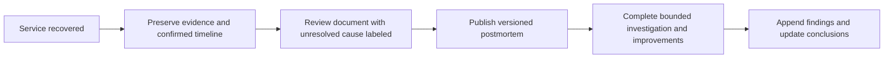

# Write a Useful Postmortem When the Root Cause Is Still Unknown

Author: [nawazdhandala](https://www.github.com/nawazdhandala)

Tags: Postmortem, Incident Response, SRE

Description: Document confirmed impact and recovery, label unresolved causes honestly, and assign useful investigation and reliability work without inventing certainty.

The service is healthy again, the incident channel is quiet, and the postmortem template still contains an empty “root cause” field. Restarting a worker pool helped, but nobody can explain why it became unhealthy.

You can write a useful postmortem now. Publish what the evidence supports, state what remains unresolved, and make the next investigation step explicit. Do not delay the whole record until a satisfying explanation appears.

A postmortem should help people understand the incident and reduce future harm. Google's SRE guidance emphasizes documentation, contributing causes, and effective preventive work within a blameless learning process. Those goals still matter when the causal explanation is incomplete. [Google's postmortem guidance](https://sre.google/sre-book/postmortem-culture/)

## Separate recovery from explanation

Three questions are often collapsed into one:

| Question | Example answer |
|---|---|
| What failed? | Checkout requests returned HTTP503 responses while the worker queue filled |
| What restored service? | Responders restarted the affected worker pool; errors subsequently returned to normal |
| Why did it happen? | The initiating condition and connection behavior remain unconfirmed |

A failure mode describes the observed way the service stopped meeting expectations. A mitigation reduces the immediate impact. A causal explanation describes the conditions and interactions that produced it. Knowing one does not establish the others.

For example, a restart can replace connections, clear queued work, release memory, and change traffic distribution. Recovery afterward does not identify which change mattered. Record the intervention and the observations separately.

Atlassian's incident handbook explicitly includes an “Unknown” cause category and recommends improving diagnostic capability for those cases. You do not need to invent a software defect merely to populate a classification field. [Unknown-cause handling](https://www.atlassian.com/incident-management/handbook/postmortems)

## Write the summary with the uncertainty visible

The following is a fictional example, not a report of a real outage:

> Between 11:04 and 11:26 UTC, the checkout API returned approximately 4,800 HTTP503 responses out of 120,000 requests observed at the gateway. The worker queue grew during the same period. Responders began restarting the affected pool at 11:18 UTC, and gateway error rates returned to their normal range by 11:26 UTC. The initiating cause remains unknown. Available telemetry does not distinguish exhausted connection capacity from requests held by a slow dependency. The team is preserving the incident record and adding the measurements needed to distinguish these possibilities.

This summary provides an impact window, an evidence source, a recovery action, and a clear limit. It does not say that 4,800 customers were affected: retries and multiple requests per customer make that a different measurement.

Keep “unknown” in the summary, not only in a footnote several pages later. Readers who see only the opening paragraph should not leave with stronger certainty than the investigation supports.

## Build an evidence-backed timeline

Start with records that already exist: incident messages, alert evaluations, deployment events, gateway measurements, and responder notes. Give every consequential timeline entry an evidence reference and a time zone. PagerDuty's guidance recommends linking timeline entries to the metrics or other records supporting them. [Postmortem workflow](https://docs.pagerduty.com/ops-guides/postmortem-best-practices/step-by-step)

For the fictional example:

| UTC time | Recorded event | Evidence and limit |
|---|---|---|
| 11:04 | Gateway503 rate rises | Aggregated gateway counters; earliest confirmed impact |
| 11:06 | On-call responder acknowledges alert | Paging event; not the incident start |
| 11:12 | Responder observes a growing worker queue | Saved dashboard view; no connection-state breakdown |
| 11:18 | Pool restart begins | Deployment event and incident message |
| 11:26 | Error rate returns to normal range | Gateway counters; continued observation follows |

Label the earliest confirmed impact as such. If logs start late, do not manufacture an earlier timestamp. If clocks disagree, retain both recorded times and describe the unresolved offset instead of silently rearranging events to fit a theory.

Preserve the actual query, labels, time range, aggregation interval, and dashboard version where available. A screenshot alone may omit the filters that produced it. Save expiring records within your access and retention rules, excluding credentials and unnecessary customer data.

## State what the evidence can and cannot establish

A useful uncertainty section is concrete:

| Observation | Supported conclusion | Unresolved question |
|---|---|---|
| Queue depth increased | Work accumulated faster than it completed | Why completion slowed |
| Restart preceded recovery | The intervention may have contributed to recovery | Which changed state mattered |
| No deployment appears in the deployment log | No deployment is recorded in that source | Whether a configuration, traffic, or dependency change occurred |
| Connection-state metrics were absent | The investigation lacks that distinction | Whether connections were busy, stuck, or unavailable |

An absent record is not proof that an event never happened. A successful mitigation is not a controlled experiment. A plausible explanation should remain labeled as a hypothesis until its supporting and conflicting evidence are evaluated.

Avoid replacing uncertainty with blame. “The responder should have captured more logs” ignores the conditions under which the decision was made. Describe the operational constraint instead: the runbook had no low-risk evidence capture step, and responders prioritized restoring checkout availability.

## Turn unknowns into bounded work

“Investigate root cause” is too broad to manage. Give each unanswered question an owner, an intended evidence source, and a decision it can change.

For the fictional case, a useful investigation task is: “Reproduce blocked dependency responses in staging and determine whether queue growth can occur while all client connections remain occupied. Record connection states before restarting the pool.” The outcome might support the hypothesis, weaken it, or reveal that the reproduction does not resemble the incident.

Keep investigation work separate from improvements justified by known weaknesses:

| Action | Owner role | Completion evidence |
|---|---|---|
| Add connection-state measurements | Checkout team | Staging exercise distinguishes busy, idle, and waiting work |
| Add a safe diagnostic capture step | On-call lead | A responder follows the runbook during a rehearsal |
| Review queue bounds and rejection behavior | Service owner | Load test documents overload behavior and chosen limits |
| Investigate the dependency interaction | Assigned engineer | Written result with conditions, observations, and remaining limits |

Assign dates and tracking links in the real postmortem. These example actions are proposals, not a claim that any particular change has been implemented or will prevent recurrence.

Improving diagnosis alone may not reduce outage impact. Review mitigation and containment opportunities as well, and validate their tradeoffs before adopting them. A tighter queue limit, for example, can reject work earlier while changing the customer-visible failure pattern.

## Publish a reviewed version and preserve the open question

Use separate states for service recovery, document review, and causal investigation:

A reviewed document can remain causally incomplete. Record an owner and next review date for the investigation, and state what new evidence would reopen it. If further investigation is deferred, record the decision, residual risk, and who accepted that decision. Do not disguise “we stopped investigating” as “we proved the cause.”

When a later experiment or recurrence clarifies the mechanism, add a dated revision describing the new evidence and changed conclusion. Preserve the earlier uncertainty so future readers can distinguish what responders knew from what became clear afterward.

Before sharing, ask a reviewer whether every causal sentence has support, whether estimates are labeled, whether recovery is confused with explanation, and whether each follow-up has an observable completion condition. A postmortem with honest limits and useful next steps is ready to teach even while one important question remains open.
